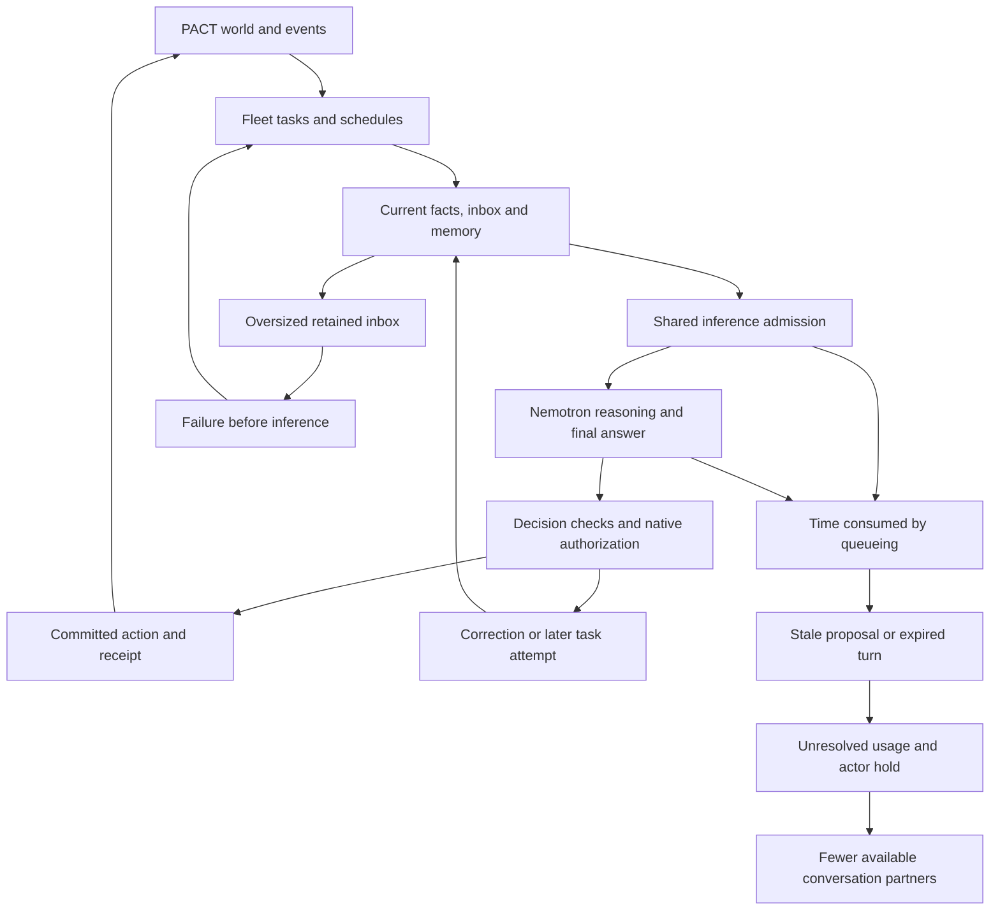

# Fleet and PACT agent society investigation

The six-hour experiment demonstrated working game execution, parallel inference and some cooperation, but it did not provide a fair comparison of eight architectures. Host defects, growing event packets, stale observations, model passivity, reasoning exhaustion and normal resource shortages interacted. The evidence does not establish that Nemotron 4B is incapable of this experiment, or that all eight architectures are fundamentally unsuitable.

The R&D objective is a society of agents that perceive their environment, form plans, communicate, make mistakes and adapt. Reliable execution is necessary for measuring that behavior. Optimal decisions, successful trades and maximum building progression are behavioral outcomes, not prerequisites for admitting every decision.

This investigation covers the retained 26 October 2026 run, 01:31:04–07:31:04 UTC, its deployed source manifest, all 3,071 allocation records, retained request/response events, task/event histories and final authoritative game state. Historical failures are distinguished from failures actually observed in this run. Source checkpoints are Fleet `15f8a7a` and PACT `b37bfa4`; the live manifest differs from current Fleet source only in the already documented post-run `src/model.ts` diagnostic correction. That correction was not deployed into this run.

## How the parts affect each other

PACT owns rules, resources, permission checks, commands, receipts and world events. Fleet turns events or schedules into tasks, chooses an architecture, assembles an authorized observation and memory, obtains model decisions through shared inference admission, checks the decision, and submits authorized actions. Receipts and new events feed subsequent decisions. All architectures share significant parts of this infrastructure; eight profiles are not eight independent implementations of the entire system.

The inbox cycle and stale-proposal mechanism are supported by source and retained events. Queueing, long reasoning and retries appear together in the expired-turn timelines. The precise reason cancellation failed to stop eight responses before their deadlines remains unresolved; it must not be silently attributed to a GPU failure or clock drift.

## What the eight profiles actually did

Each row represents three kingdoms. Calls include unknown allocations; actions are committed effects. The hours column is the sum of time before an unknown-usage hold, capped at the six-hour window. It is exposure time, not continuous model execution or a count of independent opportunities.

| Group | Profile | Turn attempts | Calls | Actions | Exposure hours | Main observed limitation |
|---|---|---:|---:|---:|---:|---|
| A | legacy-loop v1 | 72 | 178 | 5 | 18.00 | Repeated read-schema lookup |
| B | legacy-cognition v1 | 72 | 161 | 0 | 18.00 | Persistent resource-reserve/risk deferrals |
| C | reactive-basic v1 | 288 | 510 | 37 | 17.93 | State-echo mistakes, correction cost and one late hold |
| D | reactive-cognition v1 | 239 | 362 | 30 | 13.65 | Similar shared decision issues; one early hold |
| E | reactive-cognition v2 | 77 | 115 | 19 | 5.50 | Reasoning truncation; all three held early |
| F | reactive-cognition v1.1 | 118 | 162 | 21 | 12.77 | One early hold and reasoning truncation |
| G | specialist-coordinator v1 | 184 | 384 | 1 | 18.00 | Proposals become stale during deliberation |
| H | autonomous-specialists v1 | 1,380 | 1,199 | 94 | 18.00 | Empty-skill rejection and accumulating inboxes |

H's 1,380 attempts are not 1,380 independent decisions. Three persistent tasks were attempted 162, 160 and 128 times. Together they account for all 435 context-incomplete failures, each occurring before a model call. A/B had 15-minute scheduled opportunities while event-driven profiles received additional work. E had only 5.50 of its nominal 18 kingdom-hours before holds. Comparing action totals without these differences would confound architecture, availability and workload.

C is a useful simpler baseline because it demonstrated construction and interaction without specialist coordination. That is a practical comparison baseline, not a proven winner. Memory variants E/F cannot be ranked below C from this run when their available operating time differed so much. G's current implementation and H's current inbox handling prevent a clean test of their intended architecture.

## Confirmed host failures and architectural constraints

**Empty skill operations are rejected as attempted selection.** All 317 terminal `SKILL_SELECTION_REQUIRES_READ` turns contained a response with no actual skill operation: 314 had `skills: {}` and three had an empty publish list. The response schema accepts these shapes. The final-decision guard rejects a present skills object when the skill service is unavailable and the listed-skill mode is inactive. Learning was disabled and skill mode was off. These were not 317 examples of the model trying to learn an unauthorized skill. See [autonomous engine](../src/engines/autonomous-specialists/engine.ts), particularly `SkillChanges` and the final `if (skills)` guard.

**The event inbox is outside the successful evidence-compaction boundary.** The three failing tasks ended with 344, 344 and 242 pending deliveries. [Participant context](../src/app/participant-context.ts) reads the first 100 pending deliveries into a task's inbox. A failing packet's inbox reached 78,209 bytes by itself; total attempted packets ranged from 113,561 to 181,068 bytes against a 64,000-byte input ceiling. Removing optional memories or shrinking the world observation cannot fit an inbox larger than the entire ceiling.

The skill error happens before acceptance of the specialist envelope, which includes delivery acknowledgements. Failed work leaves deliveries pending; subsequent events change the task revision and make it runnable again. [Task recovery](../src/platform/tasks.ts) and [specialist routing](../src/engines/autonomous-specialists/routing.ts) explain how fresh events revive a concern whose oldest pending packet still cannot fit. This is a coupled acknowledgement, batching and wake-up problem. Increasing the ceiling would delay accumulation, not establish bounded behavior.

**Coordinator deliberation conflicts with snapshot lifetime.** There were 271 rejected focused proposals marked stale and 172 turns ending `STALE_PROPOSAL`. PACT effect revisions include the world clock and broad resource/authority dependencies, and quotes expire after 30 seconds. G's average turn lasted 134 seconds; provider queue delays averaged about 34 seconds before generation. Focused reasoning and coordinator selection happen between observations. A world tick can invalidate the proposal even without a competing player command.

The check correctly refuses stale execution, but the workflow repeatedly asks the model to reason over facts whose validation lifetime can expire during normal deliberation. The three-call budget also limits complete reconsideration after worker/selection calls. This mechanism explains the fragility; individual stale cases can additionally involve real stock or authority changes. See [coordinator](../src/engines/specialists/coordinator.ts), [proposal checks](../src/engines/specialists/proposals.ts), PACT [effect facts](../../pact/packages/kingdom/src/action-effect-facts.ts) and [effect validity](../../pact/packages/application/src/action-effects.ts).

**G has a narrower behavioral interface than free negotiation.** Its PACT adapter advertises at most eight quoted candidates. Its generated message choice reports observed game time using a fixed host-written sentence. Arbitrary negotiation prose is outside that menu. This is explicitly stated in [PACT coordination](../src/games/pact/coordination.ts). Its social performance therefore cannot measure the model's ability to freely negotiate using the same affordances as the other profiles.

## Context size and context usefulness

The provider was configured for 32,768 tokens, with up to 8,192 output tokens. The largest reported input was 22,554 tokens; that input plus the full output allowance is 30,746 tokens. The observed context-incomplete failures were local packet-construction failures before inference, not evidence that the provider's context window overflowed.

| Group | Mean input tokens | Maximum input tokens | Maximum admitted request bytes |
|---|---:|---:|---:|
| A | 5,807 | 6,585 | 29,445 |
| B | 6,968 | 7,157 | 29,575 |
| C | 14,407 | 17,525 | 63,775 |
| D | 14,900 | 16,982 | 63,947 |
| E | 15,333 | 19,376 | 60,761 |
| F | 12,917 | 16,014 | 56,504 |
| G | 8,522 | 11,440 | 29,878 |
| H | 7,437 | 22,554 | 63,991 |

Token means/maxima use reported ledger usage and exclude unresolved allocations. Request bytes include the serialized messages and generation schema; they are not token counts. A/B also retain a conservative gate in [legacy execution](../src/engine.ts) that adds input bytes to output-token allowance against the per-call token budget. Thus doubling the advertised byte limit does not create the same effective input allowance in every architecture.

Several profiles carry substantial protocol overhead. Generation schemas reached roughly 12–15 KB in A/B/D/H; G's continuity field reached about 17 KB despite a roughly 30 KB total request. H's separately budgeted evidence field stayed around 1.45 KB while its inbox could exceed 78 KB. The problem is the distribution and selection of context, not one universal missing context-size setting.

The packers preserve core authority/current facts and mark omitted social material as unknown. That is valuable, but structurally preserving data does not prove that a model understands its presentation. Compact fact tables, multiple versions of read contracts, current state, memory, proposed state and expected outcome all impose interpretation work. I found no basis to certify all packed views semantically sufficient. Controlled presentation comparisons are still needed, especially for queued versus completed construction and scoped social evidence.

## Model behavior and correction costs

**A repeatedly asks for a schema it already received.** Its 148 read decisions were all schema lookups: 132 for `pact_command_outcome_v2` and 16 for `pact_observation_read_v2`. In 141 cases the requested schema matched the schema already delivered in that request's `requestedRead`. This is a read-progress failure, not a missing initial catalog or insufficient context capacity. A's legacy path does not inherit H's `read-final.v3` progress handling merely because both profiles run in the same Fleet deployment.

**B is passive even when construction options are present.** It returned 148 waits, nine schema reads and four truncated outputs, with zero action decisions. All 148 waits were paired with an input containing ready construction choices. It supplied 137 `resource_reserve` and 11 `risk_review` deferrals. Those observations establish passivity under this prompt/memory setup. They do not establish that every available action was strategically mandatory, or that memory itself caused the passivity.

**A factual-state rejection is often a copying failure, not a fully wrong world model.** Modern wait validation requires the model to reproduce complete building-level and queue-phase maps. Retained rejection details show missing keys, malformed keys such as a building name where `building:level` was required, and some genuinely wrong values such as reporting Hall 2 while the actual Hall remained 1. These categories should be separated. Requiring an exact redundant state echo adds a protocol task on top of choosing a strategy. [Wait validation](../src/games/pact/goal-state.ts) already allows deliberate deferral; it does not generally require the numerically optimal move.

**Thinking was enabled and sometimes exhausted the output budget.** All 3,070 retained response events recorded nonzero reasoning-character counts. Of 107 responses classified as truncated, 103 had zero final-answer characters. All 107 included reasoning; their recorded maximum final-output whitespace run was zero. This evidence points to reasoning consuming the output allowance, not the old whitespace/stream-size failure. Only seven turns ended with truncation because other calls recovered or ended with different codes. Raw reasoning text was not retained, so the quality of the internal reasoning cannot be reconstructed from character counts.

The installed model's [pinned NVIDIA model card](https://huggingface.co/nvidia/NVIDIA-Nemotron-3-Nano-4B-BF16/blob/dfaf35de3e30f1867dd8dbc38a7fc9fb52d3914f/README.md) reports imperfect tool/agent benchmarks even with reasoning, and recommends different sampling temperatures for reasoning and tool calling. This run used temperature zero. That makes sampling a reasonable later experimental variable; it is not proof that changing temperature will improve PACT behavior. Larger context or a larger model would not repair an empty-object guard, acknowledge an undeliverable inbox or extend a stale action quote.

## Shared inference and deadline failures

Actual provider telemetry reached four simultaneous requests. The old claim that local inference was serialized by Ollama does not describe this vLLM run. However, four is a maximum, not a guarantee for every prompt combination: the shared 65,536-token admission budget and 92 usable cache blocks must also fit. Three requests reserving roughly 23,000 tokens each already exceed the token budget. Mean queue delays ranged from about 17 to 34 seconds by architecture, with observed maxima around 138 seconds. The observer saw at most one provider-side waiting request and a cumulative preemption counter reaching two; much of the waiting occurred in Fleet admission.

Six unknown-usage holds happened during the run and three at its closing deadline. All first six expired turns had used three calls. Repeated long reasoning and correction consumed a six-minute turn allowance. For example, F2's final allocation began with about 100 seconds remaining, ran about 129 seconds and returned after the turn had been marked expired. D1 began its last allocation with under eight seconds remaining and returned about 28 seconds later.

Eight of the nine unknown allocations have late response metrics and separate usage observations, totaling 106,175 input and 43,936 output tokens. Their reservations correctly remain unresolved in the ledger; the late evidence is not an authorization to settle or replay anything. One allocation has no retained final response. The label `WORKER_EXPIRED` is emitted by [deadline recovery](../src/store.ts) when a running turn passes its deadline; it does not by itself prove a dead worker process.

The precise cancellation failure remains open. Source passes abort signals and deadlines through admission and transport. A synthetic local streaming endpoint exercised the current transport and aborted in 154 ms for a 150 ms signal. This verifies the simple cancellation path, not the historical full-worker path under load. Across 43,123 guardian clock samples, wall and monotonic elapsed time differed by about 2.7 ms over six hours; the largest adjacent disagreement was about 4.3 ms. The retained host-clock evidence does not support a recurrence of the previously investigated large clock drift as the explanation for these late responses.

## Game economics and social outcomes

All Halls remaining at level 1 is not a single failure category. Hall 2 requires Farm 2, Barracks 2 and Storehouse 1, plus 180 iron and 90 silver. Eleven kingdoms met those building prerequisites at the end, but resources still mattered. C1 completed all six non-Hall upgrades to level 2 and ended with only about 22.3 iron and 13 silver, with no construction allowance remaining. Its Hall was genuinely waiting on stock. B1–B3 retained their initial construction allowance and completed no upgrades despite having ready choices. These are different behaviors.

The defaulted E2–D3 contract illustrates a legitimate R&D outcome. E2 promised 30 iron per hour while its level-1 mine produced 20; D3 promised 15 silver per hour. The contract later closed for insufficient stock. That is a sustainability/planning issue worth observing, not automatically an invalid command that the host should forbid. E2 also went on hold during the run, removing its ability to adapt later. Exact responsibility for each transfer failure would require a settlement-history reconstruction; final balances alone cannot attribute all shortages.

Social activity was concentrated:

| Direction | Messages |
|---|---:|
| H1 → C2 | 51 |
| C2 → H1 | 1 |
| H2 → C2 | 2 |
| D2 → A1 | 1 |

The three accepted contact pairs involved only five kingdoms; 19 kingdoms had no accepted contact edge. There were eight pending introductions. Four active supply contracts show that cooperation did occur, including through offers without a broad message network. A database read marker is not proof that a message was or was not included in an observation, so it must not be used as a model-awareness metric by itself. Fifty-five messages are not evidence of 55 conversations or broad reciprocal coordination.

## Reporting and experimental validity

203 committed actions occurred in turns whose terminal code was `WAIT`, and four in turns whose code was `READ`. The terminal code describes how execution ended, not every effect within that turn. Likewise, 690 wait-rejection events are validation events, not 690 independent failed turns; 83 turns ended with the two wait-related rejection codes. Counting these as interchangeable units distorts both activity and recovery rates.

The primary supervisor reached deadline draining and then raised `SUPERVISOR_FAILED_CLOSED`. Its catch block discards the original exception. The independent guardian completed shutdown and encrypted restore verification. The missing primary final report is an observability/finalization defect; the retained evidence does not establish its originating exception. A race between finalizers is a hypothesis, not a proven cause. See [controller shutdown](../scripts/control-real-pact.ts).

Earlier passing offline tests certified their fixtures and boundaries, not prolonged behavior under accumulating events, world ticks, shared capacity and real model corrections. The current results expose gaps in duration, composition and behavioral coverage. They do not justify marking prior passing tests false, or treating those tests as proof of live acceptance.

Three actors per profile, different role prompts, one shared world, temperature zero, event-driven workload differences and early holds prevent a causal ranking. H also used different role presets for H1 versus H2/H3, with skill learning disabled. These are not replicated independent societies or evidence that learned skills improved behavior.

The complete terminal-code inventory below accounts for all 2,430 attempts. These are outcomes, not 20 independent root causes.

| Terminal code | Turns | Interpretation |
|---|---:|---|
| `WAIT` | 1,293 | Includes 203 committed actions; remaining turns require behavioral interpretation |
| `SPECIALIST_CONTEXT_INCOMPLETE` | 435 | Three repeatedly revived tasks; no inference on these attempts |
| `SKILL_SELECTION_REQUIRES_READ` | 317 | Empty-operation host guard described above |
| `STALE_PROPOSAL` | 172 | Observation/quote lifetime versus deliberation |
| `READ` | 53 | Includes four committed actions and repeated schema reads |
| `PACT_WAIT_STATE_MISMATCH` | 46 | Complete state-map validation fails |
| `MODEL_WAIT_REJECTED` | 37 | Wait correction cannot finish within the decision budget |
| `RESOURCE_CLAIM_CONFLICT` | 21 | Claim admission rejects demand exceeding available capacity |
| `MODEL_PROPOSAL_REJECTED` | 10 | Proposal correction cannot finish within the decision budget |
| `WORKER_EXPIRED` | 9 | Six in-run and three closing-deadline holds |
| `MODEL_FEEDBACK_EXHAUSTED` | 9 | Bounded feedback ends without an accepted result |
| `MODEL_OUTPUT_TRUNCATED` | 7 | Terminal turns; distinct from 107 truncated responses |
| `DEADLINE_MISSED` | 5 | Deadline guard; four attempts made no model call |
| `TURN_CALL_LIMIT` | 5 | Three-call allowance exhausted |
| `PACT_DUPLICATE_NEGOTIATION` | 5 | Attempt to duplicate an observed negotiation |
| `OBSERVED_BUILDING_LEVEL_MISMATCH` | 2 | Proposed level conflicts with observed level |
| `PACT_SUPPLY_ZERO_FLOWS` | 1 | Supply terms contain no resource flow |
| `PACT_TRADE_PERSPECTIVE_MISMATCH` | 1 | Submitted terms/description disagree about trading roles |
| `CLAIM_FENCED` | 1 | Execution claim no longer valid; no model call |
| `INVALID_READ_QUERY` | 1 | Unsupported read-query shape |

Intermediate proposal checks additionally recorded 47 duplicate-negotiation, 26 self-target, 13 building-level, six trade-perspective, three excessive-bond and one zero-flow rejection events. Some were corrected before the turn ended. These are distinct from the terminal counts. The [resource claim checker](../src/modules/action-admission/v1/claims.ts) protects shared capacity; the 21 rejections alone do not establish whether individual conflicts were unavoidable, stale or caused by poor specialist coordination. That requires inspecting each reservation/proposal pair. Likewise, no stream-format failure appears as a terminal code in this run, but the allocation with no final response cannot be diagnosed from that absence.

## Directions that fit the R&D goal

1. **Make the experiment observable before optimizing intelligence.** Report task/decision/attempt/command/receipt separately. Measure successful actions and conversations per available actor-hour, cost and delay. Preserve original exceptions, event coverage, evidence age, final-answer completion and the reason an actor is unavailable.
2. **Repair mechanical blockers without prescribing strategy.** Empty optional operations must remain no-ops. Inbox delivery must be bounded by bytes and make acknowledgement progress. Stale-quote handling must allow reasoning followed by fresh native validation without replaying uncertain commands or weakening atomic authorization. Calls need an enforceable time envelope that includes queueing and final settlement. Diagnose the unresolved cancellation path before declaring that part fixed.
3. **Reduce protocol work assigned to the model.** Let the host retain exact observed maps, identifiers, units and receipt associations. Ask the model to select a permitted action, reference evidence and state a concise intention. Continue validating authority and current effects. Avoid making the model transcribe an entire state map merely to explain a strategic wait. Preserve explicit coverage and scoped retrieval rather than silently dropping relevant evidence.
4. **Separate environment truth from behavioral success.** A valid bad trade, a cautious wait, a failed plan or a disagreement can be research data. Unauthorized actions, malformed references, fabricated receipts and broken delivery are host reliability problems. Evaluate whether the agent later notices consequences and changes its plan; do not force every agent into the same optimal policy.
5. **Compare one variable at a time using the same Nemotron 4B.** Begin with a small common set of observation → decision → native result → follow-up workflows. Compare complete current packets with focused packets containing the same essential facts; then compare memory, reflection cadence and reasoning settings independently. Use multiple runs and matched budgets/availability before choosing an architecture. A larger model is a later diagnostic comparison only if the model restriction changes.
6. **Measure society rather than activity.** Track unique and reciprocal relationships, requests receiving relevant replies, proposals revised after replies, promises fulfilled/defaulted, coordinated division of work, adaptation after a shortage, plan persistence and diversity of behavior. Expose a concise decision rationale and intended next condition; raw hidden reasoning is neither required nor available in these logs. Give comparable conversational affordances to profiles being compared for negotiation.

Memory, reflection and planning are plausible ingredients rather than reasons to add more agents or tools immediately. [Generative Agents](https://arxiv.org/abs/2304.03442) studied a 25-agent social environment and used ablations to evaluate those components. That supports controlled behavioral comparison as a method; it does not prove this model or PACT's current implementation will reproduce those results.

## Evidence and preserved state

Detailed aggregates and analysis scripts remain private under the investigation pointer `/tmp/fleet-society-investigation-root`; retained run evidence is located by `/tmp/pact-six-hour-root`. Repository documentation contains aggregate results and source pointers only, not prompts, correspondence, credentials, grants or decrypted traces. Prior aggregate evidence and publication checks are in the [six-hour inspection](six-hour-run-inspection-20261026.md) and [handoff](six-hour-investigation-handoff-20261026.md).

This was read-only database analysis, source inspection and one synthetic transport cancellation check. No live model call, game command, deployment, reset, replay or uncertainty settlement occurred. The world remains paused at tick 359; all 24 finite cohorts are finished and nine agents retain owner holds. Runtime services and the model provider were not restarted. E4/KQ1 remain blocked. No implementation fix or new behavioral qualification is claimed by this report.
