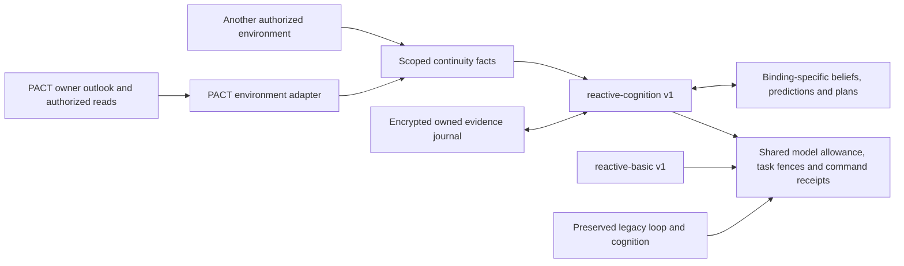

# Phase3 — grounded continuity beside existing engines

F5 source/offline implementation, paired with PACT P2 (`bae89b8`, timestamp correction `d4f0ea7`). Codex owns this assignment without delegation. Existing runtime/cohorts are not enrolled or installed; server Fleet is untouched.

## What changes

`reactive-cognition@1` is a full memory/planning/reflection/belief bundle, not an isolated belief ablation. It adds current self capabilities, needs/dependencies and owner values from an authorized environment to focused reactive tasks. Stored hypotheses remain subjective, retain an alternative and cite delivered original evidence. No trust/survival scalar or communication preference is generated. Waiting, declining, omitting an update and retaining a belief are valid decisions. No model weights are trained.

The separate encrypted `reactive-cognition@1` namespace is keyed by binding. It does not copy legacy cognition or change Laya/model settings. Existing `Cognition.capture` provides encrypted originals, source deduplication and a maximum200 retained episodes; retained-source queries enforce account ownership and30-day expiry. Missing/expired/evicted originals withhold associated interpretations rather than invent support. Each evidence link retains its environment-scoped source, observation time and task ID. Only12 originals enter normal continuity context; fitting can reduce this further and reports omissions. Current observations precede older anchors; omitted refs cannot support an update.

Version/fence checks and per-turn idempotence protect updates. Duplicate identities, invalid/cyclic plan dependencies, foreign/undelivered/expired citations and unsupported subjects are rejected. Confidence is low or medium; medium requires multiple original non-statement observations about that subject. It is a bounded interpretation, not a measured probability or proof of motive. Model-authored memory/reflection text remains interpretation; it cannot become authoritative evidence. Invalid accompanying cognition blocks a command, while known model usage remains reported.

Predictions are immutable, saved before command dispatch and test the next later observed fact of their named subject/predicate before the stated horizon. Both capture and environment/occurrence times must follow the saved prediction. Peer statements never prove material fulfilment. Historical agreement/battle records without reliable occurrence time cannot test a later prediction. Missing evidence stays unresolved, including when a horizon passes without coverage; this is not evidence that an event did not happen. Fulfilled help and a lost battle are distinct facts, neither proving betrayal. Command confirmation records admission only. New snapshots do not refresh old peer statements into new evidence.

Structured plans reuse `ContinuationUpdate` step/wait schemas, dependency validation and `reconcileContinuation`. Owner-intent changes mark stored plans for review. The legacy cognitive-analysis envelope remains unchanged to preserve its UUID/source-attribution contract and exact legacy inputs; the new generic envelope handles opaque actors through the new profile.

## Operator composition and rollback

All selection is explicit through trusted operator composition on a new unconsumed inactive cohort: `tasks.enroll(id,{id:"reactive-cognition",version:"1"})`, then the existing optional `intake.enroll(id,policy)`. These calls do not create game accounts, start cohorts or invoke models. Consumed profiles/policies remain immutable. Profile selection UI/comparisons are F7, and release/new-run qualification is F8.

The adapter must advertise `continuity:true` plus native/poll event delivery and return `fleet.continuity-observation.v1` facts. Non-social environments work without a peer graph. Every fact source must be present in the authorized observation and is scoped by environment/version/instance/actor/entity. No PACT economy or unit types enter the engine/platform packages.

PACT requires the separately enabled P2 read (`PACT_AGENT_OUTLOOK_ENABLED=1`) and exact Fleet expected version `FLEET_PACT_OUTLOOK_VERSION=pact.agent-outlook.v1`; event delivery retains the separately reviewed `FLEET_PACT_EVENT_FEED_VERSION=pact.agent-events.v1`. All remain default off. The adapter validates the advertised read tool, versioned response and bound owner before model dispatch. Ordinary basic/legacy reads do not gain extra outlook calls. Requested conversation reads are separate snapshots; their incoming text is an untrusted statement. Bounded prefixes are marked partial, and clipped statement-fact counts are disclosed. Only PACT computes its exact stock forecasts, signed exposure and authority checks.

Migration016 creates empty continuity state/update tables with binding/cohort cascades; no cohort backfill. Run standard migrations before running a new source release. Only the isolated test database was migrated during this assignment. Existing30-day pruning covers the new state/update records. Inspector output and model/update telemetry honor observation consent; revocation withholds inspection and clears debug details, while encrypted operational memory follows the existing cognition policy. `runtime().continuity.inspect(binding)` provides trusted consent-controlled inspection; a new product UI is outside F5.

Rollback means select the prior source release and retain encrypted tables/history. New profiles must be drained using existing task/receipt rules before changing release; never replay uncertain commands. Disabling the outlook flag does not make a consumed profile compatible with a missing capability and does not authorize rebinding it. Existing installations have not changed, so no operational rollback was needed here.

## Verification and practical limits

Full regression acceptance:168 unit tests/38files and296 integration tests/36files passed (464 total). Type/style, production build, recursive game boundaries and dependency audit passed with0 vulnerabilities. Non-blocking style/AJV warnings remain. Final author review keeps authenticated tool capabilities separate from account-level authority quotes; the adapter retains those quotes as conditional feasibility facts. The final bounded-statement correction was followed by a fresh type/style check, build and19 affected adapter/continuity/parity tests (all passed). Full command logs and actual results are retained in the local phase3 evidence archive. Commands: `npm run check`, `npm run build`, `npm run check:boundaries`, `npm test`, `npm run test:integration`, `npm audit`, `git diff --check`. Node24.12.0; isolated loopback5437/fleet_test with fake games/models. Integration files run serially because their fixture intentionally truncates this test database. PACT used its separate5438/pact_test schema fixture. No installed database was used as a test target.

The new tests cover prediction ordering/contradiction, fulfilled help during a loss, source expiry/delivery/binding isolation, stale versions, restart/encryption/consent, owner-plan changes, cyclic plans, growing history/omissions, optional no-update decisions, invalid cognition without command success, admission versus fulfilment, opaque/non-social actors and explicit immutable wake enrollment. An actual P2 synthetic snapshot is retained in `tests/fixtures/environments/pact-outlook.json`; the adapter also exercises an authenticated fake PACT session. `reactive-basic` request messages/schema match the saved original F4 fixture exactly. The pinned legacy controller remains byte-identical; all existing cognition/continuation/envelope/recovery suites remain part of full regression checks.

Read-only operational preservation at16:50UTC: same installed7093cb8 release and exact fingerprints of22 application tables;20 existing agents still needs_owner,40 historical unknown allocations/1,600,000 retained tokens, zero running turns and10,121 retained turns. Nothing was resumed or reviewed. Server Fleet was not contacted or changed.

This proves source behavior and deterministic plumbing, not improved live strategy, conscious experience, accurate motive inference, production latency or real-provider compatibility. Memory may lose sources under the200-episode cap; omissions stay explicit. Very large owner intent/schema/context combinations can fail input admission rather than silently truncate owner values. New real runs, installation and larger model allowances remain separately scoped. Next architecture package is F6 focused proposals/coordinator; it is unstarted.

| Verification | Result |
| --- | --- |
| `npm test` |168 passed /38files |
| `npm run test:integration` |296 passed /36files |
| `npm run check` / `build` / `check:boundaries` | passed |
| `npm audit` |0 vulnerabilities |
| Final affected adapter/continuity/outlook/basic-parity suites |19 passed /4files |
| Compiled runtime and paired P2 contract | four profiles resolved; expected default-off capabilities; actual synthetic P2 snapshot validates |
| Original `src/engine.ts` versus c212373 | byte-identical |
| Local installed application fingerprints |22/22 unchanged |

Author review was performed under the repository's no-delegation instruction; independent review and hosted CI are not claimed. Review corrections covered authoritative occurrence times, authenticated tool capabilities versus account-level allowance quotes, immutable predictions, cyclic plans, duplicate update identities and explicitly partial peer text. There is no current source blocker. Release/provider/run qualification remains future F8 work.
