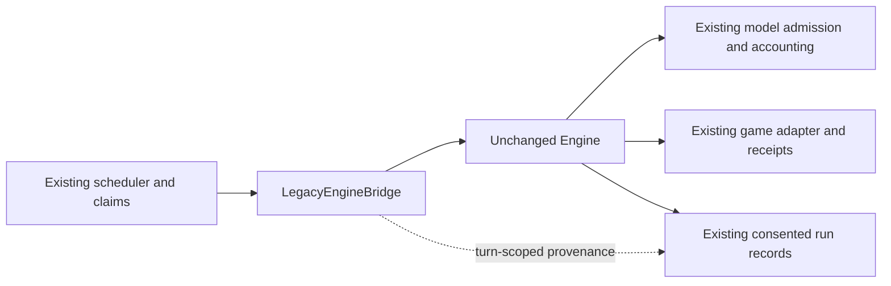

# F1 — Existing-engine baseline and bridge — 17 October 2026

Phase 0 adds an identification boundary around Fleet's existing controller. The runtime defaults to the compatibility bridge; the reasoning implementation in `src/engine.ts` remains byte-identical. The two existing configurations are identified as `legacy-loop@1` and `legacy-cognition@1`. Recall assistance remains an explicit setting rather than a third engine.

## Contract

The pinned baseline is source revision `c212373ccca98d3e064d24ebd2a9398dd94e2a77`. `src/engines/legacy/baseline.json` inventories 69 source, vendor, migration and package files with SHA-256 hashes. Its digest is `5ef9a0145cfa8cdd9dc9f5a43a662474e30e36425f38ffaf62f4e9838bfcaa06`: SHA-256 of the compact JSON file inventory, ordered by path, with each entry's keys ordered as `path`, `sha256`. This identifies a source snapshot; it does not identify an installed binary or certify model behavior.

The bridge inherits claim admission, tick, stop, model decisions, budget reservations, command submission and receipt reconciliation. It delegates `run` directly and carries metadata in an async scope. The existing first observation event persists it within the existing consent/encryption transaction. No extra pre-admission event, table, migration, prompt field, configuration mutation or provider call is introduced.

New consented run JSON includes the profile, baseline reference, continuity/recall settings and a configuration fingerprint. The fingerprint uses deterministic ordinal string-key ordering and hashes the effective model/budget, schedule/anchor, strategy, owner-guidance/policy and integration identifier. Raw policy or credentials are not included in this manifest; credentials, stored notes and private run bodies are excluded from the hash input. This is a configuration fingerprint, not an encrypted policy archive or a full environment/observation fingerprint.

A valid retained manifest is labeled `recorded`. Historical, withheld, expired or malformed metadata yields `inferred_legacy`, with null exact profile/version/configuration and an explicit coverage explanation. Current cohort cognition settings never supply a historical version. Existing ciphertext is not rewritten. Existing 30-day consent/retention behavior applies to the new detail too.

## Verification and review

Validation uses the isolated local `fleet_test` PostgreSQL database on port 5437, fake models/game ports and synthetic clocks/data. Test fixtures reject nonlocal or non-`fleet_test` database URLs. No installed cohort is a test fixture.

The unmodified baseline passed 154 unit and 222 integration tests. Initial behavioral tests failed on missing profile/provenance behavior after a delegating scaffold was present. Later tests reproduced malformed retained manifests being treated as recorded and locale-dependent fingerprint ordering; both were corrected. A test-only invalid agent state and then a typed strategy fixture were corrected without changing production lifecycle behavior.

Two synthetic wait cases, with and without cognition, have golden normalized model-input hashes captured using the original controller before adding the bridge. A paired action case compares the original controller against the bridge using the byte-pinned reasoning body. Parity normalizes generated identifiers while preserving reference relationships. It checks model-visible messages/schema/output limits, read requests, committed action payloads, lease opening and accounting. Additional cases cover recall labels, historical reads without rewrites, malformed provenance, inherited scheduled ticks, async-context cleanup, original pending-command reconciliation without resubmission, retained 40,000-token unknown allocations, stop/disabled execution and consent.

Final verification: `npx vitest run tests/unit tests/integration --maxWorkers=1` passed **389 tests across 63 files** (155 unit and 234 integration), including 12 compatibility cases. `npm run check`, `npm run check:boundaries`, `npm run build`, `npm audit` and `git diff --check` passed. All 69 inventory entries were independently reconstructed from the pinned Git revision and matched their recorded hashes.

Type/style checks, game-independent boundary checks, production build and dependency audit passed. The style command reports 20 existing warnings and 3 informational diagnostics in untouched files; it has zero errors. Dependency audit reports zero vulnerabilities. A compiled Node 24 runtime smoke check confirms the default instance is `LegacyEngineBridge` and disabled execution still rejects with `LIVE_EXECUTION_DISABLED`, without external calls.

Self-review checked the bridge's inherited lifecycle, metadata consent/retention, truthful historical provenance, private-data scope, fingerprint portability and adapter import boundaries. Repository instructions prohibit delegation, so this was an author review, supplemented by golden parity and the complete suites. No independent reviewer is claimed.

## Installed runtime preservation and limits

This is source implementation and isolated local acceptance, not installation or live-provider qualification. No service restart, maintenance hold, migration, recovery review, reconnect, uncertain-command replay, cohort configuration change or new live run occurred. No server connection or server Fleet operation occurred. PACT game code and its running rules remain untouched.

Read-only local observation at 13:17:53 UTC found the existing immutable release `7093cb8782e1b81df1ebddfd24a00eec9927b5b5`, both cohort intents running, all 20 agents `needs_owner` with ready credentials, zero running turns and 40 unknown allocations totaling 1,600,000 tokens. These are existing recovery gates, not a fresh failure introduced by F1. All three local services were active. A second read-only proof matched all 22 non-ephemeral application tables exactly; the release remained unchanged and all three services remained active. Heartbeats, worker-health and operator sessions are ephemeral exclusions. Private hashes/evidence stay outside Git under `/home/mnim/.local/share/fleet-phase0-validation-20261017`.

These tests establish deterministic compatibility for the exercised cases. They do not prove unchanged stochastic model outcomes, certify a real-provider run or add selectable reactive/specialist engines. The bridge remains coupled to today's controller until the later host extraction. The two sparse golden cases are supplemented by action parity and existing engine, cognition, scheduler, recovery, admission, credential and worker-liveness suites.

## Scope and next package

Only F1 of the [implementation plan](superpowers/plans/2026-10-17-multi-engine-platform.md) is assigned here. F2–F8 and PACT P1–P3 remain unstarted. Next is F2: shared engine/environment contracts and static registries, including an independent toy environment. Existing operational recovery is a separate assignment, and exact unknown reviews are not implied by this source change.

Execution rulings: use a Fleet Git worktree because the native workspace creator targets this chat's PACT repo; extract the F1 task brief manually because the bundled helper accepts only `Task N` headings; perform author review without delegation because repository instructions require it; keep the controller byte-identical with async-scoped metadata; label the baseline as source-only provenance. No code or acceptance scope is deferred within F1; local installation and later packages are distinct.
