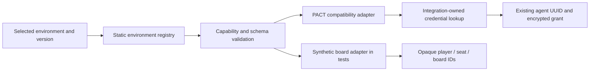

# F2 — Environment contracts and bindings — 17 October 2026

Fleet now has shared versioned observation/action/outcome/event contracts, a reviewed static environment registry and additive opaque identity bindings. Only PACT is composed for real deployments. A synthetic board adapter proves the second-environment boundary; it is not a certified real game.

`BindingRef` contains environment ID/version/instance and opaque account/actor/entity references, with no credentials. `Bindings` adds metadata rows beside legacy account/entity columns. An active controlling entity is unique per environment ID and instance, across adapter versions. Terminal agents retain that exclusivity; no automatic retirement, rollover or reassignment is introduced. The same agent's active binding is immutable. Trusted integration enrollment owns binding creation; it is not an agent-facing authorization API.

PACT's integration maps a verified legacy account/entity to its original agent UUID. The existing `agent:<uuid>` vault identity, ciphertext, consumed configuration, anchors, turns, original pending command and usage allocations remain unchanged. Legacy association is labeled inferred. Migration013 creates only the binding table/indexes; there is no unknown-source automatic backfill. The deployment's actual instance is known when a trusted integration attaches an existing account.

The registry resolves exact reviewed versions within one selected deployment instance. Required capabilities and observation/action schema versions are checked before connecting or dispatching model work. It validates action binding/schema and returned command identity. An unavailable lookup or unrecognized PACT receipt remains unknown, never a reason to replay. Source references are wrapped in an opaque JSON-array namespace containing environment/version/instance/actor/entity and the adapter's source ID. Native/polled event capability remains none for the current PACT adapter; this package adds no feed or wake enrollment.

Adapters supply their presentation/default goal and an optional integration-owned existing-account enrollment hook. The board adapter has no social capability or contact requirements. Its opaque action/receipt cycle uses no PACT types, credentials or game database. Runtime composition exposes the selected PACT registry alongside the original legacy engine; the legacy reasoning body and decision inputs remain unchanged.

Verification: all399 tests across66 files passed (162 unit,237 integration). New checks cover opaque IDs, duplicate/terminal control, immutable association, exact legacy ciphertext/turn/unknown-ledger preservation across repeated migration, capability/schema refusal before model dispatch, semantic registry keys, unavailable/unknown receipts and a complete board move/receipt cycle. Existing enrollment, release preservation, engine and F1 golden parity tests passed. Type/style, production build, recursive core/engine boundaries and dependency audit passed;20 existing style warnings and3 informational diagnostics remain. Dependency audit found zero vulnerabilities. A fixture-only bigint generation assertion was corrected to respect PostgreSQL's string representation; no production identity or generation conversion was changed.

RED/GREEN: initial tests failed on missing APIs; a reordered descriptor reproduced key-order-sensitive resolution; an unfamiliar receipt reproduced an unsafe rejected classification. Both behavior failures now pass. Boundary fixtures check deep engine directories and static/dynamic/require integration imports. Registry/contracts are generic; integration imports stay under `src/environments/` and runtime composition.

Author self-review was used because repository instructions forbid delegation. Source-only local verification applies: no installed database migration, process restart, server connection, recovery review, reconnect, replay, model call or new cohort/run occurred. The installed local and server releases remain unchanged. F3 supplies the task host next; real adapter certification and UI/profile selection remain later work.
