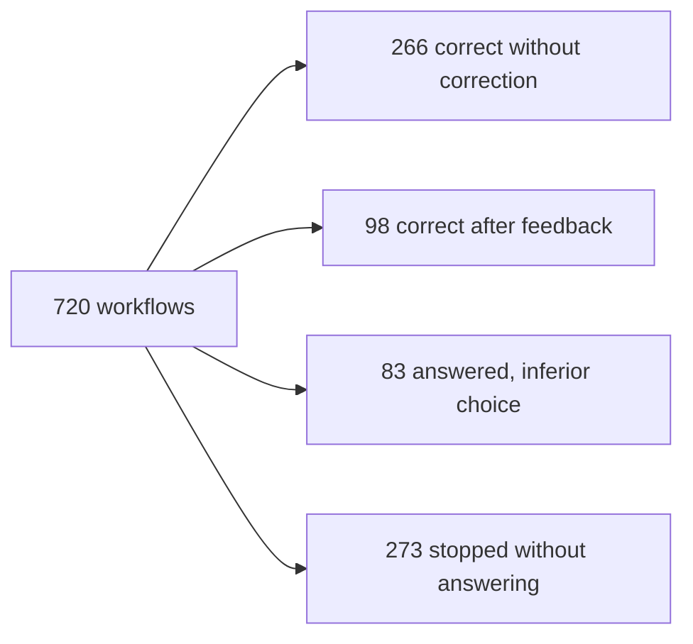

# Investigation of the 24-session feedback failures

Read-only investigation of the [30-minute observation](feedback-workflow-soak-20261024.md). No model calls, worker starts, game execution, provider changes or source repairs. E4/KQ1 remain blocked. This report categorizes saved synthetic workflows; it does not change the original verdicts.

## Outcome and recovery denominators

Of 720 workflows, 266 were correct without correction and 98 became correct after feedback: 364/720 (50.56%) correct overall. The remaining 356 (49.44%) comprise 273 unanswered workflows and 83 answered with an inferior offer.

Recovery is a different denominator. Of 393 workflows receiving rejection feedback, 98 (24.94%) became fully correct, 22 answered with an inferior choice and 273 remained unanswered. Thus 295/393 (75.06%) did not fully recover. The 327 workflows receiving no rejection include 266 correct and 61 inferior answers. A further 22 inferior answers had recovered legality/facts after another error but still missed the objective. In total 120/393 (30.53%) feedback-affected tasks eventually produced a valid answer; 98/393 also achieved the goal.

## Disjoint categories of the 356 unsuccessful workflows

Blocked workflows are classified by the final rejection. This identifies the observed stopping point; another issue might remain behind a check that short-circuits earlier.

| Category | Workflows | Share of unsuccessful workflows | Observed behavior |
| --- | ---: | ---: | --- |
| Wrong current gold balance |136|38.2%|88 workflows used historical 999; 48 used an offer price as current gold. None recovered. |
| Affordable but inferior offer |83|23.3%|54 selected `b` when `c` was best; 29 selected `c` when `a` was best. The validator accepted these and supplied no objective-quality feedback. |
| Paid offer despite insufficient spendable gold |76|21.3%|All 76 were in the no-affordable-offer scenario, cycling through paid offers instead of `none`. |
| Stale observation not refreshed |61|17.1%|The model kept proposing without obtaining the new observation, sometimes merely changing its revision label. |

All 273 unanswered workflows stopped at a configured bound: 108 repeated-failure stops and 165 correction-attempt-limit stops. No task stopped because of a transport timeout, unknown model outcome, parser failure or exhausted 256-token generation. Checked binding/request IDs did not trigger a rejection in this run. Unused fields on initial read calls were not treated as authoritative facts, so this does not mean every generated placeholder/reference was correct.

## What the model actually did

### Current facts mixed with history or offer prices

Every one of 361 FACT_MISMATCH rejections involved only the `gold` field. The other fields checked by that rejection—`spendable` and `delivery`—matched. There were 252 rejections copying 999 from the explicitly historical observation, and 109 using an offer price(60,80,110 or 140). These are repeated attempts across 136 workflows, not 361 different tasks. The 88 history-copying and 48 offer-price-copying workflow groups are disjoint.

Example: the current observation supplied `gold=135`, `reserve=20`, `spendable=115` and offer `c` costing 110. The model returned `gold=110` and `spendable=115`. Feedback explicitly said `gold=135`, but the next proposal repeated `gold=110`. Another example used historical `gold=999` while correctly copying current `spendable=130` and `delivery=pending`. This is evidence-source/field confusion; it is not a wrong `delivery` claim in these 361 rejections.

The records establish wrong-field selection and failed correction. They do not isolate why the neural model selected a particular number. Contributing interface risks are visible in source: the output repeatedly requires a generic `gold` field, history with another `gold` value shares the prompt, and unnecessary fact fields are required even on a read action. Testing a clearer interface is warranted; its benefit is not yet measured.

### No affordable offer

This scenario has 90 workflows and 0 correct outcomes. Seventy-six stopped on reserve violations; 14 stopped on wrong gold first. Example: `spendable=0`, but the proposal sequence chose `b` costing 80, then `c` costing 110, then `d` costing 60 after successive rejection messages. The documented legal fallback `none` was not chosen.

The feedback named the violated reserve and exact spendable amount. It did not explicitly enumerate the remaining legal choices or say `none` is the only feasible choice. The original prompt did describe that fallback. Therefore the message reached the model, but descriptive feedback did not reliably produce the required change of plan. Simply granting more attempts has no demonstrated benefit here.

### Stale observations

All 90 workflows in this scenario encountered the deliberately advanced revision. Twenty-nine performed a second read and completed correctly; 61 did not complete. There were 90 rejected proposals labelled `r1` and 122 labelled `r2`. In 19 workflows, the trace specifically shows `r2` paired with the old `gold=120` after the environment had moved to `gold=95`. Relabelling a proposal is not obtaining fresh evidence; the check correctly refused it.

The host knows which revision is current. In the tested design, it returned an error and asked the model to initiate the fresh read. This recovery behavior is one of the model's weak points. Automatically obtaining the authorized new observation is a possible host-level repair, separate from command replay or authority expansion; it has not been implemented or trialled by this investigation.

### Objective quality was graded after completion, not fed back

All 83 inferior answers were legal and factually consistent at acceptance. The validator enforced scope, freshness, exact facts, affordability and proposal-before-answer. The goal of maximizing iron was checked only by the final grader. Consequently none of these 83 received an objective-not-met correction opportunity. Sixty-one received no rejection at all; 22 had earlier corrected another type of error.

This is a limitation of our feedback design as well as a model decision error. A correction loop cannot repair an objective violation it is never told about. For an explicit numeric maximization objective, a trusted checker can return actionable goal feedback while leaving the model to choose among legal offers. That differs from treating every subjective strategy preference as a hard error.

## Recovery by first rejection

| First rejection or no rejection | Workflows | Fully correct | Inferior answer | Unanswered |
| --- | ---: | ---: | ---: | ---: |
| No rejection |327|266|61|0|
| Reserve violation |167|69|22|76|
| Stale observation |90|29|0|61|
| Wrong current gold |136|0|0|136|
| Total |720|364|83|273|

All 921 recorded rejection events occurred at the `propose` step: 348 reserve, 212 stale and 361 wrong-gold. The model did perform the initial read. The old repeated-schema-lookup scenario was not exercised: this harness has no schema-lookup tool. No conclusion about that older architecture behavior follows from its absence here.

## Scenario overview

Grouped input families below retain all 720 workflows. These are synthetic task variants and replicas, not the eight production agent architectures.

| Input family | Workflows | Answered | Fully correct | Recovered |
| --- | ---: | ---: | ---: | ---: |
| Unknown delivery, ordinary resources(two replicas) |180|179|133|28|
| Pending delivery, ordinary resources |90|70|54|6|
| Pending delivery with hostile peer text(two replicas) |180|79|58|0|
| Observation changes after first read |90|29|29|29|
| No affordable offer |90|0|0|0|
| Very large integer balances |90|90|90|35|

Lower success with hostile text is an observed association, not a controlled proof of prompt-injection causality. The checked binding/request identities and delivery fields did not fail; the direct traces instead show wrong gold. No single-cause inference is made from the scenario labels.

## Next experiments justified by these findings

1. Bind exact current facts to trusted observation references and render balances from the host; do not repeatedly ask the model to reproduce known numbers. Keep relevant historical information available with explicit provenance. Evaluate whether the model can still make useful strategic choices.
2. Advertise currently legal choices and the explicit `none` fallback when no purchase is feasible. Prevent illegal references without preselecting a preferred strategy.
3. On stale evidence, refresh the authorized observation before another proposal, preserving existing bounds and never replaying a possibly executed command.
4. Return objective-quality feedback for explicit, objectively checkable goals. Score subjective strategy separately; do not reject valid alternatives just to inflate accuracy.
5. Compare these changes one at a time on held-out workflows. A native tool-result interface and action-specific schemas are additional interface hypotheses: the tested harness returns JSON tool results as user-role messages and requires the same fields for `read`, `propose` and `answer`. Their effect is unmeasured.

No changes or new trials are authorized by this report itself. The current request is investigation; all recommendations remain proposals.

## Evidence verification

All 720 workflow IDs are unique. Per-workflow attempt counts sum to 2,564 actual calls. The cohort totals, final rejection totals, per-field comparisons, disjoint gold-source groups and overall 356 failures were checked with executable assertions against every saved trace. Original `workflows.jsonl` SHA256:`b7fb9f0784fcd95cf7c272f3e47a3b9213458ae1076be9ab2d3aa3fc5b73b81f`. Private derived audit: `failure-investigation-verified.json` under the original run root. Original evidence is unchanged.

Factual accuracy of 447/447 recorded answers is conditional on a guard refusing bad proposals; it is not 100% raw-model factual accuracy. The failure rate here is for repeated synthetic workflows, not a statistical estimate for all future PACT play. E4/KQ1 remain blocked; game execution stays disabled.
