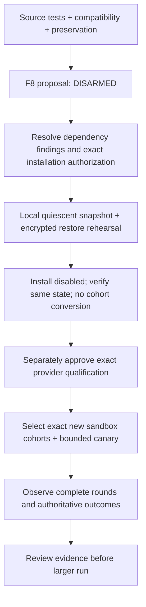

# F8 release proposal — 17 October 2026

**Prepared, not authorized for installation or execution.** Source candidate Fleet `8c83be5da23b7bae2cbcdfb8986b696ffcd2ec28`; PACT `60ec57b98c825eb1756d63121aa53d1aaa3b3315`. Server Fleet is excluded. Existing local installed Fleet `7093cb8782e1b81df1ebddfd24a00eec9927b5b5` is unchanged. The [machine review manifest](multi-engine-release-manifest-20261017.json) has `runs:[]`, no run authorization and the remaining target/authorization gates. Review always returns `executionEnabled:false` for this proposal.

## Local rehearsal follow-up — 18 October

The [authorized local rehearsal](local-release-rehearsal-20261018.md) passed encrypted target backup/restore, full file/table preservation, idempotent migration and inference-disabled old-source rollback on a network-isolated copy. The exact installed release remains unchanged. Original services/keepalive are restored with zero new turns or allocations; historical blocked agents/unknowns remain. `rollbackRehearsed:true` now records that scoped result. `workersFenced:false` remains: a new installation needs fresh fencing/quiescence and its own authorization. No server contact, provider qualification, run or push occurred.

## Exact selection and boundaries

| Item | Selected for this assignment |
| --- | --- |
| Deployment target | None; proposed first target is this machine's existing local installation after separate authorization |
| Server Fleet / Mac | Excluded; no contact or inspection |
| Existing local cohorts | Both original ten-account cohorts retained; 20 agents remain needs_owner; no engine/model/budget/schedule/anchor change |
| New run / accounts / cohort IDs | None; empty selection is intentional, not a placeholder authorized to auto-fill |
| Provider route/model/settings | None selected or newly qualified; existing installed configuration preserved |
| Live caps / absolute start / deadline | None selected; execution cannot be enabled without exact finite values |
| Profiles proposed for first live qualification | legacy-loop/1, legacy-cognition/1, reactive-basic/1, reactive-cognition/1, each separately evidenced |
| F6 | Excluded from PACT release; requires a reviewed coordination protocol and its own acceptance |
| Push / installation / provider call / recovery review | Not authorized or performed by F8 |

Preserve all historical terminal populations. Existing consumed cohorts cannot be converted to another profile; terminal bindings cannot be transferred by copying credentials. A later multi-profile game run therefore requires an explicitly selected fresh sandbox cohort/account plan or a separately implemented migration, not replacement identities for blocked agents. The original local cohorts retain 40 unknown allocations of 40000 (1600000 conservative tokens) and 10121 historical turns. None was reviewed or erased.

## Concrete candidate for later review

Recommend separating installation acceptance from provider qualification and gameplay. First qualify the selected route against synthetic game observations with no gameplay writes: propose **four profiles, three complete rounds/profile, at most12 executions/profile including retries (48 total),1920000 total conservative tokens,40000/execution,2000 output tokens,24000 input bytes, serial route capacity1,90 seconds/execution,120 seconds/turn, and a two-hour absolute window from the subsequently selected UTC start**. If legacy cognition uses Laya, include at most24 helper requests total in that same window with its existing helper timeout. These are proposed ceilings, not allocations, spent usage or an enabled configuration; route/model/settings/absolute times and qualification inputs still need explicit selection and authorization. Do not raise installed allowances. A route that cannot complete the window fails that proposal rather than receiving an extension.

After route acceptance, propose one fresh sandbox actor/profile for at least3 normal scheduled rounds under the same approved parent caps before considering the earlier twenty-account/week idea. Exact account/cohort IDs, sandbox instance, authority, owner goal, common timing, configuration digests, provider/helper caps and absolute deadline must appear in the selected manifest before any account creation/run. No group is rewarded for more communication or more actions: inspect useful goal/obligation outcomes, legitimate waits, losses, latency, failures and compute with explicit missing coverage. Interacting-world groups are not independent randomized replicas. A larger outcome-oriented allowance can be chosen at that review; F8 does not invent consent for it.

## Local installation sequence, after authorization

1. The dependency blocker is resolved at PACT `60ec57b98c825eb1756d63121aa53d1aaa3b3315`: UUID11.1.1 plus reviewed local braces/node-forge backports pass direct vulnerability/compatibility tests, clean-install/consumer guards, native export and local/pruned-image audits (0 findings). No Expo downgrade or waiver was used. Review [the dependency qualification evidence](dependency-qualification-20261017.md) and rerun audit/provenance checks immediately before any authorized installation; private backports need ongoing original-version advisory review. The dependency gate is now true. Existing browser saved-file download certification remains F7's documented limitation; HTTP export/privacy checks passed.
2. Inventory the exact installed binary, protected configuration/vault/helper artifacts and every non-ephemeral table. Record original accounts/grants/mandates, encrypted history, model/settings, lifetime counters/allocations/reviews, anchor/next slots, pending IDs/receipts and terminal states in protected storage. No secrets/private rows in Git. Read-only F8 snapshots matched all 22 application tables exactly; that observation is not a future installation snapshot.
3. Use a separately authorized maintenance hold to stop new claims and credential/callback admission. Let known calls drain; bound the drain, fence stale workers and verify zero active model calls/commands/credential operations/callbacks. Unknown historical allocations retain their original budgets and exact recovery gates. Uncertain commands block migration acceptance until their original-receipt procedure is separately authorized; never replay or clear them. Do not turn blocked running intent into healthy resumed execution.
4. Before switching binaries, make an **encrypted full database/config/state snapshot**, preserve the matching vault key separately and the exact old immutable release/helper pins, and record checksums. Restore/decrypt into a disposable local database; compare complete retained row hashes and decrypt synthetic/approved sampled ciphertext under its original associated data. Refuse rollout if restore/key/preservation verification fails. The separately authorized [local target rehearsal](local-release-rehearsal-20261018.md) has now passed; `rollbackRehearsed:true` records disabled source rollback only. Repeat a fresh snapshot/fence at installation; old-worker execution of new profiles remains unqualified.
5. Apply only the candidate's additive migrations 001–019, once then idempotently. F8 introduces no migration. New profile tables/nullable pins do not backfill or enroll existing cohorts. Start candidate services with admission disabled, verify local health/auth/origin/CSRF, exact environment/schema negotiation, reports/retention and zero model/account/game calls. Read back retained hashes/configuration with only explicitly reviewed maintenance audit/heartbeat differences allowed. No reset of counters, history, recovery gates, identities or terminal states.
6. Keep execution disabled until the exact separately authorized qualification/canary manifest and all original recovery prerequisites pass. A successful install does not resume the two blocked existing cohorts or permit creating replacement accounts.

## Rollback

Fence/drain both old and new workers and credential/callback entry points; select the compatible prior source and protected configuration while retaining the **newest database, encrypted state, commands, allocations and task migrations**. Never restore the pre-upgrade snapshot over post-upgrade writes, downgrade/drop tables or replay commands. An encrypted backup is disaster recovery after reconciliation, not a way to undo gameplay.

**Older workers may not exclude new profile cohorts.** Before allowing any old worker to claim, prove it cannot admit unsupported task profiles; otherwise keep every affected task cohort paused/fenced and inference disabled. Old-column SELECT compatibility is not full old-worker execution certification. Verify credential-rotation compatibility independently; do not re-enable an older unsafe refresh path. Rollback cannot undo game actions, settlements, messages, obligations or unknown usage. Repeat identity/settings/history/pending/ledger proof and explicitly review eligibility before any authorized resume.

## Stop and monitoring

The selected proposal must name an operator and exact monitoring artifact references. Observe each admitted execution's allocation ID, route/capacity wait, fitted input, timeout/output stage, task/trigger/version/environment, exact submitted UUID and actual receipt, later factual outcome and evidence coverage. Monitor provider usage and conservative allocations separately; unknown is not zero. Confirm each intended actor completed 3 rounds rather than substituting aggregate activity or heartbeat counts.

Stop new admission immediately for unknown usage, pending/unknown command delivery, identity/scope/authority mismatch or revocation, unexpected credential generation, lost provenance/accounting/retention, repeated context/schema failure, changed configuration/anchor or cap/deadline reached. Preserve originals, inspect receipts and expose the exact next recovery step. Stop never authorizes cancellation, review, replay, grant expansion, identity replacement or terminal restart. Missing/expired evidence remains missing. Report accepted actions separately from fulfilled promises and outcomes; subjective beliefs and motives are not authoritative facts.

## Evidence and decision

See [compatibility](multi-engine-compatibility-20261017.md), [artifact/review API](profile-qualification.md) and [F8 verification report](qualification-release-20261017.md). Source/offline preparation can complete while release/run eligibility remains blocked. Dependencies and local disabled rollback rehearsal now pass. Next work is review of a concrete authorized local installation/provider selection, not an automatic F9 or live experiment.
