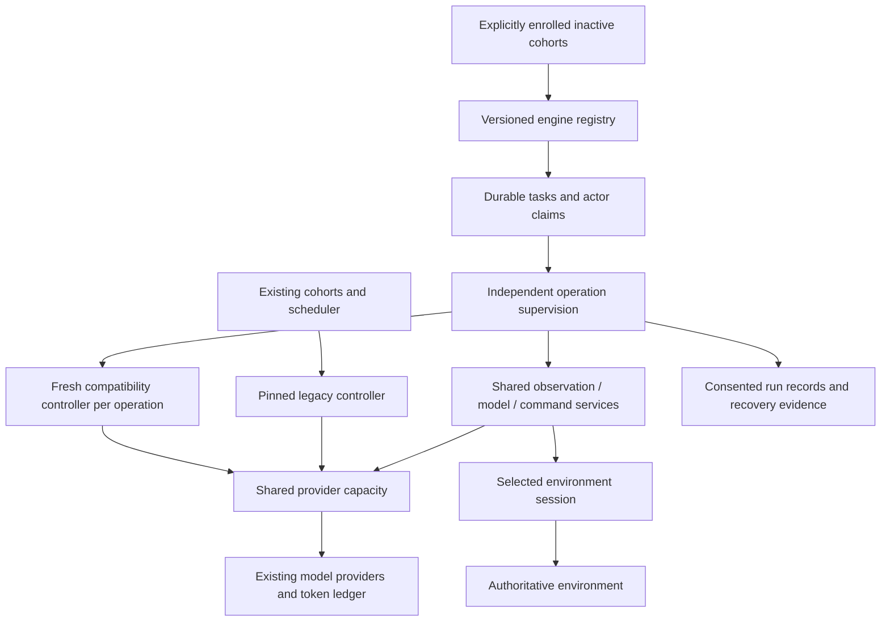

# F3 — Durable task host and shared execution — 17 October 2026

Phase 1 adds an explicitly enrolled task path beside the preserved controller. F2 is committed as `aba5630`; this report covers F3. The installed local runtime and server Fleet remain unchanged.

## Enrollment and tasks

`cohort_engine_profiles` records an exact engine reference and explicit timed-review selection. Enrollment is an internal trusted operation on fresh draft/paused cohorts, before any task/turn consumption; it is not a dashboard switch or an agent tool. Existing cohorts are not enrolled by migration. The legacy controller excludes these explicit task cohorts; all other cohorts retain its existing selection order, configuration, scheduling anchor and recovery behavior. Only the two compatibility profiles are composed for real deployment. The generic board engine is a test fixture.

Tasks persist their binding, profile, goal key, sources, six-state lifecycle, priority, deadline, wake condition, revision and fenced turn association. Duplicate source IDs do not create more work. Related source arrivals coalesce; arrivals during execution retain a ready follow-up rather than disappearing at acknowledgement. Context includes the latest 100 source references with explicit total/omitted counts; durable source records remain intact. Event metadata/message bodies are not copied into this task-source table.

Admission holds the same PostgreSQL lock used by legacy claims, reuses the existing turn creation/fence and enforces both global/cohort concurrency, active actor exclusivity, ready credentials, owner blockers, maintenance holds and terminal/deadline constraints. A persisted admission ticket round-robins eligible task cohorts. Within a cohort, owner priority precedes comparable UTC deadlines, due time and stable sequence. Domain deadlines use a matching authoritative observation clock; UTC or matching integer clocks are supported, while unavailable/incompatible clocks fail explicitly. An earlier compatible deadline is retained when sources coalesce. UTC checks and fresh domain observation checks run again after provider waiting, before inference/commitment.

The worker retains one original legacy operation, adds bounded independently supervised task operations and alternates first admission opportunity between the two lanes when both exist. Task-cohort fairness is durable across workers; legacy cohorts retain their prior scheduling order. With no enrolled task cohort, the original worker dispatch branch remains selected. A durable cursor table is groundwork only: feed intake, cursor advance/resync and event-wake enrollment remain F4/P1 work.

## Models and commands

A PostgreSQL FIFO capacity lease gates each provider route independently of cohort allowance. Consented records separate queue delay from generic provider execution time and retain actual model requests/responses/failure evidence under the existing debug bounds and 30-day retention. The compatibility controller's original elapsed-call timer includes its capacity wait, which is also recorded separately. Waiting does not create a new token allocation on the new path. `ModelAdmission` then uses the original `reserveCall`/`recordUsage` ledger, validates persisted model/budget limits, preserves original unknown allocations and differentiates proved non-dispatch from uncertain usage. It cannot gain allowance by changing a request's copied cohort data. Codex still has its original process lock and a hard capacity of one. Real routes are composed at capacity one; parallel capacity two is qualified only with fake providers. A stale route lease is reaped after its bounded operation expires and its turn is settled; this is not a provider-termination guarantee or a refund.

Compatibility engines own their original observations and ledger. A capacity-only model port forwards the original model request unchanged; it never makes a second reservation. Each task operation gets a fresh bridge/abort controller. The original reasoning body remains byte-identical and its cognition/recall configuration is retained. No additional compatibility world reads are introduced by the host. The shared generic admission service is for engines using the new host contract.

`CommandExecutor` atomically records the original pending command and encrypted intent journal before network dispatch, with the stable agent/vault identities retained. It opens the environment's write lease at actual execution. Confirmed outcomes use the existing receipt archive/accounting boundary; the original environment outcome/code/source refs remain in the evidence alongside Fleet's normalized commitment code. Known local non-dispatch is an explicit rejection; ambiguity stays pending/unknown. Internal command IDs remain UUIDs; external account/actor/entity IDs are opaque strings. Repeated requests return that exact command's retained outcome. Recovery queries the original receipt and never submits a replacement command or silently retries a possibly committed action.

## Stop and recovery

Each operation owns its abort controller and guard. Stopping one fences that task/actor while other operations continue. Global stop refuses more work, aborts current work and drains the admitted promises. In-flight actions may already have committed: stop is not action cancellation. Unknown calls, exact pending commands and original allocations remain recoverable through existing owner-review/receipt flows. An unresponsive provider/transport remains bounded by the original operation/model deadlines and explicit uncertainty, not an invented successful cancellation.

Task recovery derives its state from the retained turn/receipt/usage record. A crash after turn completion but before task acknowledgement does not repeat effects. A prepared but undispatched command is archived as such with its full original outcome envelope. A compatibility controller's own authentication/owner blocker cannot be overwritten by the supervisor's normal completion. New generic run reports identify their recorded engine reference or explicitly unavailable detail; they are not mislabeled inferred legacy. Detailed observations retain existing consent/encryption/bounds/30-day expiry. Operational task/command history remains recovery evidence; it is not a new archive of model reasoning or private messages.

| Failure boundary | Verified behavior |
| --- | --- |
| Before model reserve | No invented usage; fresh fenced claim can retry |
| Reserved, no reliable result | Full 40,000 allocation remains unknown and actor blocked |
| Tracked, proved not dispatched | Original allocation/counter retained with not-dispatched evidence |
| Before command dispatch | Original ID archived without game submission |
| Server committed, response lost | Original receipt reconciled; one effect and one archive |
| Task completed, acknowledgement lost | Completed work is not dispatched again |
| One operation stopped | Other actor's signal remains active |
| Existing compatibility auth failure | Actual worker keeps needs_owner/AUTH_REQUIRED with zero calls |

## Verification

Final verification: `npx vitest run tests/unit tests/integration --maxWorkers=1` passed **431 tests across 69 files** (162 unit, 269 integration). This includes 32 new F3 cases across host/recovery, capacity-wrapped golden parity and actual-worker admission. All verification uses the isolated local `fleet_test` database, fake game/model providers and synthetic credentials/data. No real-provider qualification is claimed.

Type/style checks, recursive environment boundaries, production build and dependency audit passed after the review fixes; 20 existing warnings and 3 informational diagnostics remain. No new production dependency or package lock change was made. The F1 golden messages/schema/output limits still match with and without cognition, both directly and through shared capacity, with exactly one original allocation per model call. Full suites include scheduler, worker-liveness, admission, cognition, Codex process, enrollment and release preservation. A synthetic actual worker process exercised explicit task admission and retained its authentication gate without any model dispatch. The old-schema migration rehearsal and repeated additive migrations preserve exact historical table hashes, pending IDs and unknown allocations.

Author self-review was required by the repository's no-delegation instruction. Important findings were reproduced and fixed: mutable copied allowance/forged binding, historical-legacy labeling of a generic run, queued/coalesced deadlines, command-specific receipt selection, legacy bootstrap's premature table query, incomplete not-dispatched outcomes, false uncertainty on proved local non-dispatch, silent source-reference omission compatibility completion overwriting an owner gate, and missing shared model/queue telemetry. A telemetry-write failure before provider invocation retains a proved not-dispatched allocation instead of inventing uncertain usage. No independent review is claimed. No deferred minor finding is recorded.

## Operational preservation and scope

No installed migration, service restart, maintenance hold, recovery review, reconnect, replay, model/budget/anchor change, new live cohort, source push or server connection occurred. Read-only local evidence before final verification found the same `7093cb8782e1b81df1ebddfd24a00eec9927b5b5` release, both cohort intents running, all 20 agents already needs_owner, zero running turns and the original 40 unknown allocations totaling 1,600,000 tokens. Final readback matched all 22 non-ephemeral application tables exactly; the installed release/agent states/unknown allocations stayed identical and all three local services remained active. A compiled Node 24 smoke check resolved both compatibility profiles, retained the default legacy bridge and rejected disabled execution before any external call. PACT's checkout and game rules remain untouched. Private evidence/logs are outside Git.

The next architecture phase is the scoped PACT event feed/P1 and Fleet reactive profiles/F4. No feed, event trigger, specialist execution, new cognition semantics or profile-selection UI is claimed here. Actual installation and real-provider qualification remain separate from this source acceptance.

Execution rulings: continue the clean existing branch; interpret next phase as both F2/F3 per the approved phase diagram; manually extract F-number task briefs because the helper accepts only Task N; author-review without delegation; keep compatibility observation/accounting in the original controller with capacity-only wrapping; compare only supported clocks; report bounded source omissions while preserving recovery history; leave actual cursor intake/resync to F4. The costs are an accumulating isolated branch, a larger source-only batch, manual brief checking, no independent reviewer, separate compatibility scheduling, explicit refusal of unsupported clocks and no live event-driven engine yet. These limits are recorded rather than claimed away.
