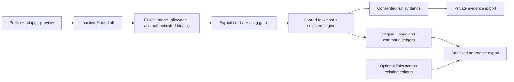

# F7 — profiles, optional comparisons and reports

17 October 2026. Source/offline implementation under the founder's F7 + PACT P3 assignment. Existing feature/engine-baseline-20261017 worktree; baseline d162c66. No installed runtime or server Fleet change. This report's containing commit identifies the new source; F8 release/provider qualification remains future work.

## Operation first

Engines & reports previews the statically registered engines against the selected reviewed environment's schemas/capabilities without connecting to the environment. Incompatible selections show their reason and cannot create a draft. Compatibility is not live/provider qualification. A profile draft atomically creates inactive Fleet controller/agent records and its exact profile/environment selection. It creates no game accounts, credentials, model calls, tasks or study. Existing Create fleet and paired comparison workflows continue to work.

Configure the model/allowance, authenticate the accounts, review owner authority and start explicitly through existing operations. Profile is inherited by the cohort's agents. Model choice is separate from architecture: legacy-cognition requires its legacy cognition setting; modern engines use their selected continuity module rather than the legacy model cognition/recall options. No cap is chosen or raised. Existing basic notes/cache remain intact.

Timed review uses the chosen interval. Optional event wakes are explicit policy (categories, quiet categories and review interval); creating a draft or receiving an event never starts inference. When an event policy is enabled its periodic review supplies the timer, avoiding duplicate timed-review lanes. With wakes off, normal timed review remains. The API accepts the existing bounded wake-policy schema. Consumed profiles are immutable; model/budget configuration is also frozen after any turn, including a zero-call wait. A selected environment is pinned before binding, and another deployment selection is refused. Older cohorts are not backfilled or relabeled as recorded versions. Before any explicit start, terminal/configuration/deadline gates are checked; existing authorized generic bindings need no optional enrollment port. PACT may attach its stored authenticated identity through its reviewed enrollment port.

## Optional comparison

POST /api/profile-comparisons links2–10 distinct existing permitted cohorts with an idempotent requestId and a declared interacting_world, independent_replicas or unspecified design. It pins configuration digests; it never creates/reassigns game accounts, edits allowances, starts groups or aligns old anchors. GET /api/profile-comparisons and /:id inspect these links. The four-group UI shows current profile, configuration drift, operational metrics, evidence links and unmeasured material outcomes. Independent replicas is an operator declaration, not proof of world independence. Existing paired templates retain their original endpoints and launch guard.

The new additive migration019 creates comparison metadata and nullable selected-environment metadata. No historical rows are rewritten. Draft creation uses existing Store/TaskStore writes within one transaction. Schema installation is source-only here. Tests also exercise pre-platform schema configuration compatibility; the legacy controller body stays byte-identical to the pinned baseline.

## Evidence and export boundaries

Runs retain readable inputs/outputs/raw JSON and original256KiB capture bounds. New sections show recorded task/profile/environment/trigger identifiers, exact allocation request→response links, retained prediction→observed-evidence references and proposal expectation→command result links. Overlapping workers are paired by allocationId; the old execution number remains a fallback only for old events lacking allocation IDs. Command confirmation is admission; material fulfilment stays unmeasured there unless later environment evidence actually records it. Prediction and belief content remains subjective and does not prove motive.

POST /api/reports/export accepts scope=private|shareable and1–10 cohortIds. Viewing/exporting uses Fleet's retained database only: no models, environment reads, message acknowledgments or action submissions. All endpoints use the existing operator authentication/CSRF boundary.

| Report | Included | Deliberate limits |
| --- | --- | --- |
| Private | Actual selected/current configuration and digest, lifetime counters, consented bounded runs and exact evidence links |30-day detail window enforced at read time;20 newest turns/cohort;512KiB/run;8MiB raw-run budget; explicit omitted records |
| Shareable | Ordinal group labels, allowlisted engine refs, environment family/version without instance, counts/timing/unknown allocations, definitions and coverage | No cohort/actor IDs,names,model strings,prompts,peer text,source refs,private continuity or configuration digests. Detailed configuration matching requires private review. Aggregates are not an anonymity guarantee. |

Definitions live in src/evaluation.ts and travel in versioned fleet.operation-report.v1 exports. Calls count lifetime ledger allocations including unknown/reserved, not just successes; allocated tokens preserve conservative charged history; unknownAllocatedTokens sums original unknown allocations. Reported input/output are separate measured fields. Queue-delay samples cover started-minus-due; duration samples cover finished_at-present turns. Accepted command counts, waits and revisions do not establish goal completion. Consent/expiry/retention coverage distinguishes missing detail from measured zero. Revocation removes observation detail; retained operational history/unknown allocations are not erased. Old resolved action detail and legacy paired cognition telemetry also obey the30-day read window if physical pruning is delayed. Outstanding pending commands remain available for exact operational recovery.

PACT P3's versioned isolated-world outcome records remain owned by its harness; Fleet imports no PACT harness source or game database. Ordinary operation needs no outcome study/import, and operational exports explicitly mark material outcomes unmeasured. Optional outcome evaluation and live qualification do not invent causality from action/message counts.

## Local evidence and limits

Red tests preceded the profile/report behavior, overlapping-worker links, retained predictions/expectations, expiry enforcement, environment pin and terminal/generic-binding start correction. Focused tests verify ordinary operation without a study, four-cohort linkage, drift, consumed configuration, auth/CSRF, sanitized exports, original40,000-token unknown allocation, delayed pruning, unavailable history and zero inference/remote reads on view/export.

The synthetic browser console used only localhost8831 and the isolated fleet_test database5437, with live execution disabled and throwing game/engine ports. Desktop and390px checks covered baseline selection, incompatible specialist feedback, an inactive five-agent draft, four-profile comparison and missing historical run evidence. Browser checks caught/fixed the unwanted settings panel and mobile control overflow. The viewport was restored and the preview process stopped. A browser download-event wait reset its automation session; an actual saved-file download is not certified by that attempt. Authenticated report responses and privacy/side effects are covered by API integration tests.

Final command counts, preservation and author-review results are recorded below. No hosted CI, independent reviewer, real-provider performance or universal intelligence winner is claimed. F6 remains unsupported on PACT until its separate atomic coordination protocol/parallel capability is implemented and qualified. No new twenty-account/week-long run or numeric allowance was selected.

## Verification record

PACT P3 is committed locally as177ad6c:389 unit/124 files and465 integration/66 files pass, with1 pre-existing optional real-model skip; full build/type/lint/contracts/boundaries/evaluation/backlog checks passed. Its complete integration suite used two workers after unrestricted parallel migration-lock contention. No game-host change was required.

At18:27:05 UTC the installed local Fleet release was still7093cb8782e1b81df1ebddfd24a00eec9927b5b5 and all22 application-table fingerprints matched phase4 exactly. The same two cohorts retain running intent, all20 agents remain needs_owner,0 turns are running,10,121 historical turns and40 unknown allocations totalling1,600,000 tokens remain intact. No recovery review/resume/reconnect was performed. The PACT fixture container on127.0.0.1:5438 was verified and stopped; the disposable console on8831 was stopped. Server Fleet was never contacted.

Author review (no delegation): reviewed authentication/CSRF, no-inference read paths, atomic draft writes, consumed configuration, environment pin, start gates, optional generic enrollment, digest/drift/idempotence, export allowlist, consent/expiry, model allocation links, old-column migration compatibility, authoritative PACT outcomes and frozen playback/branch isolation. Review fixes include delayed-prune resolved-action privacy, legacy telemetry expiry and terminal/generic-binding preparation; each has a red-to-green check. This is weaker than independent review and does not claim hosted CI or provider qualification.

Fleet acceptance: npm run check passed (type/style; existing warnings remain); npm test178/41files; npm run test:integration325/38files, all503 passed with no skips; npm run build, check:boundaries and npm audit passed (0 vulnerabilities). A final comparison timestamp rendering regression, type/style and build check also passed before commit. Initial full integration caught a pre-platform schema compatibility regression; the targeted correction and later complete suite passed. No failed check is treated as acceptance. Comparison snapshots show their own timestamp and require reopening to refresh, independently of the live overview clock.
