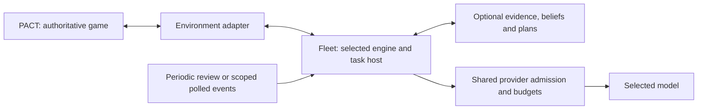

# PACT and Fleet: project handbook

**Evidence checkpoint: 19 October 2026.** This handbook explains the product, technical system, design changes, experiments and remaining gaps for collaborators who have not followed the implementation chats.

PACT is a persistent kingdom game with consequential choices. Fleet is an independent platform for running agents in an authorized environment. PACT is its first real integration. The goal is useful autonomous participation: an agent can build, conserve resources, negotiate, accept help, refuse it or wait according to its owner's goals and actual circumstances. Comparisons and reports help us choose implementations; they support the product rather than define its purpose.

The platform has progressed further than demonstrated intelligence. We have multiple engines, durable tasks, scoped evidence, budgets, receipts and recoverability. We have not demonstrated reliable long-term memory use, sound strategic decisions, or an architecture that improves survival and relationships in live play.

## Publication scope

This handbook describes the recorded, locally verified source candidate. The documentation-only publication does not merge the implementation branches `feature/engine-baseline-20261017` (Fleet) or `feature/phase2-agent-events-20261017` (PACT). Code paths and acceptance refer to the pinned candidates in the reports; they must not be read as a claim that all candidate code is present on `master` or installed. The original branch histories remain preserved. A later implementation merge and any runtime rollout are separate operations.

## Reading paths

| Reader | Start here | Continue with |
|---|---|---|
| Hearing the idea for the first time | [Talking points and glossary](talking-points.md) | [Current state](current-state.md) |
| Engineer joining the project | [Architecture](architecture.md) | [Design decisions](design-decisions.md), [operations](operations.md) |
| Asking what happened | [Development journey](journey.md) | [Findings and corrections](findings.md) |
| Checking a claim | [Evidence index](references.md) | Original dated report, source and tests |
| PACT contributor | [Game-side guide](https://github.com/safa-safakhou/pact/blob/master/docs/project/README.md) | [Canonical specifications](https://github.com/safa-safakhou/pact/blob/master/docs/pact/README.md) |

## How to read status claims

| Label | Establishes | Does not establish |
|---|---|---|
| Designed | Intent, contracts and acceptance criteria | Implementation or activation |
| Source/offline verified | Code and deterministic tests exercise stated behavior | Real-model behavior or deployment |
| Synthetic provider qualified | An actual pinned model handled a defined synthetic protocol within its grant | Strategic competence or actual game consequences |
| Installed, disabled | A specific artifact was installed and verified with admission off | Agent execution or recovery of old blockers |
| Live accepted | Exact authorized deployment, actors and outcomes were observed | Unrelated models, environments or future scale |

Claims are scoped by source revision, model/settings, environment, time and coverage. Older reports retain their original results; a later repair does not convert an earlier failure into a pass. A phase marked done means its stated scope was delivered.

## Boundaries at this checkpoint

- Source publication is not deployment. Installed local release `953034e` is older than the recent qualification and diagnostic source.
- Local execution is disabled. Twenty original local agents and forty historical unknown allocations retain their recovery gates.
- Latest diagnostics used synthetic game ports, not real accounts or game writes. Four command proposals were withheld.
- Server Fleet was excluded from recent work; this handbook is not a fresh server-health assessment.
- The future 100-Luna world plus local comparison groups remains a proposal. No reset, shadow or population launch is implied.
- Credentials, keys, runtime databases, private correspondence and raw private traces stay outside Git. This guide contains aggregate evidence and labelled synthetic examples. Repository access does not make private exports safe to publish.

The [current state](current-state.md) separates achieved capabilities from installed and live acceptance. The [evidence index](references.md) supplies the original records rather than asking readers to trust this summary.
