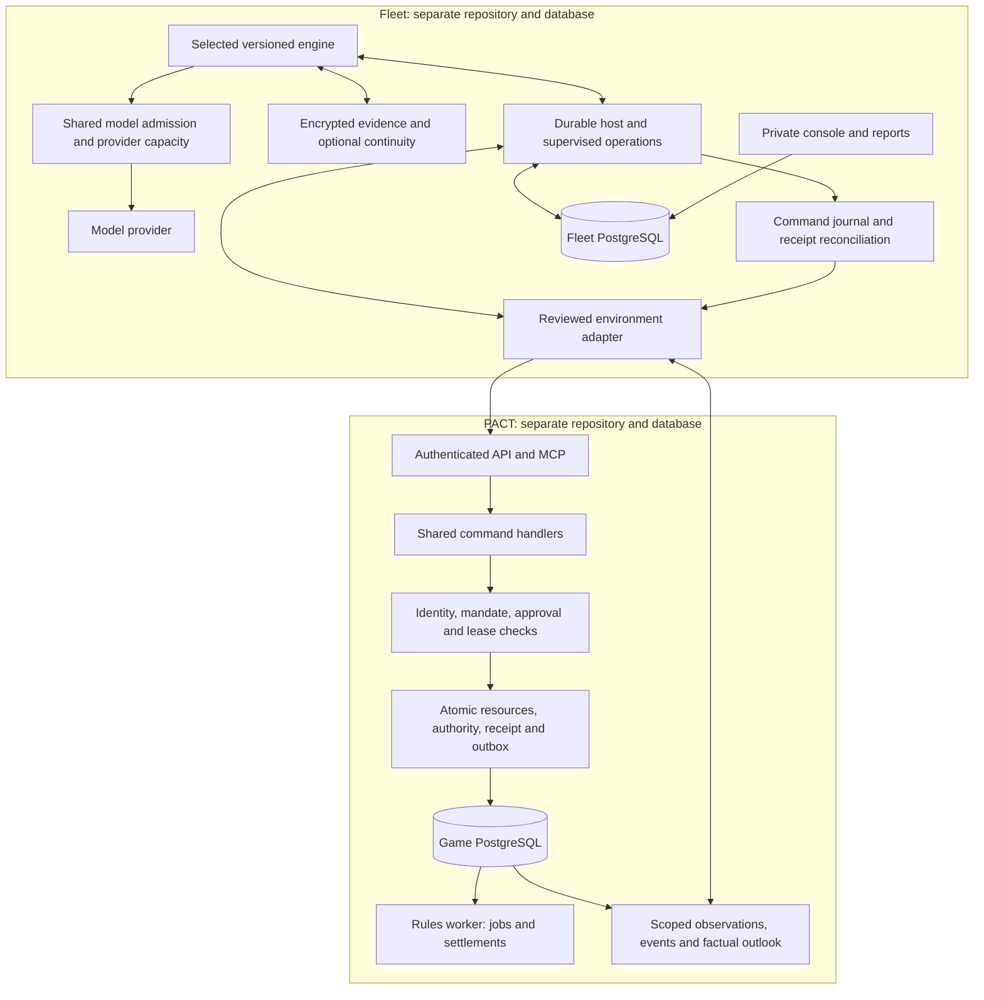

# Technical architecture

This describes implemented source boundaries at the 19 October 2026 checkpoint. The [current-state matrix](current-state.md) identifies what is installed or qualified; the [handbook](README.md) defines those labels.

## Two independent systems

| Concern | PACT owns | Fleet owns |
|---|---|---|
| World truth | Resources, ownership, jobs, contracts, combat, time and outcomes | Authorized observations of that truth |
| Authority | Authentication, grants, mandates, human exceptions, leases and command validation | Admission within existing limits; never granting itself authority |
| Execution | Shared command handlers, atomic effects, receipts and settlements | Engine selection, tasks, model calls, proposals and receipt reconciliation |
| Knowledge | Visibility and original source records | Bounded copies, subjective beliefs, predictions, plans and interpretations |
| Operations | Game services and data | Separate console, worker, database, encrypted credentials and accounting |

Fleet never connects to PACT's database. The adapter uses authenticated game interfaces. A proposal does not become true because an LLM wrote it; successful submission does not prove a future delivery or defense succeeded.

Reactive action contracts may optionally require a structured `expectedOutcome` alongside the bare action payload. The environment validates this assertion before preparation and may return factual guidance/details for a correction within the existing turn budget. PACT uses this for creator-relative supply send/receive claims and validates bonds from its observed versioned rule descriptor. The core has no PACT rule imports; outcome claims grant no authority and are never receipts. See [the trade repair](../reactive-trade-repair-20261020.md).



## Technology and process map

PACT uses Node 24/TypeScript, Fastify, PostgreSQL 17 and React. Its modular monolith has separately runnable API, rules, inference, channel-delivery and notification processes. Source clients include web/PWA, Telegram and React Native/Expo. Source presence does not certify every physical device, consumer assistant host or broader release requirement. The [PACT technical guide](https://github.com/safa-safakhou/pact/blob/master/docs/project/architecture.md) maps its modules.

Fleet uses Node 24/TypeScript, Fastify, PostgreSQL, React/Vite, Zod and AJV. Console and worker are separate processes. Provider credentials and vault keys belong in protected configuration, not model input. `laya-service/` is a separately pinned Python process for advisory recall ordering. Exact dependency versions belong to `package.json` and its lockfile; the handbook adds no runtime dependency.

| Fleet source | Responsibility |
|---|---|
| `src/platform/contracts.ts`, `environment-registry.ts`, `bindings.ts` | Versioned observations/actions/events/outcomes, capabilities and opaque bindings |
| `src/platform/tasks.ts`, `supervisor.ts`, `admission.ts`, `execution.ts` | Durable work, supervision, accounting/capacity and exact command lifecycle |
| `src/engines/legacy/`, `src/engine.ts` | Preserved controller and compatibility bridges |
| `src/engines/reactive/` | Focused decisions, scoped reads and waiting |
| `src/engines/continuity/` | Grounded subjective state and plans |
| `src/engines/specialists/` | Proposal workers, coordinator and conflict protocol |
| `src/environments/`, `src/games/pact/` | PACT-specific facts, tool contracts, presentation and validation |
| `src/cognition.ts`, `src/laya.ts`, `laya-service/` | Legacy evidence/cognition and optional helper selection |
| `src/model.ts`, `src/model-recovery.ts` | Provider transport and metered output correction |
| `src/qualification-run.ts`, `src/full-qualification.ts` | Preserving grants, trials, allocations and lineage |
| `src/cognition-diagnostic-*.ts`, `scripts/diagnose-cognition-local.ts` | Source-pinned diagnostics and encrypted invocation journal |
| `web/`, `src/evaluation.ts` | Inspection, metric definitions, comparisons and bounded exports |

## Engine and model choices are separate

| Profile | Organization | Continuity | Evidence limit |
|---|---|---|---|
| `legacy-loop/1` | Original timed observe/read/decide/action loop | Ordinary notes/cache | Preserved baseline; later generation repairs explicitly labelled |
| `legacy-cognition/1` | Original loop with evidence review | Cited beliefs/plans/interpretations; optional Laya ordering | Synthetic provider qualified; useful memory delivery unreliable |
| `reactive-basic/1` | Focused durable task; timer and optional event wakes | No full cognition bundle | Synthetic provider qualified; live PACT pairing not accepted |
| `reactive-cognition/1` | Focused tasks with optional grounded updates | Binding-scoped beliefs, predictions, plans, memories and reflections | Latest actual-model diagnostics wrote no memories |
| `specialist-coordinator/1` | At most two proposal workers and one coordinator | Separate specialist namespace | Synthetic coordination environment only; PACT rejects before inference |

Controller preservation does not mean every later prompt/schema packet is identical: generation-contract repairs are separately labelled and comparisons pin revisions. Modern continuity does not use the legacy Laya path. An older mixed-world proposal suggesting otherwise is superseded by this code-verified distinction.

## Events, timing and concurrency

```mermaid
sequenceDiagram
    participant P as PACT scoped feed
    participant I as Fleet intake
    participant T as Durable tasks
    participant E as Selected engine
    participant Q as Provider queue
    participant C as Command executor
    I->>P: Poll with account credentials and cursor
    P-->>I: Bounded page or explicit gap/resync
    I->>T: Atomically deduplicate, group and advance cursor
    T->>E: Admit eligible task under policy and fence
    E->>P: Fresh authorized state
    E->>Q: Separately metered inference
    Q-->>E: Response, bounded correction, or preserved uncertainty
    E->>C: Wait, read, or propose exact command
    C->>P: Submit journaled ID through normal handlers
    P-->>C: Receipt; material outcome is later evidence
```

PACT delivery is opt-in polling, not a hard real-time push guarantee. Periodic review remains useful without events. Related arrivals coalesce; quiet/unselected categories do not initiate inference. Gaps create a fresh-snapshot review and explicit missing-history coverage.

Kingdom tasks can be independently supervised while model inference remains serial on current real routes. Within-actor worker overlap additionally needs environment permission. PACT lacks the F6 coordination protocol and parallel-reasoning exception. Event responsiveness is constrained by queue delay, context size and inference latency.

## Memory is a pipeline


Original evidence, interpretation and receipt have distinct meanings. Stored interpretations cannot become authoritative facts. Modern continuity is namespaced per binding. Confidence and alternatives remain subjective; missing evidence leaves predictions unresolved. Packing can remove evidence from a packet while the original remains stored. The [latest retrieval finding](findings.md) demonstrates why every stage needs observation.

## Commands and recovery

Fleet journals the stable UUID/encrypted intent before submission. PACT checks authority and atomically commits resources, reservations, receipt and outbox. Network ambiguity retains the pending ID; recovery looks up its original receipt instead of generating a replacement command. Delivery, completion and battle results must be observed later.

The HTTP model adapter makes one execution. Admission can perform one corrective attempt for a completed unusable answer with known usage, within existing call/token/deadline limits. Thinking text is never executed. Unknown spend, uncertain commands, authentication and authority errors do not become blind retries. See [operations](operations.md).

## What another adapter needs

A synthetic board proves contract separation, not universal compatibility. Each real integration needs authenticated enrollment, authorized views, world/source identity, action validation, time semantics, idempotency/outcome lookup and acceptance. Registry entries are reviewed/static, not arbitrary uploaded plugins. Reusing a URL for a new world requires trustworthy game-owned incarnation identity; changing a Fleet string alone is insufficient.
