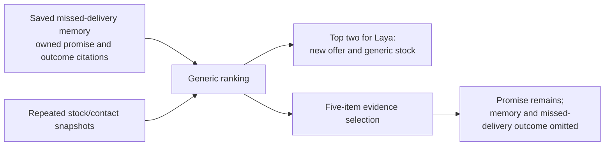

# Findings, mechanisms and corrected interpretations

This page separates recorded observations, reproduced mechanisms and hypotheses. Failed results remain evidence; eventual green qualification does not prove everything works. [Original sources](references.md).

## Earlier gameplay worked, with substantial assistance

The 4 October population experiment retained 100 kingdoms, used 200 model requests, committed 2321 commands and activated 131 contracts. All ten Luna agents entered a contract. However, only 84 committed commands came from Luna decisions;2057 came from deterministic bots and 180 from the separately labelled simulated-human contact controller. Eleven contracts involved Luna;120 were between scripts. Scripts supplied much of the activity. This is functional evidence for development/message/trade mechanics, not a self-sustaining LLM society.

The 9 October five-model comparison completed 553 turns from 555 attempts and committed 38 actions, without activated contracts/direct dialogue. A later five-Luna pilot recorded 31 turns,87 executions and 4 construction commitments, with no communications/contracts. More turns or richer prose did not establish negotiation. These are different cohorts/protocols, not controlled rankings against the latest engines.

## Nemotron empty content: provider contract and resilience

Thinking-enabled calls could finish with nonempty thinking and empty final content, even with done=true/stop and only 64/28 generated tokens. Output-limit exhaustion was therefore insufficient to explain them. Original/schema-grounded prompt controls each produced 3/4 valid outputs; describing the schema alone did not fix it. Separate non-thinking controls passed 8/8, without authorizing automatic mode switching.

Inspection of pinned Ollama 0.35.1 source found an empty alternative in the thinking grammar, consistent with ending before final JSON while the parser kept text in the thinking channel. The original request did not retain sampled token IDs, so its exact token sequence cannot be reconstructed. No upstream upgrade was established or installed as a fix.

Fleet also lacked corrective recovery on generic admission. The repair adds one separately metered correction for known completed unusable output, retaining mode, evidence, scope and original limits. It never executes internal thinking or blindly retries unknown spend/commands. [Recovery report](../model-output-recovery-20261018.md).

## Later failures were distinct defects

| Observed problem | Change or enforced boundary |
|---|---|
| Invented modern action schema IDs | Constrain to the bound environment's advertised registry |
| Read branches missing kind/summary | Complete closed schema alternatives; grammar is not application validation |
| Answering nonexistent contact requests | Conditional advertised shape plus exact reference preflight |
| Malformed nested payloads | Shared proposal validation before preparing commands; bounded correction |
| Duplicate citation UUID enums causing compilation failure | Deduplicate final IDs and validate schemas before provider dispatch |
| Rejected continuity update ending without replanning | Bind citations to finally delivered evidence; one known noncommitting correction |
| Interrupted/uncertain spend | Stop and retain original allocation/history; only specifically authorized review |

No repair rewrote old responses, deadlines or raw verdicts. The exact reviewed local schema failure did not become fabricated reported usage. Eventual full qualification used 108 calls and passed both modes under its agreed criteria, but did not establish long-term memory or strategy.

## Corrected reporting: legacy had written memories

An earlier coverage script inspected only modern `continuity` and generalized its zero count. The 19 October investigation corrected this: the preceding full qualification had 3 legacy thinking interpretations,10 thinking/7 non-thinking saved beliefs and 2/1 plans. Modern wrote 0 memories in those snapshot cases.

The audit now reads both envelopes and labels proposals separately from accepted database writes. Snapshot cells created fresh actors/bindings and supplied different cognition stimuli, so they could not establish an architecture effect or later usefulness. New diagnostics introduced same-identity three-turn episodes and controls while retaining declared profile-policy differences.

## Latest memory results

| Profile/mode | Model calls | Saved memory records | Meaning |
|---|---:|---:|---|
| Legacy thinking |8|3|Elicited promise note, absence-of-evidence note, later stock snapshot |
| Legacy non-thinking |10|1|Missed-delivery memory during promise episode |
| Modern thinking |8|0|6 omitted updates/2 empty; one narrative memorization claim |
| Modern non-thinking |8|0|5 omitted updates/3 empty |

Every saved record has owned retained originals. Fidelity is separate: the stock snapshot says the contact was unknown even though its citation lists it. The absence note is not an invented reliability history. Non-thinking's positive control spent both calls rereading state rather than attempting a write, so that control does not prove inability.

Offline probes of all 16 modern schemas admit a cited memory in every 14 evidence-bearing request; the 2 empty-evidence controls correctly cannot. All 16 reject fabricated references. No rejected substantive update/storage failure explains the zero modern writes. The omission is observed; its internal model cause is not established.

## Reproduced retrieval loss

The non-thinking legacy episode persisted a useful memory before the next turn. Its summary and zero-delivery source were absent from that turn's packet; the old promise remained through a belief. Pure-function replay exactly reproduces all five delivered IDs before packing. The memory ranks 7 th. Importance 1 and absence of the opaque peer ID disadvantaged it against repeated peer-bearing observations. Laya could only reorder the top two, neither the memory nor outcome.

This demonstrates one concrete loss path, not that every memory is lost or mandatory summaries improve strategy. Candidate selection must preserve original-source/trust distinctions, useful current state and bounded input while exposing omissions.

## Controlled Laya results

| Arm | Calls | Accepted | Intended source among accepted |
|---|---:|---:|---:|
| Frozen cases, both orders |32|18|18|
| Original broad goal/text |16|3|3|
| Focused query, identical text |16|15|15|
| Same focused query, compact text |16|15|15|
| Negative/ambiguous controls |8|1|No unique positive-support target |
| Embedded legacy recall |16|1|Unlabelled production candidates |

The query change is supported on 8 paired examples in both orders. Formatting adds no accepted selection; mean selected-option score increases only 0.00321. These are not 16 independent worlds or general accuracy estimates. Broad goals can lack a unique best source;3/16 is agreement with the focused target.

One absent-fulfilment control selected an explicitly unfulfilled promise at 0.6599 in one order. It can be relevant counterevidence, but does not prove fulfilled delivery. The helper did not assert a false world fact. The unchanged 0.65 threshold is not calibrated truth probability or a no-answer verifier. Do not lower it or retry legitimate abstentions seeking a selection. Embedded recall still mostly abstained 15/16; query/candidate generation was measured, not changed in the running engine.

## Valid structure did not establish good decisions

A thinking legacy response calculated 100−40=60, then said an 80-iron reserve was satisfied, proposed a hall upgrade despite no displayed builder and claimed timber had been added without a receipt. The command was withheld. Non-thinking retained the reserve; one small case does not prove a general mode winner. A modern acceptance-message proposal is not a settled trade or resource loss.

Measure JSON validity, ownership, statement fidelity, arithmetic/constraints, admission and material outcome separately. Current verification is stronger at the first two than at demonstrating the rest.

## Still unproved

No strategic architecture winner, general thinking advantage, universal memory-writing policy, dependable survival/alliance behavior or 100-player throughput has been established. More agents, longer contexts, forced memory quotas and larger budgets are not proven remedies. The next useful evidence is a complete controlled memory-to-outcome cycle, not another broad count of valid JSON responses.
