# Development and reporting journey

This timeline combines product, architecture, operations and evidence. Dates identify recorded work, not a claim that every feature was deployed that day. UTC budgets/deadlines remain authoritative; some 19 October Berlin reports describe late 18 October UTC execution. Links resolve through the [evidence index](references.md).

## Product and operating baseline

| Period | Work and decision | Evidence and limit |
|---|---|---|
| 15–20 September | Repository history begins; design/backlog, Node/TypeScript foundation, identity, command/receipt, OAuth/authority, MCP, approval and inbox work | Commit history and canonical specifications; initial implementation was dependency ordered |
| 1–4 October | v1.4 product baseline, game-only Alpha, generated experience and friends testing | Playable scoped milestones;24 broader production tasks remained deferred, not automatically authorized |
| 4 October | Bounded 100-kingdom population:10 Luna envoys/90 scripts,200 model requests | 2321 commits/131 contracts; extensive scripted support, not proof of autonomous society |
| 9 October | Five local models, five actors each, exactly two hours | 555 attempts/553 completed turns/38 commits; no contracts/direct dialogue; terminal history retained |
| 9–10 October | Separate continuous 50-owner controller, model/pacing changes, communication/society UI and collections | These are dated separate authorizations; no permission to restart terminal experiments |
| 11–12 October | Independent Fleet controller, five-Luna pilot, migration into sibling repository | Pilot 31 turns/87 executions/4 construction commitments; no communications/contracts. Fleet owns separate DB/services |
| 13 October | Fresh-read/controller/communication/recovery repairs and same-cohort server operation | Completed rounds/accounting remained distinct from weak planning/social progress |
| 14 October | Two local 10-account Nemotron groups, discovery and comparison inspection | Distinct from old populations; same identities/history retained through later failure/recovery |
| 15 October | Eleven paired reliability batches, recoverability work, deployment and exact recovery/reboot operations | Each deployment/review/resumption had its own scope; old unknown allocations were not erased |
| 16 October | Per-run encrypted traces and readable input/output stages | Much stronger inspection; old blocked agents did not become healthy merely because the dashboard improved |

The PACT specification index is normative. Older discovery documents, completed experiments and deployment notes remain dated history rather than competing live instructions.

## Multi-engine architecture: 17 October

The founder challenged one broad LLM loop, asked for event-triggered work and more independent kingdom handling, then emphasized survival, beliefs and relationships without forcing a social strategy. The design evolved into selectable engine packages and generic environment adapters, preserving the original controller. Research-style comparisons support product decisions; they do not become the primary product.

| Package | Delivered scope | Boundary |
|---|---|---|
| F1 | Versioned legacy bridge and provenance/baseline preservation | Existing reasoning controller retained |
| F2 | Generic environment contracts, registry and opaque bindings | PACT integration plus synthetic second environment |
| F3 | Durable host, supervision, shared provider admission, command journal | Real route capacity remains 1 |
| PACT P1 + F4 | Scoped metadata event feed, cursor/resync, wake policy, reactive basic | Default-off game protocols, polling; explicit enrollment |
| PACT P2 + F5 | Factual owner outlook and grounded continuity bundle | Optional subjective updates; no preferred alliance/survival scalar |
| F6 | Two focused proposal workers plus coordinator | Fake/synthetic coordination only; PACT refuses unsupported profile |
| PACT P3 + F7 | Consequence scenarios/playback, profiles, comparisons and reports | Actual handlers tested with synthetic principals; strategic results unmeasured |
| F8 | Compatibility, acceptance and disarmed release proposal | Done within source/offline scope, not a blanket release |

The dependency review found 23 PACT findings in unchanged Expo-related dependencies. The subsequent UUID update and reviewed braces/node-forge backports cleared the audit with provenance/direct tests. This did not deploy PACT or certify all clients; private backports still need ongoing original-version advisory review.

## Local release operations: 18 October

Encrypted full backup/restore, vault/AAD verification, maintenance fencing, idempotent migrations and disabled old-source rollback were rehearsed on isolated copies. The real local target was then installed as `953034e` with execution off in configuration and persistent worker/console overrides. Original 20 agents,10121 turns and 40 unknown allocations remained. Recent source repairs were made later and were not installed over that artifact.

A future world design proposed 100 server Luna kingdoms plus 20 local kingdoms in four groups. It identified missing world-incarnation identity, cross-host roster, stable authorization renewal and throughput evidence. It remained planning; no game reset, new world or population followed.

## Local provider qualification and diagnosis: 18–19 October

Every row below belongs to the same preserved local Nemotron qualification/diagnostic history. It excludes older gameplay experiments and fake-provider test calls. Reservations are conservative accounting, not reported usage or price.

| Actual stage | Model calls | Reserved tokens | Result |
|---|---:|---:|---|
| Initial Q1 plus separately approved output/mode controls |18|720000|Empty thinking-mode finals reproduced; schema grounding insufficient; non-thinking controls passed separately |
| Bounded retry qualification |49|1960000|No new empty finals in this sample; schema names/read envelopes/payload gaps exposed |
| Targeted repair plus immutable recheck |29|1160000|First 18 calls retained; later 11-call recheck passed its targeted scope; not full qualification |
| First aligned full matrix |96|3840000|Stopped at a new uncertain execution; output/continuity contract defects exposed |
| Exact authorized review and continuation |110|4400000|Full original 40000 unknown allocation retained; thinking 48/48 accepted, non-thinking 47/48; continuity replanning gap remained |
| Fresh full requalification |108|4320000|Both modes:4 calibration +48 engine cases passed raw/recovery criteria; no new unknown |
| Controlled longitudinal memory/recall diagnostics |34|1360000|32 turns; modern 0/legacy 4 memory records; retrieval loss/query effects/reasoning defects found |
| Total for this lineage |444|17760000|1152140 reported tokens; original historical unknown remains |

The original qualification tables retain 410 executions/16400000 reservations/1023602 reported. The final 34-call diagnostic uses a separate append-only registry/journal; it is not backfilled into those tables. New diagnostic usage is 128538 reported tokens and 104 helper calls. The historical unknown is not invented as reported usage. Separate grants/windows retain unused allowances; none becomes an automatic restart or refund.

```mermaid
flowchart LR
    A[Empty finals] --> B[Provider investigation and explicit modes]
    B --> C[Metered output correction]
    C --> D[Schema, target and payload repairs]
    D --> E[Uncertainty stop and exact review]
    E --> F[Final citation binding and replanning]
    F --> G[Full synthetic protocol passes]
    G --> H[Memory audit correction]
    H --> I[Longitudinal diagnostics reveal quality gaps]
```

## What changed in our interpretation

1. “Model returned nothing” became a specific final-channel/provider contract observation plus a Fleet recovery gap.
2. “Structured output passes” was separated from exact proposal validation and actual outcome.
3. “Neither engine wrote memory” was corrected: the earlier audit had omitted the legacy envelope.
4. “Memory exists” was separated from retrieval, final delivery and useful application.
5. “Laya always abstains” became input-conditional: focused query comparisons 15/16 versus 3/16 broad, without changing threshold or the actual engine.
6. “More agent architecture should be better” remains a hypothesis; F6 has no PACT live acceptance.

## Report trail and authority

Original reports preserve initial failures, later corrections, exact source pins and operational limits. Full tests eventually passed, but initial test setup failures and the unique fake-journal-path collision remain recorded. New guidance does not overwrite old usage/reviews. Handbook publication changes documentation/source availability only; installation, review, reset and new experiments require their own covering assignment.

Start with [current state](current-state.md), then [findings](findings.md). Use [references](references.md) to inspect the individual reports instead of treating this timeline as a substitute for evidence.
