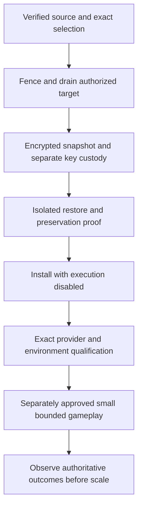

# Operations, evaluation and evidence

This page explains the operating model; it is not authorization to activate anything. Use the [operator guide](../operator-guide.md), [operations](../operations.md) and exact release/run report for executable procedures. Never point tests at an installed or game database.

## Execution and uncertainty taxonomy

| Situation | Supported treatment | Retained evidence |
|---|---|---|
| Completed unusable model output with known usage | At most one metered correction within original limits | Original output/error/usage plus separate retry allocation |
| Known noncommitting input/proposal/update rejection | Bounded fresh-context replanning where supported | Rejection and corrected/failed proposal; no fictitious receipt |
| Proven pre-dispatch failure | Record non-dispatch, retain counted reservation | Dispatch state and reason; no fabricated zero-spend success |
| Dispatched transport/usage uncertainty | Stop affected authorization; exact review when authorized | Original allocation, unknown marker and failure detail |
| Possibly committed game command | Reconcile the original command ID/receipt | Pending intent and original receipt lineage; no replacement replay |
| Authentication uncertainty | Reconnect the same account when authorized | Identity, encrypted history and exact blocker |
| Exhausted grant/deadline or terminal experiment | Remain exhausted/terminal | Original caps, deadline and cumulative history |

One failed answer need not kill an ordinary agent; a retry must not conceal uncertain spend or duplicate effects. Independent actor supervision is separate from conservative stop rules for a shared diagnostic grant.

## Budgets and admission

Actual requests reserve before dispatch. Reported input/output is separate from reserved tokens; unknown usage retains its full allocation. Reads, corrective attempts and helper calls are included in the selected protocol. Reservations are not estimates of billing or guarantees against a provider overrun. The qualification route uses 40000 tokens/call,24000 input bytes,2000 output tokens,90-second call and 120-second turn limits. These are scoped protocol settings, not universal defaults for all providers or deployments.

The latest diagnostic allowed 64 model calls/2560000 reservations and 160 helpers, partitioned by mode/profile/turn and standalone/embedded lanes. It used 34/1360000/104, then closed. No summaries, warmups or canaries were omitted from accounting. Real routes are serial. New grants require exact scope/source/model/time and cannot reopen a closed predecessor.

## What to measure

| Layer | Useful measurement | Common false conclusion |
|---|---|---|
| Admission/liveness | Every intended actor completes a known-usage turn; blockers and queue delay | Heartbeat proves the fleet works |
| Transport/output | Actual calls, latency, complete output, validity and retry cause | Valid JSON proves intelligence |
| Evidence | Owned/delivered sources, omissions, temporal coverage and fidelity | Citation ownership proves content is true |
| Memory | Proposed → persisted → retrieved → delivered → used | A memory table or “I remembered” proves recall |
| Action | Validation, original UUID, receipt, admission/rejection/uncertainty | “I will trade” proves a contract exists |
| Material outcome | Actual delivery/completion/upkeep/loss/obligation resolution | A command receipt proves later benefit |
| Comparison | Same model/authority/budget, exposure, source/configuration and interaction design | Message/action count ranks architectures |

Track useful builds/production, upkeep losses, threat exposure, survival under actual danger, fulfilled/defaulted obligations, useful trades/relationships and legitimate inactivity. A kingdom never threatened provides no evidence of a superior survival response. An unanswered contact cannot demonstrate negotiation quality. Shared-world groups influence each other; their outcomes are not independent replicas.

## Inspection and privacy

Runs retain consent-controlled readable stages and bounded raw JSON, pairing model attempts by allocation ID and commands by original UUID. Optional comparisons pin configurations without creating accounts, changing anchors or starting groups. Viewing/export uses retained data and does not itself invoke models or acknowledge remote messages.

Private reports can contain sensitive observations, IDs, prompts, beliefs and configuration. Shareable exports use allowlisted aggregates, ordinal labels and explicit coverage limits; aggregates are not an anonymity guarantee. Detailed evidence has retention/capture limits, including the documented 30-day window and bounded recent-turn exports. Missing history must remain visible. Do not place actual keys, environment files, private messages or decrypted traces in Git.

The handbook's numbers are aggregate observations, and examples are synthetic. A public explanation should use exact receipts/records only after checking the intended audience and account consent. Internal thinking text is not promoted into executable decisions or advertised as access to an agent's subjective experience.

## Release, restore and rollback

The 18 October full local rehearsal restored 28266 file entries, compared original database fingerprints, decrypted populated ciphertext types with original AAD, reapplied migrations idempotently and tested disabled old-source rollback on a network-isolated copy. The disabled installation retained original accounts/history/allocations and added empty platform tables.

The 19 October diagnostic archive is different evidence: AES-GCM authentication/plaintext hash and 371 archive entries were checked; it was not another full restore rehearsal. Do not conflate these operations. Rollback retains the newest database/history/receipts, rather than restoring a pre-run snapshot over later effects. Never drop new tables or erase allocations to make an older worker appear compatible.

## Reproducing verification safely

Use the exact report's Node/tool versions, source pin and loopback fixtures. Fleet's ordinary integration tests truncate dedicated `fleet_test` only. Qualification tests preserve a separate local fixture history; fake calls there are not actual provider usage. PACT paired tests use isolated `pact_test` schemas. Never copy real credentials into those fixtures.

Latest passing suites:237 Fleet unit,393 integration,12 paired PACT/profile acceptance and 3 helper HTTP tests with stub predictor. Build/type/style/boundaries/audits passed. Some earlier attempts failed because fixture 5436 was stopped or a fake journal path collided with retained test registrations; corrected setup and final full rerun passed without erasing records. Hosted CI and independent review are separate claims; original work used author review because delegation was prohibited.

Fresh model inference, deployments, world changes and recovery actions need their own authorization. Merely running the documentation checks or publishing `master` starts none of them.
