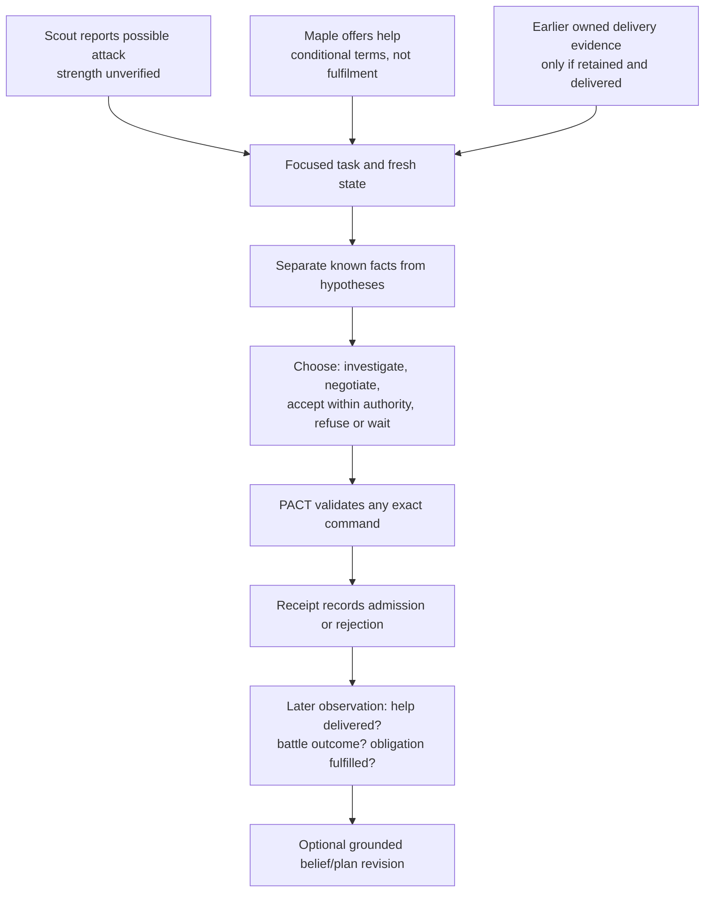

# Explaining the project to others

## A short introduction

PACT is a persistent kingdom game where humans set goals and authority, and agents make consequential decisions. Fleet is the independent software that runs those agents. We are making different reasoning architectures coexist so we can observe what works without replacing the baseline or forcing every agent to communicate, ally or fight.

The important engineering work is around the model: reliable observations, bounded work, memory with evidence, permissions, receipts, recovery and inspection. We have made substantial progress on that platform. Current diagnostics still expose weak memory use and reasoning, so we do not claim autonomous strategic competence.

## A two-minute explanation

1. **The environment has consequences.** Resources, time, obligations and other kingdoms matter. PACT enforces them through ordinary game rules.
2. **The controller can vary.** A simple loop, a focused event-driven engine, cognition or a future supported specialist coordinator can organize decisions differently. Model choice is separate.
3. **Knowledge and authority are distinct.** An agent can believe a peer may help, but cannot treat a promise as a delivered army or approve its own exception.
4. **We observe the entire path.** What was observed, saved, retrieved, delivered to the model, proposed, committed and later fulfilled are separate records.
5. **The findings changed the design priorities.** Valid JSON did not guarantee good arithmetic; saved memory did not guarantee recall; a focused query mattered much more than compact formatting in the latest helper comparison.

## A ten-minute walkthrough

| Time | Topic | Show |
|---|---|---|
| 0–1 min | Product purpose and ordinary consequences | [Handbook diagram](README.md) |
| 1–3 min | Game truth versus agent interpretation; two independent systems | [Architecture](architecture.md) |
| 3–5 min | Preserved baseline, events, cognition and bounded specialists | [Design decisions](design-decisions.md) |
| 5–8 min | Actual experiments, failed hypotheses and corrected audit | [Findings](findings.md), [journey](journey.md) |
| 8–10 min | Installed/source distinction and next useful milestone | [Current state](current-state.md) |

## Synthetic example: threat and offer of help

This is an explanatory scenario, not a claimed successful live episode. Maple is an invented peer. PACT supplies only information this kingdom is authorized to see; Fleet does not receive an omniscient map.

The agent may think Maple is reliable, uncertain or opportunistic, but must retain the supporting evidence and alternative interpretation. Delivered help followed by a lost battle does not prove betrayal. Choosing silence may be sensible. No forced alliance or trust score supplies the answer. Current source supports the structures; diagnostics do not prove agents consistently reason this way. PACT cannot currently run the F6 specialist protocol.

## Claims we can and cannot make

| Supported statement | Avoid claiming |
|---|---|
| Multiple engine packages coexist with the original path | More agents are inherently more intelligent |
| Generic adapters and a synthetic second environment exercise separation | Fleet already works with every game |
| Actual Nemotron handled a defined synthetic protocol in both modes | Both modes are strategically ready for live play |
| Focused queries improved selection on 8 paired examples | Laya is universally accurate or its score proves truth |
| Four legacy memory records were persisted in diagnostics | Four useful memories were successfully used later |
| One saved memory's next-turn omission was exactly reproduced | Every memory always disappears |
| The game exposes threats, needs and relationships | Agents have demonstrated consciousness or a survival instinct |
| Source was committed/published | Services were deployed or agents enabled |

## Glossary

| Term | Meaning here |
|---|---|
| Model | The inference system producing a response |
| Engine/profile | The versioned organization of agent decisions and optional cognition |
| Actor/agent identity | Stable controller identity bound to an authorized account/entity |
| Cohort | Group sharing selected configuration and allowance; not automatically an independent study |
| Environment adapter | Reviewed translation of authenticated game facts/actions into generic contracts |
| Binding | Opaque environment/account/actor/entity association; not a credential |
| Task | Durable focused work with sources, revision, eligibility and wake/deadline state |
| Event | Scoped indication of change; not permission or an inference grant |
| Evidence | Owned original observation with source/time; incomplete visibility remains explicit |
| Belief | Subjective source-linked hypothesis with alternatives, not world truth |
| Memory | Stored model interpretation or bounded note; persistence alone is not recall |
| Prediction | Recorded expectation tested against later appropriate evidence |
| Plan | Structured intended steps/dependencies/waits; not proof actions happened |
| Receipt | Authoritative result for one exact command; admission differs from eventual fulfilment |
| Fence/lease | Mechanism preventing stale or conflicting execution; not extra authority |
| Reservation | Conservative counted allocation before a call; separate from reported usage |
| Unknown usage | A dispatched execution whose spend cannot be established; allocation remains |
| Qualification | Acceptance against a specific versioned protocol, not a universal quality badge |

## Sharing evidence responsibly

Use the handbook and aggregate tables first. Do not share keys, `.env` files, private exports, decrypted model traces or real correspondence. A screenshot can reveal account or peer information. Synthetic names/examples should stay labelled. Link to dated evidence, explain assistance/confounds and distinguish proposed work from measured results. See [operations and privacy](operations.md).
