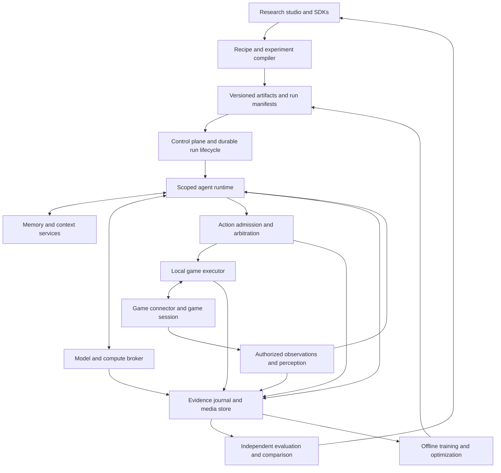

# Fleet target architecture for configurable game agents

30 October 2026. Proposed end state for architectural review, assuming migration can happen immediately. This is not an implementation assignment, a deployment claim, or a phased migration plan. The [selected tooling list](agent-engineering-tooling-20261030.md) remains the record of the six tools the owner selected for planning.

The subsequent [PACT-focused migration plan](../superpowers/plans/2026-10-30-pact-research-engine.md) implements a narrower proposed release with scoped Python workers, Temporal, evidence and research tools. It deliberately defers this document's cross-game/general perception/control scope. Follow its linked design for current release decisions; the broader vision remains future work.

## Mission and product boundary

Fleet enables researchers and game developers to compose, run, inspect, and compare agents across many kinds of video games. An agent can decide, advise, perceive, plan, execute a script, follow a learned policy, or combine those behaviors. Its intelligence, memory, tools, action authority, and learning policy are independently configurable.

The target includes structured game APIs, instrumented game engines, and visual/audio interfaces with ordinary controller input. It covers episodic and persistent worlds, turn-based and simultaneous play, and fast local control. Supporting a connection is separate from demonstrating competent play. An unfamiliar game can still require a connector, action mapping, perception work, training, or human instruction; no library reviewed establishes competent play in every game.

This architecture makes configuration, validation, visibility, and replacement first-class product capabilities. It does not assume that LLMs outperform scripts, that more agents outperform one agent, or that the current Fleet implementation deserves to remain because it already exists. PACT is one environment integration, not the domain model of the platform.

The initial interface assumption is that developers can provide a legitimate integration or the user can provide an accessible local game session. Native consoles, inaccessible controls, and unsupported capture/injection paths require separate adapters. Research-only oracle access is never silently exposed to a playing agent.

## Architectural choice and unavoidable tradeoffs

| Approach | Strength | Cost or restriction | Assessment |
| --- | --- | --- | --- |
| Center the platform on one agent framework | Integrated authoring and fewer boundaries to build. | The framework's agent lifecycle, memory, and execution abstractions shape the product; non-LLM and fast policies may be awkward. | A useful reference engine, not the platform contract. |
| Assemble independent services for every feature | Broad access to specialized tools. | Distributed state ownership, compounded retries, extra operations, and difficult causal attribution. | Specialization is useful, but not every module should become a service. |
| Own a small research/runtime kernel with replaceable workers | Independent experiments, games, policies, memory, and inference backends. | Fleet must maintain contracts, conformance tests, scoped execution, and evidence provenance. | Recommended target architecture. |

No design eliminates future losses. Extensibility adds interfaces; isolation adds boundary costs; recording adds storage; durable execution adds operational machinery. The aim is to make these costs explicit and keep changes local. A supported replacement must be able to consume exported state, pass conformance tests, and recover an interrupted owned fixture without relying on the old implementation.

Selection uses correctness requirements first, then measured capability, customization, visibility, replacement cost, latency/resource use, maintenance, and licensing. Scores should be filled from experiments, not invented from documentation or popularity. An attractive feature cannot compensate for incorrect authority or irrecoverable data.

## Logical system



These are logical responsibilities, not a requirement for twelve independently deployed services. Modules can share a process when isolation and resource requirements permit. Public and cross-language boundaries remain versioned. Local frame processing and control do not require a network round trip to the control plane.

## Ownership of state

| State | Authoritative owner |
| --- | --- |
| Resources, game rules, actual game outcomes | Game server/engine; a pixel observer has estimates rather than authoritative hidden state. |
| Run lifecycle, workflow waits, cancellation progress | Durable orchestration service through the Fleet lifecycle adapter. |
| Budgets, reservations, dispatch evidence, usage, logical command identities | Fleet transactional ledger. |
| Agent working state and checkpoint versions | Scoped runtime checkpoint service. Framework checkpoints are scoped implementation state. |
| Retained observations, outputs, media, source references | Fleet evidence service, subject to its retention policy. |
| Memories, beliefs, plans, embeddings, graph edges | Versioned projections/agent state with explicit provenance and access scope. |
| Results and statistical conclusions | Evaluation artifacts linked to the exact run inputs and evaluator version. |

PostgreSQL and an outbox coordinate Fleet-owned transactional updates. Temporal signals and worker dispatch are delivered idempotently from those records; there is no assumed transaction spanning PostgreSQL, Temporal, a model provider, and a game. Reconciliation repairs missing delivery by original identity. It does not invent a successful effect.

## Environment contracts and game integration

An Environment Descriptor declares observation modalities and visibility, action spaces, ordering, clocks, lifecycle, acknowledgement semantics, reset/save/restore capabilities, resource requirements, and supported evaluation hooks. Every connection is bound to a game build, world/session incarnation, actor identity, connector version, and authority scope.

| Integration | Inputs and outputs | Important distinction |
| --- | --- | --- |
| Structured API | Authorized state/events and typed commands/receipts. | Can support exact reconciliation when the game provides it. PACT belongs here. |
| Engine instrumentation | Engine sensors, simulation steps, entities, and native actions. | Privileged training sensors and player-visible sensors are different observation profiles. |
| Visual/audio control | Timestamped frames/audio and keyboard/mouse/gamepad actions. | Successful input dispatch is not proof that the intended in-game effect occurred. |

Expose Gymnasium, PettingZoo, Unity ML-Agents, and OpenSpiel facades where their contracts match. Gymnasium distinguishes task termination from external truncation [S1]. PettingZoo distinguishes sequential AEC and simultaneous Parallel execution [S2]. Preserve those distinctions rather than forcing every game into a synchronous single-agent step API.

Persistent games may not expose reset, pause, rewind, or deterministic stepping. Advertising a capability is a tested property of a connector and selected game mode, not an assumption inherited from a training library. An agent checkpoint is not a game save. A continuous-control environment may have no formal scalar reward; evaluation can use declared outcomes, constraints, and human annotations.

Perception adapters translate available inputs into typed observations without erasing raw evidence. OCR, tracking, object detection, visual-language interpretation, and audio processing are interchangeable workers. Derived facts carry source frame/event IDs, timestamps, uncertainty, validity, and model version. Evaluation access to hidden state uses another principal and another data path.

## Three execution timescales

| Loop | Responsibility | Placement |
| --- | --- | --- |
| Fast control | Input tracking, low-latency learned/scripted control, action chunks, interruption, and watchdogs. | Beside the game process or inside its engine. |
| Tactical behavior | Skill selection, behavior trees, local replanning, scene changes, and action verification. | Local worker or nearby inference worker. |
| Deliberation | Goals, dialogue, retrieval, negotiation, reflection, and long-horizon planning. | Scoped research/agent workers with durable lifecycle. |

The actual frequency and deadline are part of the environment/recipe, not universal platform constants. An LLM can select a goal while a local policy performs the repeated movement. Simple scripts and learned policies can also be complete agents without any LLM call. Temporal coordinates sessions and long-lived work; it is not the frame loop. XState is available for explicit statechart policies and bounded local lifecycles; it does not become a second global workflow engine.

Use wall time for external grants, monotonic time for local deadlines, and environment time/frame numbers for game behavior. Record explicit mappings and uncertainty. Pausing the game does not extend a provider budget or a human authorization window. A watchdog's response—neutral input, input release, control handoff, or session stop—is declared and connector-tested; Fleet cannot promise to pause a game that cannot pause.

## Agent composition

An Agent Definition is an immutable, versioned composition of perception, working state, memory, retrieval, context, decision policy, skills, learning policy, and action access. A compiler validates compatible ports and produces a fully resolved run manifest. YAML, UI forms, and SDK builders are frontends for that same manifest.

| Role or policy | Example behavior | Action access |
| --- | --- | --- |
| Scripted actor | Execute a reviewed finite script with fresh preconditions. | Only the declared action scope. |
| Reactive actor | Respond to current events through rules or a statechart. | Declared actor control. |
| Learned actor | Infer controller actions from observations using a trained policy. | Declared controls with local deadline checks. |
| Deliberative actor | Select reads/actions with an LLM, VLM, search algorithm, or planner. | Proposals through admission. |
| Helper | Retrieve, explain, suggest, or report to another actor or human. | Read/advisory by default. |
| Thinker or critic | Produce plans, predictions, objections, or tests. | Advisory unless separately granted action access. |
| Specialist team | Addressed roles with scoped memory and explicit communication. | One configured arbitration owner for each controlled actor. |
| Hybrid | Compose a planner, tactical skills, and a fast policy. | Explicit handoffs and cancellation, never competing implicit controllers. |

Roles do not require human-like internal reasoning or a language model. A critic cannot approve its own proposal or convert a prediction into a fact. Multiple simulated people, multiple reasoning roles within one player, and multiple neural modules are different experimental configurations.

A recipe specifies exact module/model versions, dependencies, observation profile, trigger policy, memory namespaces, communication graph, arbitration, concurrency, time domains, budgets, checkpoint format, learning mode, and failure behavior. It also declares whether fallback is allowed and what counts as another attempt. A fallback is a logged treatment change, not silent model substitution.

The shared protocol has explicit Observation, DecisionRequest, Proposal, ActionDispatch, Outcome, Usage, and Checkpoint records. Each carries applicable run/world/actor identities, schema/module versions, clock domain, ordering/epoch, visibility profile, and source references. Structured quantities preserve units and exact integer/decimal representations. Outcomes distinguish proposed, admitted, dispatched, acknowledged, observed, predicted, rejected, and uncertain states; a connector only emits the states it can actually establish. Loops and subagent fan-out require declared bounds and share the parent's resource grant.

Example target recipe, intentionally illustrative rather than an executable existing configuration:

```yaml
agent:
  recipe: hybrid-helper-player
  observation_profile: player-visible
  roles:
    actor:
      planner: bounded-language-policy
      executor: local-learned-policy
      action_scope: player-controls
    helper:
      policy: retrieval-and-advice
      action_scope: none
  memory:
    episodic: source-linked-outcomes
    semantic: versioned-claims
    procedural: qualified-skills
    prospective: pending-commitments
  retrieval:
    candidate_sources: [exact-lookup, lexical, dense]
    fusion: reciprocal-rank
    reranker: pinned-cross-encoder
  learning:
    mode: frozen-during-evaluation
  control:
    arbiter: actor
    on_deadline: connector-declared-neutral-input
```

## Action admission and external effects

Fleet owns a narrow effect kernel: scoped identity, original operation IDs, resource admission, deadlines, control arbitration, cancellation, usage settlement, and reconciliation. Agent frameworks call those ports. They do not receive game credentials, arbitrary ledger access, or an unmetered provider path.

For structured APIs, record the exact logical command before dispatch, preserve its identity across retries, and reconcile its original receipt. Revalidate state/authority when admission requires it. The game performs final authorization and rule enforcement. A quote is a projection, not a permission grant or completed effect.

For controller input, use session/control epochs, sequence numbers, observation references, bounded action chunks, and expiry. The edge executor rejects obsolete owners and duplicate/stale chunks. After an ambiguous interruption, do not replay a button press merely because a workflow retries. Reobserve or stop under the declared policy. Exactly-once in-game effects cannot be guaranteed by a generic input adapter.

Temporal retries Activities, so side-effect operations need application-level idempotency [S3]. Framework node retry and checkpoint behavior also needs explicit review: LangGraph documents that resuming an interrupt restarts the node, including preceding code [S4]. Only one layer owns the retry policy for each logical operation; SDK retries, framework retries, orchestration retries, and game retries cannot multiply invisibly.

For fast control, local action/evidence journaling has a declared durability/performance policy. Research recording uses bounded local spools and backpressure. A full or failed spool cannot silently produce a complete-looking dataset; either stop or mark the declared degraded-recording interval. Long-lived transactions and remote SQL writes are not required per rendered frame.

## Memory, context, and knowledge

Use a source journal plus replaceable memory policies. The journal stores what was actually observed, requested, output, and acknowledged. Knowledge and skills are derived views, not replacements for the original evidence. Raw data retention is finite and access-controlled; source deletion propagates into memories, embeddings, graph projections, exports, and backups under the defined retention rules.

| Memory | Representation | Validation |
| --- | --- | --- |
| Working | Current operation state and bounded scratch data. | Task scope, version, and restart consistency. |
| Episodic | Objective, selected action, native result, later outcome, source links. | Admission and later completion remain distinct. |
| Semantic | Claims, entities, preferences, and beliefs. | Source, speaker, uncertainty, validity interval, and supersession. |
| Procedural | Qualified reusable skills and preconditions. | Version, dependency checks, tests, bounded execution, and revocation. |
| Prospective | Pending commitments, wake conditions, and deadlines. | Explicit clock domain; intentions never become queued authority. |
| Relational | Time-aware links among actors, statements, agreements, and outcomes. | Visibility scope and provenance; extracted relationships remain claims. |

The default memory substrate is PostgreSQL plus object storage. LangMem is a reference extraction/consolidation policy [S5], integrated through Fleet's model and state ports. Mem0 is a competing memory backend [S6]. Graphiti is an optional temporal-graph projection/backend [S7]. Letta is an alternative complete stateful-agent implementation [S8]. They are not all authoritative stores for the same agent at once.

Indexes are access-scoped before candidate retrieval and ranking. Embeddings and summaries remain sensitive derived data. Search over encrypted retained records requires a deliberate design—authorized derived indexes, scoped decrypt-and-rank, or another reviewed approach—not a promise that pgvector searches ciphertext. Indexes must be rebuildable from authorized sources, and an unavailable index must not manufacture missing history.

The context compiler performs typed selection and budgeting: current observations and authority; requested answers; outstanding commitments; relevant outcomes; then optional history. It emits the final input, schema, tokenizer/model binding, byte and token measures, omission coverage, and delivered source IDs. Current state and exact contract terms remain lossless. Model-based compression such as LLMLingua is restricted to declared optional content and must be tested for semantic loss [S9]. LlamaIndex's prioritized memory blocks are a useful alternative context policy [S10].

The retrieval baseline combines exact IDs/structured lookup, PostgreSQL lexical search, and pgvector dense search; PostgreSQL's standard text rank is not BM25. Optional BM25S provides a distinct lexical baseline. Reciprocal Rank Fusion combines rankings, and Sentence Transformers supplies a bounded cross-encoder reranker [S11]. Temporal filtering, diversity, and graph traversal are configurable. Measure relevant-source recall, precision, final delivery, obsolete evidence, and downstream outcomes separately. More stored memories and longer contexts are not success metrics.

## Policies and learning

Support scripts, statecharts, behavior trees, symbolic planners, search, recurrent neural policies, imitation learning, reinforcement learning, LLM/VLM reasoning, and combinations. Some require a simulator or an observation history; the recipe compiler refuses unsupported combinations. A learned world model offers predictions with uncertainty, not the real game state.

Pydantic AI is the reference typed LLM worker, with its own model requests/tools redirected through Fleet ports [S12]. XState and BehaviorTree.CPP provide different control-policy implementations. OR-Tools supplies optional integer constraint solving [S13]. OpenSpiel contributes search/game-theory environments and algorithms where its game representation applies [S14].

PyTorch and TorchRL provide the reference custom learned-policy/training path; collectors, replay buffers, and recurrent state belong in this lane [S15]. Stable-Baselines3 supplies straightforward algorithm baselines [S16]. Ray/RLlib is an optional distributed and multi-agent training/execution backend [S17], not another owner of live-world reset/recovery policy. Its environment restarting features must respect the connector's lifecycle capabilities.

Training and optimization are isolated jobs. Dataset selection, reward definitions, demonstrations, behavior policies, environment builds, and checkpoints are versioned. DSPy optimizes prompts/examples in this lane [S18]. Training outputs become candidate artifacts, pass evaluation, then enter the registry. They do not silently alter a running frozen study. An explicitly adaptive study can learn during execution, but its adaptation rule and every resulting artifact are part of the experimental treatment.

## Compute and resource brokerage

All remote inference, local policy execution, embeddings, reranking, extraction, summarization, reflection, skill learning, and world-model simulation have resource identities and accounting. Policies declare reservations for their applicable units: calls/tokens, GPU time/memory, frames, CPU time, storage, or external executions. Missing token usage for a token-reporting provider remains unknown; a script has no fictional token counter.

The broker knows model/tokenizer/capabilities, output controls, request limits, provider cancellation behavior, queue policy, and capacity. It admits work only when the declared deadline and resource policy permit. Cache demand and GPU affinity matter in addition to request counts. Old unknown allocations keep their original reservations and cannot be cleared by replacing a provider.

Use vLLM for compatible language/vision-language serving; PyTorch for research-native policies; ONNX Runtime for compatible exported inference with numerical/behavioral parity tests [S19]. Export compatibility is model-dependent. A server crash or a cancellation request is not proof of zero work. Resource slots remain owned until execution settlement or an explicit uncertainty boundary.

## Research and validation plane

Experiments compile into immutable manifests including hypothesis, protocol, splits, environments, builds, actors, observation privileges, models, weights, prompts, tools, memory policies, evaluators, resource limits, seeds, stopping rules, and configuration/artifact hashes. Keep a separate display name so researchers can navigate without weakening identity.

Validation has several independent layers:

1. Protocol and schema conformance, including SDK compatibility and numeric precision.
2. Property/state-machine testing of lifecycle, cancellation, resource conservation, identity, and recovery. Use fast-check and Hypothesis as complementary clients of the same contract [S20].
3. Targeted model checking of small, consequential concurrent protocols with TLA+/TLC, without claiming that a model proves the implementation correct [S21].
4. Environment conformance: view restrictions, timing, stepping, reset behavior, action ordering, receipts, and result semantics.
5. Repeated behavioral tasks with native outcomes and failure-path cases. Promptfoo is one runner for language-heavy components, not the only evaluator for a video-game episode [S22].
6. Held-out game/task/build/opponent conditions; perturbations, long horizons, outages, and incomplete observations.
7. Operational recovery and resource/latency tests on the declared deployment profile.

Correctness combines game-derived metrics, task assertions, evidence checks, calibrated perception measures, and human adjudication where needed. LLM judges are separately evaluated secondary signals. They do not establish consent, resources, delivery, or victory merely by endorsing prose. A shadow agent's unexecuted proposal has no observed counterfactual outcome; branching needs a resettable fixture/simulator and is labelled accordingly.

Compare repeated success, time to failure, survival/progress, cooperation/contract fulfillment where applicable, false claims, violations, memory precision/recall, useful recovery, latency distributions, and all resource costs. Use task-appropriate metrics rather than one universal intelligence score. Report confidence intervals and failed/unstarted denominators. The statistical-precipice study supports interval estimates and robust aggregates [S23]; its associated rliable repository is archived, so adopt reviewed methods or a pinned maintained implementation rather than assuming ongoing upstream maintenance [S24].

Record every repeated attempt, including failures and timeouts, instead of only the best result. Report both per-attempt success and consistency across repeated trials. Any cross-game aggregate declares its task weighting and reward normalization; raw scores from unrelated games are not directly comparable. Memory evaluation separately checks retrieval of required sources, validity of derived claims, and whether the complete final decision used correct evidence.

Shared worlds create interference. Randomize and analyze at world/session or other defensible experimental units, not by pretending every turn is independent. Provide both equal-resource comparisons and equal-elapsed-opportunity comparisons when the question needs them. Report unequal compute and queue exposure. Frozen holdouts and preregistered stopping rules reduce selection bias; matched seeds do not guarantee deterministic models, GPUs, or games. A game unseen in Fleet's training split is not necessarily unseen in a foundation model's unknown pretraining data.

Replay has three distinct modes: forensic playback of recorded events without effects; policy reevaluation against fixed historical observations without claiming new game outcomes; and fresh branching from a supported saved world. Only the last can produce new consequences, and it creates a new run identity. None silently replays original live commands.

## Evidence, observability, and product experience

PostgreSQL stores manifests, authority, accounting, source metadata, command journals, and memory records. An object store holds content-addressed authorized media, checkpoints, full request/response artifacts, and datasets. Parquet/Arrow and documented JSON/Protobuf envelopes make exports usable without a particular vendor UI. Large media is referenced by hashes and synchronized timestamps rather than copied into workflow histories.

OpenTelemetry spans correlate the connector, perception, context, retrieval, decision, broker, action, and outcome stages [S25]. Durable research evidence is distinct from sampled operational traces. Absence of a sampled span is not evidence of no event. MLflow provides experiment/model tracking projections and artifact navigation [S26]; it does not become another budget ledger. Langfuse is an optional inspection frontend, not mandatory infrastructure or the sole store of private prompts.

The studio presents an agent composer, game/connector certification matrix, experiment designer, synchronized video/event timeline, evidence and context inspector, memory lineage, declared decisions, action/receipt/outcome inspector, resource/queue dashboard, dataset browser, and comparison reports. Show unavailable measurements explicitly. Visibility means access to recorded inputs, outputs, state, and decision summaries; it does not imply access to a closed model's hidden internal reasoning or proof that a rationale is faithful.

A researcher can fork an agent definition, swap one module, validate compatibility, and run a declared comparison. Editing a recipe creates a new version. Inspecting a run or opening its UI starts no inference. Human takeover changes the control epoch and invalidates old inputs/commands. Helpers can remain read-only while the human controls the game.

## Extension and isolation boundaries

Custom algorithms run in reviewed packages or isolated worker processes/containers with declared filesystem, network, device, and tool capabilities. The game connector and local input executor have narrowly scoped native access; a reasoning plugin does not inherit that access. Model/provider credentials, game grants, operator identities, and storage keys remain separate from model context. Worker code cannot gain authority by requesting a different manifest or claiming to be a reviewer.

An authenticated researcher or operator selects scopes and observation privileges. The runtime rechecks them at each broker, memory, and action boundary. Peer messages, screenshots, OCR text, and retrieved material are untrusted inputs rather than host instructions. Schema-valid content can still be false or adversarial. Cross-agent memory sharing is an explicit treatment with named readers and writers, not a global convenience store.

Connector certification reports capture quality, control semantics, action verification, lifecycle support, observation restrictions, and measured closed-loop task results separately. Passing an SDK contract does not certify a game, and passing one game task does not certify cross-game transfer. Plugins, game builds, model checkpoints, and deployment changes invalidate the affected qualification evidence according to declared dependencies.

## Reference implementation and deployment

These are concrete proposed bindings, not performance results or declarations that alternatives are inferior:

| Responsibility | Reference binding | Why and replacement boundary |
| --- | --- | --- |
| Studio | TypeScript/React. | Established interactive UI ecosystem; consumes public control/read APIs. |
| Control API and experiment compiler | Python/FastAPI/Pydantic with psycopg/PostgreSQL [S27]. | Direct access to research tooling and typed validation; no frame-loop responsibility. A .NET, Go, Java, Rust, or TypeScript implementation can replace it against the same contracts. |
| Durable lifecycle | Temporal with Fleet lifecycle/operation adapters. | Session/task durability and explicit recovery; adds a service and workflow versioning burden. |
| Effect/accounting kernel | Small Fleet-owned transactional services. | Domain-specific guarantees stay visible instead of hidden in framework defaults. |
| Local capture/control executor | Rust reference process; C#/C++ engine-native plugins where appropriate. | Local I/O, bounded buffers, epochs, and native integration; measured deadlines still determine suitability. |
| Language-agent worker | Python/Pydantic AI. | Typed tools and research ecosystem; a worker, not the platform contract. |
| Other architecture workers | .NET/Microsoft Agent Framework, Google ADK, LangGraph, Letta, or Rust/Rig behind the same SDK. | First-class alternative recipes with explicit state/retry ownership, not all loaded into every run. |
| Learned policies | PyTorch/TorchRL; compatible ONNX Runtime deployment. | Research flexibility plus an export path; numerical and behavioral changes are tested. |
| Memory/retrieval | PostgreSQL/pgvector, scoped object evidence, LangMem policy, Sentence Transformers. | Replaceable policies and rebuildable indexes. Graphiti/Mem0/LlamaIndex/Haystack are alternative recipes/backends. |
| Scientific tooling | fast-check, Hypothesis, Promptfoo, DSPy, MLflow, statistical analysis. | Different scopes with shared immutable manifests and evidence IDs. |
| Cross-language transport | Protobuf/gRPC for remote control/worker contracts; JSON Schema for recipe/config validation. | Generated clients, explicit schema evolution, and contract tests; Buf checks wire/schema breaking changes [S28]. |

Python is selected here for research leverage, not because Fleet must become Python-only. Rust is selected for a reference local I/O component, not because memory safety proves controller correctness or faster inference. Native plugin language follows the engine. Multi-language support incurs SDK and operating costs, so a recipe uses only the runtimes its modules need.

A workstation deployment can co-locate the API, workflow workers, retrieval, database, and local executor. A cluster deployment separates CPU research workers, GPU serving/training, and game hosts using the same contracts. Containers isolate compatible workers; native game capture can run outside containers. CPU, GPU, and game-host placement are explicit. Kubernetes and Ray are deployment/execution backends when their scheduling capabilities are required, not prerequisites for an individual research session.

Compatibility bindings for current PACT/Fleet histories retain identities, grants, budgets, exact pending commands, schedules, terminal states, uncertainty, and encrypted evidence. An instantaneous code migration would not reopen a finished run, resolve unknown usage, or reset a persistent game. Runtime restart and experiment restart are distinct operations even in the imagined end state.

## Tool decisions and exit conditions

| Choice | Benefit sought | What we give up or must maintain | Exit requirement |
| --- | --- | --- | --- |
| Small Fleet kernel | Independent authority, accounting, and experiments. | Custom protocol and recovery work. | Another implementation passes the same conformance and interrupted-run tests. |
| Temporal | Durable long-lived lifecycle. | Operational overhead, history constraints, deterministic workflow/versioning discipline. | Export Fleet lifecycle/operation records; a replacement may require workflow-specific transformation and cutover at explicit checkpoints, and reconciles rather than replaying effects. |
| Pydantic AI reference worker | Typed agent authoring and ecosystem reuse. | Adapter work and Python coupling inside that worker. | Reproduce behavior using the same observations, limits, tools, and outcome evaluator. |
| PostgreSQL/pgvector baseline | Transactional state plus integrated retrieval. | Index tuning, filtered approximate-search recall, and scale limits. | Export originals/metadata and rebuild indexes in another store. |
| LangMem memory policy | Reusable extraction and consolidation. | Extra model work, inference errors, and dependency evolution. | Export source-linked memories and compare another policy on held-out tasks. |
| Graphiti optional projection | Temporal relationship queries. | Graph infrastructure and extraction/tenancy work. | Rebuild the graph from retained authorized sources; losing the projection loses no authoritative game fact. |
| OpenTelemetry plus MLflow | Cross-component visibility and experiment navigation. | Instrumentation, storage, and versioned conventions. | Portable exports and stable Fleet IDs without either UI. |
| DSPy | Measured prompt/example optimization. | Compute cost and overfitting risk. | Frozen exported artifacts remain runnable without the optimizer. |
| Local native controller | Fast independent control and watchdogs. | Platform-specific code and uncertainty in observed effects. | Connector conformance, identical input mapping, and retained timing/action records. |
| Multi-language workers | Access to stronger libraries and specialized execution. | Boundary, packaging, debugging, and SDK maintenance costs. | Contract fixtures and generated clients, rather than language-specific private state. |

No framework's memory/checkpoint schema is Fleet's only export format. No hosted dashboard is necessary to interpret an experiment. Models, code, datasets, and plugins have separately recorded licenses and provenance; an open code repository does not imply unrestricted model weights or training data. Dependencies are pinned with SBOM/provenance, compatibility tests, and a reviewed upgrade path.

Portable data does not imply identical behavior after a component change. Framework-private checkpoints, learned model states, tokenizer differences, and active workflow histories may need explicit conversion or a new run boundary. Replacement tests must identify what is preserved exactly, what is re-derived, and what needs new qualification. These limitations are the reason to retain original evidence and stable contracts, not a claim that contracts eliminate migration work.

## Lessons from external systems

| Source | What it demonstrates or supplies | Fleet implication and limit |
| --- | --- | --- |
| Google DeepMind SIMA 2 [S29] | Research on instruction-following and interaction in visual 3D worlds. | Design a visual-control interface and hierarchical policies; it is not proof of a downloadable universal Fleet controller. |
| NVIDIA/MineDojo NitroGen [S30] | A vision-to-gamepad model and evaluation/code artifacts. The model card says gamepad-oriented games are a better fit than mouse/keyboard-heavy games and describes Windows play tooling. | Treat it as a specific motor-policy candidate, with pinned model/license/control requirements, not universal competence. |
| Microsoft Research Muse/WHAM [S31] | Action-conditioned gameplay modeling and generation research. | Keep a world-model interface, with predicted and real outcomes explicitly separated. |
| Unity ML-Agents [S32] | Engine instrumentation and RL/imitation integration. | Support native engine connectors alongside external capture; Unity support alone does not certify other engines. |
| Farama Gymnasium/PettingZoo [S1, S2] | Established single- and multi-agent environment semantics. | Reuse standards where they fit and extend explicit capabilities for persistent/asynchronous games. |
| OpenSpiel [S14] | C++/Python game research interfaces and algorithms. | Provide rigorous search/game-theory baselines where its model applies. |
| PyTorch/TorchRL and Ray/RLlib [S15, S17] | Research-policy components, collection, training, and distributed execution. | Distinguish learned-policy infrastructure from language-agent frameworks and live-world authority. |

These are primary technical reports and project documentation, not independent reproductions in Fleet. Vendor claims establish candidate features, not the scores in a Fleet comparison. Their architectures suggest interfaces and baselines; accepting a component requires measured evidence under the chosen game, model, observation profile, and hardware.

## Acceptance of the target architecture

The platform should demonstrate: one scripted agent, one non-language learned policy, one language-policy agent, and one hybrid; a read-only helper; a structured persistent game and an instrumented or visual episodic game; at least two language implementations of a worker; module replacement without changing the game connector; source-linked memory retrieval; complete accounting of helper work; and an interrupted-run recovery that produces no duplicate structured effects or blind controller-input replay.

It should also export and reimport a run's permitted artifacts, reconstruct a memory index, compare independent evaluator results, keep hidden oracle state out of agent observations, and report uncertainty/recording gaps honestly. These are architectural acceptance criteria, not completed results. Game-specific quality and throughput remain separate acceptance dimensions.

The remaining decisions are empirical: connector/hardware latency targets, reference framework versions, memory policies that actually help each task, licensing of selected checkpoints, and the operating cost of each deployment profile. The recommendation defines how those choices fit together and can change; it does not assign fabricated winners.

## Sources

- S1: [Gymnasium environment API](https://gymnasium.farama.org/main/api/env/).
- S2: [PettingZoo APIs](https://pettingzoo.farama.org/index.html).
- S3: [Temporal Activities and retry/idempotency behavior](https://docs.temporal.io/activities).
- S4: [LangGraph interrupts and node restart](https://docs.langchain.com/oss/javascript/langgraph/interrupts).
- S5: [LangMem](https://langchain-ai.github.io/langmem/).
- S6: [Mem0 OSS configuration and defaults](https://docs.mem0.ai/open-source/overview).
- S7: [Graphiti](https://github.com/getzep/graphiti).
- S8: [Letta memory](https://docs.letta.com/agent-sdk/memory).
- S9: [LLMLingua](https://github.com/microsoft/LLMLingua).
- S10: [LlamaIndex memory](https://developers.llamaindex.ai/python/framework/module_guides/deploying/agents/memory/).
- S11: [Sentence Transformers retrieval and reranking](https://sbert.net/examples/sentence_transformer/applications/retrieve_rerank/README.html).
- S12: [Pydantic AI](https://pydantic.dev/docs/ai/overview/).
- S13: [OR-Tools CP-SAT](https://developers.google.com/optimization/cp/cp_solver).
- S14: [OpenSpiel](https://github.com/google-deepmind/open_spiel).
- S15: [TorchRL](https://docs.pytorch.org/rl/stable/index.html).
- S16: [Stable-Baselines3](https://stable-baselines3.readthedocs.io/en/master/).
- S17: [Ray RLlib](https://docs.ray.io/en/latest/rllib/index.html).
- S18: [DSPy](https://github.com/stanfordnlp/dspy).
- S19: [ONNX Runtime](https://onnxruntime.ai/docs/).
- S20: [fast-check model-based testing](https://fast-check.dev/docs/advanced/model-based-testing/), [Hypothesis stateful testing](https://hypothesis.readthedocs.io/en/latest/stateful.html).
- S21: [TLA+/TLC tools](https://github.com/tlaplus/tlaplus).
- S22: [Promptfoo JavaScript assertions](https://www.promptfoo.dev/docs/configuration/expected-outputs/javascript/).
- S23: [Deep Reinforcement Learning at the Edge of the Statistical Precipice](https://arxiv.org/abs/2108.13264).
- S24: [Archived rliable repository](https://github.com/google-research/rliable).
- S25: [OpenTelemetry JavaScript](https://opentelemetry.io/docs/languages/js/).
- S26: [MLflow experiment tracking](https://mlflow.org/docs/latest/ml/tracking/).
- S27: [FastAPI](https://fastapi.tiangolo.com/), [psycopg](https://www.psycopg.org/psycopg3/docs/).
- S28: [gRPC contracts](https://grpc.io/docs/what-is-grpc/core-concepts/), [Buf breaking-change checks](https://buf.build/docs/breaking/).
- S29: [Google DeepMind SIMA 2](https://deepmind.google/blog/sima-2-an-agent-that-plays-reasons-and-learns-with-you-in-virtual-3d-worlds/).
- S30: [NVIDIA NitroGen model card](https://huggingface.co/nvidia/NitroGen), [code](https://github.com/MineDojo/NitroGen).
- S31: [Microsoft Research Muse](https://www.microsoft.com/en-us/research/blog/introducing-muse-our-first-generative-ai-model-designed-for-gameplay-ideation/).
- S32: [Unity ML-Agents](https://github.com/unity-Technologies/ml-agents).

Related candidates: [Microsoft Agent Framework](https://github.com/microsoft/agent-framework), [Google ADK](https://adk.dev/), [Rig](https://github.com/0xPlaygrounds/rig), [BehaviorTree.CPP](https://www.behaviortree.dev/), [pgvector hybrid search](https://github.com/pgvector/pgvector#hybrid-search), [BM25S](https://github.com/xhluca/bm25s).
