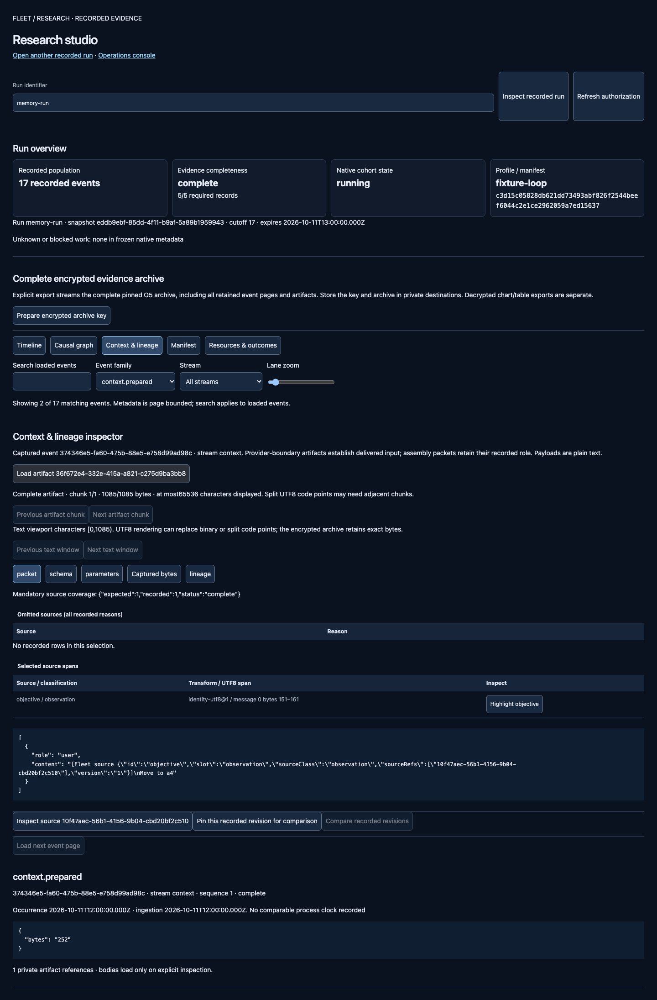

# PACT research Q1–Q4: implementation and blocked qualification

31 October 2026. Work is inline on Fleet `master`; PACT source is unchanged. The source deliverables are implemented and committed incrementally, but **the batch has not passed final qualification**. Linux image construction encountered disk exhaustion; Docker subsequently returned storage I/O errors. No Docker reset/restart/prune, retained-world operation, deployment, push, real model call or live enrollment was performed. Existing service health after that infrastructure fault has not been recertified.

[Machine-readable status and preservation hashes](qualification-20261031.json), [qualification guide](qualification.md), [release/package](release.md), [operational gates](operations.md).

## Delivered behavior

| Task | Implementation and actual acceptance |
| --- | --- |
| Q1 | Immutable scoped qualifications; exact manifest/capability/dependency/target bindings on each gate; expiry/completeness and non-disableable protections. Twenty deterministic pairwise/negative/risk obligations. Passing evidence cannot be reused by retagging an attestation or recompiling another manifest. Pure/property checks pass; the earlier native repository test passed. The final proof-binding hardening needs its SQL fixture rerun after Docker recovery. |
| Q2 | Owned pre041 synthetic data, twice-applied additive migrations, canonical row hashes, SQL+ciphertext restore and native archive verification passed. Distributed fault runner passed 32 tests in 8 files, including real local Temporal replay/restart, late settlement, original-command reconciliation, consent/retention, artifact and telemetry failure. Actual owned PostgreSQL connection termination and transaction abort retain full reservations. Final reruns are infrastructure blocked. |
| Q3 | Actual native synthetic source, memory, context, fake model action proposal, lost response, reconciled receipt, independently observed outcome and full archive; the actual studio renders that recorded dataset. Baseline/candidate comparisons retain missingness and no unsupported winner. All26 macOS browser checks passed. Recording benchmark orchestration and arithmetic guards exist, but **no accepted recording-overhead measurement is available**. Linux UI requalification is unavailable in this batch. |
| Q4 | Compiled inspection entry point, disabled execution, authenticated reads, blocked mutations, key/extension readiness, production dependency layout and owned Linux runner. Compiled macOS startup/restart and preservation checks passed. Linux package acceptance, Compose execution/config validation and actual-target installation remain blocked or ungranted. |

Source implementation is not installed-runtime, provider, strategic-effectiveness or blanket arbitrary-configuration acceptance. E4/KQ1 and historical operational gates retain their original status.

## Verification evidence

The final source checks include TypeScript, Biome error-level checks, build, import/ownership boundaries, generated-contract drift, Python tests and audit. The final root suite passed **1246 tests with23 platform skips**. The final pure configuration/protection/canonical suite passed5 tests with 2000 histories/property, seed 20261030. The latest macOS browser suite passed26 checks. Skips remain skips. Python passed 21 tests with 4 skips: three isolation probes require Linux containers and one real-weight artifact requires its own assignment. DSPy/MLflow emitted existing deprecation warnings; no weights were downloaded.

Earlier successful owned database checks, before Docker became unavailable:

- 32 distributed fault tests; 24 native/paired PACT tests across 8 files; 3 qualification/preservation/fault integrations; compiled-package test plus 2 maintenance integrations. These are separate runs with some overlap, not a summed count of distinct scenarios.
- 7 release property tests with 2000 histories/test, seed 20261030. The ledger histories use an independent reference model. The final pure configuration/property rerun is reported separately; no failed or unexecuted native gate is counted as passing.
- 77 legacy table projections retain identical canonical hashes after migration twice and restore. All original synthetic command/receipt IDs, encrypted grants/history, budgets, profiles, terminal states, queued work and schedule anchors are included. One unknown allocation retains 40000 tokens.
-The restored O5 archive verifies 2 events, 1 artifact,0 gaps. The worked native product trace verifies 17 events, 13 artifacts, 11427 plaintext bytes, 1 fake call and1 confirmed effect with 0 archive gaps. A lost response does not produce a second effect. A receipt does not by itself prove objective completion; the fixture observes the resulting state independently.

The native kernel chain uses the existing synthetic board fixture and PACT-shaped independent evaluation. The paired PACT suite separately exercises real public PACT handlers against fresh owned schemas. Neither path accesses a retained world or qualifies another actual game.

## Findings fixed during qualification

1. Thirty-day source deadlines overflowed the browser's signed 32-bit timer and immediately removed valid evidence. Bounded rescheduling now preserves both current and pinned context until the actual expiry; invalid deadlines still clear immediately.
2. Compiled output omitted the external metric catalog JSON. Build now copies the exact owned catalog into `dist/config/research`, including normal and research Docker packaging.
3. Real composition registered 33 maintenance hooks against the 32-hook bound. Two agent-field expiry scans now share one bounded update; fresh sibling fields remain intact. The guard was retained.
4. Reassessed invalidations could not be appended because their returned decisions lacked assessment provenance. They are now authenticated blocked decisions; arbitrary edited copies still cannot be recorded.
5. Gate proofs now bind scope, target and all input digests independently of the outer attestation. Changing its labels or recompiling inputs cannot recycle old successful results.

Author review was inline, following the repository's no-delegation instruction. There was no independent reviewer. Tests for every repaired behavior were observed failing before the fix and passing afterward; missing-module REDs were used for new scaffolding.

## Performance and visualization

Recording benchmark: 1000 operations/mode, 50 ms fake provider, concurrency 4, warm-up plus five alternating pairs. No real result is published because Linux construction failed. Limits remain 10% mean-p95 service overhead and 15% peak-RSS increase. Missing/nonfinite samples, incorrect operation/event counts, wrong platform and invalid repetition designs block the arithmetic assessment. Raw CPU/RSS/SQL/artifact/container measurements will be recorded when the runner can execute; optional Temporal/telemetry backend throughput is outside that benchmark's scope.

Current macOS Chromium 156.0.8078.4 large-run fixture: 100000 events/16 MiB artifact. Desktop interaction 42.7ms and page API p95 2.15ms; mobile 54.1ms and1.49ms, 20 page samples/viewport. These are synthetic browser/API observations, not PostgreSQL100k-event or current Linux performance certification. Prior U-stage Linux results are historical and are not substituted for this batch's blocked gates.

Desktop native context and mobile native outcome were visually inspected. The replay fixes browser time to the fixture's original date; it does not relabel historical evidence as fresh.

[Mobile outcome screenshot](assets/qualification-outcome-mobile-20261031.png).

## Remaining completion gates

Restore sufficient host free space and Docker storage health under an appropriately scoped infrastructure assignment, preserving existing services and retained evidence. The reference image builder now requires 8 GiB free before starting a disposable build. It reports unavailable evidence as `blocked`, with null measurements and no fabricated image/timings. Qualification preserves that status and never authorizes activation.

Then rerun `npm run qualify:research -- --fixture`. It owns fresh databases, artifact roots and internal networks; it does not select installed services. Required reruns include current SQL proof persistence, migration/fault/native suites, Linux process fixtures, Linux package and recording benchmark. Review actual image/lock/source digests, raw repetitions, resource samples and screenshots. A performance failure remains a blocker; do not relax its budget or substitute a synthetic formula for a measurement.

The Compose plugin was unavailable on this host. The disabled recipe is formatted and documented but has not been started or semantically validated with Compose here. Actual production roles, target resources, isolation/egress, backup/restore and installation remain unaccepted. Every later activation field is explicitly ungranted in the operations guide; no command with guessed live values has been prepared.

## Source checkpoints

| Commit | Change |
| --- | --- |
| `0cf3c6e` | Scoped qualification policy, immutable persistence and configuration design. |
| `95a479f` | Migration/restore and distributed-fault rehearsal runners. |
| `a8c5975` | Correct long source-expiry scheduling. |
| `5238356` | Persist assessed invalidation decisions. |
| `77b1fab` | Include the metric catalog in compiled output. |
| `a71f225` | Retain the maintenance hook and per-batch bounds. |
| `3653a33` | Native walkthrough, input-bound gate proofs, benchmark guards, disabled package and infrastructure-blocked qualification bundles. |
