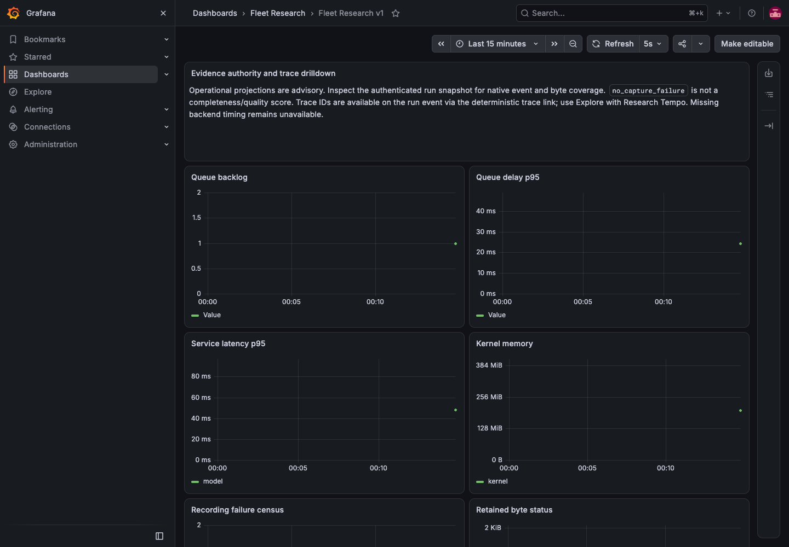

# PACT evidence and observability — O1–O6 completion

O1–O6 are implemented and verified at source/offline scope on master. This extends the [C1–C4 foundation](contracts-foundation-20261030.md) without enabling research agents, deploying services, running inference or accessing retained worlds. The optional backend stack was exercised only in disposable, owned synthetic fixtures and removed afterward. Existing paused worlds, services, identities, budgets, schedules and unresolved allocations/commands remain untouched.

| Task | Delivered behavior | Commit |
| --- | --- | --- |
| O1 | Immutable scoped journal, per-stream decimal sequence, explicit parents, producer deduplication, rollback, safe metadata and native allocation/command reconciliation | `958c4e0` |
| O2 | Vault-encrypted artifacts in chunks at most 1 MiB, exact byte/integrity manifests, finite quotas, protected atomic files, transactional ciphertext outbox, consent versions and retention | `bf797ca` |
| O3 | Shared model/game boundaries across legacy/reactive/cognition/specialist/skill paths, exact prepared HTTP bodies, exposed streaming packets, explicit provider availability and failure fencing | `1ec9b81` |
| O4 | Authenticated frozen snapshots, default200/max500 event pages, authenticated cursors, artifact streams, lineage totals and complete native/byte coverage | `f29c6fb` |
| O5 | Recipient-key encrypted exhaustive archives, all retained referenced pages/payloads, explicit gaps, bounded streaming, exclusive private destinations and offline verification/CLI | `f6dd1b7` |
| O6 | Explicit OTel providers, deterministic cross-process trace links, bounded metrics, independent delivery pump, pinned Collector/Tempo/Prometheus/Grafana stack and working dashboards | `bf64b32` |
| Review fixes | Pending legacy commands in census, native receipt settlement through scope lookup failure, distinct correction purposes, SQL aggregates, unlinked/partial artifact IDs, stale-consent bytes and honest archive coverage status | `6ba4edb`; legacy label follow-up `d15aa8b` |

The foundation/planning work was committed first as `f6d7cf4`. All implementation commits were verified incrementally. [Capture matrix](capture-matrix.md), [event inventory](event-catalog.md), [artifact policy](artifact-storage.md), [investigation API](api.md), [archive/CLI](archive.md) and [stack runbook](../../ops/research/README.md) define the interfaces and their limits.

## Verification

- Full unit suite: **1,198 passed; 23 Linux-only cases skipped; zero failures**. The skips are 22 Codex process cases and one owned-local-world process-signal case; macOS verification is not Linux process qualification.
- Final combined owned integration suite: **37 passed across nine files**. It exercises concurrent streams and missing parents, five current engine profiles, native recipe commands, correction allocations, known-receipt settlement failure injection, retention/consent, 1,205-event pagination, 16 MiB export, original legacy report/parity behavior and telemetry outage/drop handling. Additional final artifact/export regressions: six passed; final legacy/capture parity regression: nine passed; focused final evidence/baseline units: nine passed.
- Python: **six passed** using the locked isolated worker environment. Protobuf lint and regeneration drift checks passed. The actual Python worker runtime remains R2 work; current worker evidence uses an explicitly fake broker fixture.
- Type/style check, production build and architecture ownership checks passed. Whole-repository style retains 179 nonfatal warnings and 66 informational diagnostics; no errors were suppressed. Root npm audit returned **zero vulnerabilities**.
- Real pinned backend fixture: Collector **0.164.0**, Tempo **3.1.1**, Prometheus **3.15.1**, Grafana **13.3.0**, with immutable image digests. The measured synthetic trace readback was **322 ms** in the final run. One injected exporter failure was counted and recovered after Collector restart. All **12 Grafana panel queries**, Tempo access through Grafana, and isolated Chrome **156.0.8078.80** dashboard rendering/canvas/data requests passed. This single-fixture measurement is not a production latency objective.

Verification used Node 26.13.0/npm 12.2.1 in the existing task-local toolchain because the default Homebrew Node is broken. Database tests used nonce-owned fresh PostgreSQL fixtures with random loopback ports, fake providers and fixture guards. No default live database, real provider endpoint or gameplay service was selected. Source checks ran through `npm test`, `npm run check`, `npm run build`, `npm run check:boundaries`, `npm run research:contracts:check`, Protobuf lint, Python pytest, and the owned architecture harness. `npm run test:observability` separately owns the backend fixture and browser check. Private/ignored evidence was preserved.

## Reliability and research interpretation

The journal and native ledgers are the authority. Telemetry is a safe operational projection; trace loss does not erase source evidence or retry gameplay. An exporter acknowledgment means Collector acceptance, rather than proof of backend persistence. Pending/exported/dropped delivery state, failure counts, lag and Collector metrics remain inspectable. No external trace sampling is used for these spans, and no SQL parameters, prompts, peer text, artifact bodies or credentials enter telemetry attributes/metric labels.

Known model usage and command receipts settle through recording failures. Required pre-dispatch capture failure prevents new work; post-dispatch failure marks a gap and fences subsequent dispatch. Unknown usage and exact pending identities retain their native meaning. Historical compatibility runs remain explicitly compatibility provenance; a sealed manifest is unavailable unless one actually exists. Coverage describes owned evidence population and retained complete bytes, not decision correctness or blanket research qualification.

Partial/unpublished artifact writes appear as identified coverage gaps. They are not silently treated as complete published payloads. Archives export all authorized referenced payloads; their frozen coverage also preserves missing/unlinked source IDs. Offline `verified` means archive integrity/population checks passed; `coverageStatus` separately reports source completeness, and `gaps` counts referenced payload gaps. No absent provider internals or hidden reasoning are invented. Local provider-boundary duration includes observation callback time; exposed provider timing remains separately identified.

## Implementation choices and review

Work stayed inline on master under the repository instruction, with author self-review and no independent reviewer. Important review findings were reproduced before fixes: missing pending-command denominator, a scope SQL error rolling back a known receipt, and a correction mislabeled as an ordinary decision. Their regressions now pass. Concurrent stream sequence and complete SQL census checks were also added. Nonblocking style warnings were left for their own cleanup scope.

Compatibility evidence is explicitly unqualified. The fake Python broker/trace carrier checks current language-neutral boundaries; the actual scoped Python process remains R2. Codex stdout delivery is explicitly buffered until process close, with arbitrary stderr/authentication output excluded; Linux process checks remain a separate gate.

The existing operator session retains deployment-wide inspection authority; trusted internal principals can narrow agent/cohort scope, and HTTP callers cannot widen it. Consent/session checks recur at page and private chunk delivery. Reenabled consent does not resurrect old evidence. Unknown orphan ciphertext is reported for reconciliation rather than deleted automatically. This preserves private evidence at the cost of requiring an explicit reconciliation decision for unknown storage.

Exports require a separate recipient-generated key, provided in an authenticated header, never a URL. No plaintext export endpoint or retained export cache was introduced. Interrupted exports require a fresh authorized snapshot/archive; recipients must retain and transfer their keys separately. Runtime Vault keys never leave the kernel.

OTel uses explicit trace/meter SDK providers rather than global auto-instrumentation or ambient sampling. SQL delivery is finite at-least-once with stable span IDs; terminal telemetry loss is investigated from source evidence. The stack stays disabled by default, loopback-only for fixtures/development and uses 24-hour operational retention. The restart fixture uses a stable local forwarding endpoint because Docker may reassign random published ports. Runtime shutdown drains only the bounded projection batch.

Additive migrations 044–047 own evidence, artifacts, snapshots and telemetry delivery. Unimplemented future migration references were shifted to 048–052 to avoid collisions; existing historical migrations were not rewritten.

## Remaining release boundaries

R1–R5 runtime/Temporal/Python/XState, M1–M4 memory/retrieval/context, A1–A4 research metrics/evaluators/experiments/Promptfoo/DSPy/MLflow, U1–U4 research studio and Q1–Q4 release qualification remain planned. The delivered Grafana visualization is the operational dashboard, not the later studio. E4/KQ1 and earlier operational grants are not advanced or resumed by this source acceptance. No deployment or push occurred.
