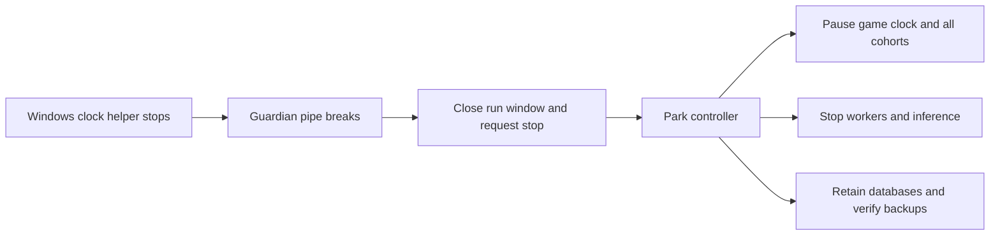

# Native run shutdown and non-progress investigation

25 October 2026. All times below are **Europe/Berlin (CET, UTC+1)**. This is a read-only investigation of the existing 24-kingdom run, including its two latest shutdowns, post-deployment decisions, native authorization/quote paths, input delivery, inference admission and verification gaps. No services were started, settings changed, model requests dispatched, commands executed, uncertainties reviewed or E4/KQ1 scenarios run. Work was inline.

The game data was preserved, but the continuous observation failed. A Windows clock-helper connection is a global shutdown dependency even though Fleet, PACT and Nemotron inference run in WSL. Independently, valid model proposals encounter credential rotation and stale-state handling defects. Accepted waits and input admission have been stronger than the evidence of useful gameplay. The system is **not operationally qualified for an unattended 24-hour native run**.

## What stopped the world

The Windows event log identifies the guardian's PowerShell helper, PID 38384, starting at **14:35:30.312** and its engine changing from Available to Stopped at **14:59:25.720**. The final successful clock sample was at **14:59:25.492**, with a 0.290 ms round trip. At **14:59:25.992**, the guardian wrote another sample request and received `BrokenPipeError` at `host.stdin.write`. It converted that exception to `GUARDIAN_CONTROL_FAILURE`, closed admission permanently for this segment, wrote a stop request, and invoked the native park controller. The latter pauses PACT's clock, stops Fleet/rules/provider, and pauses all cohorts. APIs are then stopped during finalization. This is the actual shutdown chain, not an inference from idle agents. Sources: [helper and pipe creation](/home/mnim/repos/mine/fleet/scripts/local-run-guardian.py:13), [global trip](/home/mnim/repos/mine/fleet/scripts/local-run-guardian.py:67), [failed write and generic classification](/home/mnim/repos/mine/fleet/scripts/local-run-guardian.py:105), [park implementation](/home/mnim/repos/mine/fleet/scripts/control-real-pact.ts:111).

**The helper's reason for stopping is not established.** Its stderr is empty. Windows records a PowerShell engine stop; the queried Application log has no matching crash, and the queried System/Security windows have no matching sleep/shutdown/process-exit events. The helper itself exits on stdin EOF or a stop line, but the guardian sends its own stop line only after handling the failure. An unexpected EOF/interop lifetime problem is a plausible hypothesis, not a proved root cause. Neither helper exit status nor stdin EOF provenance was saved. There is no evidence that Nemotron, GPU exhaustion or an invalid kingdom action caused this pipe closure. The exact Windows lifecycle observations and original file hashes are retained in the private evidence set referenced below.

The earlier shutdown at **14:09:56.731** had a different immediate trigger: `PRIMARY_HEARTBEAT_LOST`. Its exact stalled operation is also unrecorded. The supervisor updates its heartbeat after serial database/poll operations and performs GPU/provider telemetry on that same loop; database and telemetry timeout paths can collectively exceed the guardian's five-second heartbeat bound. This is a concrete design risk, not proof of the particular delay. The old closure also exposed concurrent finalization: the guardian attempted to create a final encryption key that the primary finalizer had already created. Both controllers can enter park/finalize without a single durable shutdown owner. Sources: [serial polling/heartbeat/telemetry](/home/mnim/repos/mine/fleet/scripts/control-real-pact.ts:147), [shared finalization path](/home/mnim/repos/mine/fleet/scripts/control-real-pact.ts:128), [earlier deployment/incident record](native-inactivity-repairs-20261025.md).

This is why moving inference to WSL did not remove the latest failure: the observation controller still depends on a live cross-OS PowerShell pipe. `isolate-actors` tolerates individual kingdom failures; it does not exempt a guardian failure from global parking.

## Timeline and preserved state

| Berlin time, 25 October | Event |
|---|---|
| 04:05:22 | Original 24-hour deadline begins; initial segment soon stops on cognition input limits. |
| 04:16:40 | Overnight continuation starts on the same world with individual actor failures isolated. |
| 14:09:56 | Heartbeat loss closes that segment. |
| 14:35:29 | Same-world continuation resumes, retaining the original cutoff and histories. |
| 14:36:53 | First repair artifact starts; six packing failures and two unsupported abstentions expose further gaps. |
| 14:49:18 | Final retained-state/schema follow-up worker is deployed. |
| 14:50:23–14:52:38 | Twenty-one kingdoms complete their next scheduled turns. |
| 14:59:25 | Windows helper stops; broken pipe triggers global parking. |
| 15:00:13 | Final encrypted restore comparison completes: 167 PACT tables and 77 Fleet tables. |
| 16:01 | Read-only inspection confirms paused clock at tick 616, all 24 cohorts paused, workers/guardian/supervisor stopped. |

The original cutoff is still **26 October at 04:05:22.320 Berlin**. It has not been extended. Databases, identities, goals, mandates, orders, budgets and evidence remain retained. There are **four unknown model allocations reserving 160000 tokens**, three autonomous actors held from their original stream failures, zero running turns, zero capacity leases and zero pending/unknown platform commands. No uncertainty has been guessed away. An additional coordinator turn remains unresolved in retained history from the earlier shutdown. The run's currently retained aggregate is **899 turn attempts, 781 usage-reported calls and 5429085 measured tokens**; four unknown and one not-dispatched allocations are separate from the 781 reported calls. Source: read-only inspection snapshots in the private evidence set and finalization-complete record in the closed run root.

## What the kingdoms actually did after the final deployment

| Architecture, three kingdoms each | Actual next-turn outcomes |
|---|---|
| Legacy loop | 3 accepted waits |
| Legacy cognition | 2 accepted waits; 1 `PACT_WAIT_STATE_MISMATCH` after three calls |
| Reactive basic | 3 accepted waits |
| Reactive cognition 1 | 3 accepted waits; no renewed input overflow |
| Reactive cognition 1.1 | 3 accepted waits; no renewed input overflow |
| Reactive cognition 2 | 3 accepted waits |
| Specialist coordinator | 2 stale proposals recorded as WAIT; 1 authentication failure |
| Autonomous specialists | No new turns; all 3 remain held from earlier unknown-stream failures |

Thus the **21 attempted turns** were **17 deliberate accepted waits, two rejected proposals hidden under WAIT, one authentication failure and one invalid-wait failure**. They used **28 reported model calls** and committed **zero new commands**. The three coordinator responses were all non-null proposals: two training proposals and one contact request. It is incorrect to describe those three as the model merely choosing inactivity.

Across the whole retained game there is still only **one completed Barracks II and two waiting Hall II orders**, all farms remain level I, and there are **zero contact requests, contacts, messages, supply offers and supply contracts**. The three construction orders predate the final fixes. No substantive building or social progress after the final deployment is established.

### Authentication rotation invalidates an active connection

The previously reported `FORBIDDEN` training failure was **HTTP 401**, not a refused mandate or missing `game:act` scope. The account is active, the kingdom is ranked, the grant is not revoked, and the grant includes `world:read`, `messages:write` and `game:act`.

The affected MCP session began at **14:50:26.392**. Its worker model request began at **14:50:46.714**. A credential refresh for that same account was prepared at **14:51:01.920** and issued at **14:51:01.924**. The model returned at **14:51:05.174**; the next MCP POST and DELETE both received 401, at **14:51:05.198/199**. Native OAuth refresh replaces the grant's access-token hash, immediately invalidating the old token. `McpGame` retains the token supplied to its constructor; its connection does not adopt subsequent rotations. The credential lock covers connection creation, not the full lifetime of outstanding clients. Event intake and other connection openings can therefore rotate credentials while an existing turn is awaiting inference. The refresh is confirmed; its exact caller is not tagged in the retained audit. Sources: [connection creation and lock lifetime](/home/mnim/repos/mine/fleet/src/games/pact/credentials.ts:349), [fixed token headers](/home/mnim/repos/mine/fleet/src/games/pact/mcp.ts:6), [OAuth replacement](/home/mnim/repos/mine/pact/packages/oauth/src/service.ts:599), [token lookup](/home/mnim/repos/mine/pact/packages/oauth/src/service.ts:525), [401 reported as FORBIDDEN](/home/mnim/repos/mine/pact/services/api/src/mcp-approval-inbox-routes.ts:105). Original API failure records are lines 28160 and 28162 of the closed segment's `logs/pact-api.log`.

### Stale proposals disappear into successful WAITs

One coordinator chose training from tick **607**, and another chose first contact from tick **609**. Their responses arrived after the world advanced. The coordinator unconditionally observes again after focused reasoning, then rejects mismatched expected versions. This correctly prevents execution against stale state, but an empty admitted list simply returns no actions. The turn then finishes as WAIT; it does not feed this rejection back for bounded replanning. The captured rejection for both is **STALE_PROPOSAL**, with zero admitted proposals. The newly added model-output correction loop does not cover this later selection boundary. Sources: [fresh observation after reasoning](/home/mnim/repos/mine/fleet/src/engines/specialists/coordinator.ts:185), [rejection becomes empty selection](/home/mnim/repos/mine/fleet/src/engines/specialists/coordinator.ts:95), [clock included in native revision](/home/mnim/repos/mine/pact/packages/kingdom/src/action-effect-facts.ts:174).

Native quotes expire after **30 seconds**. Queueing plus inference can consume that interval, and game ticks change the revision even sooner. The original authority guard must remain; dropping version checks or blindly rebasing the proposal would conceal the race rather than fix it. Source: [quote expiry](/home/mnim/repos/mine/pact/packages/application/src/action-effects.ts:344).

### A further training claim identity defect is reproduced offline

Training quotes contain a promise key `training:<commandId>`. The menu is quoted with one temporary ID; the coordinator later assigns a new command ID. The normalization helper handles `message:<commandId>` only. Two read-only native training quotes, with unchanged world revision and only different command IDs, produce unequal normalized claims. This is a **separate reproduced defect**, not the actual rejection reached by the two stale turns or the 401 turn; those fail earlier. A training proposal can still hit `CLAIMS_DO_NOT_MATCH_ACTION` after those earlier failures are repaired. Sources: [normalizer](/home/mnim/repos/mine/fleet/src/games/pact/coordination.ts:15), [training promise](/home/mnim/repos/mine/pact/packages/application/src/action-effects.ts:254), [comparison](/home/mnim/repos/mine/fleet/src/games/pact/coordination.ts:255). The control issued no command, acquired no lease and used no model.

## Why the other kingdoms continue waiting

For all twelve post-deployment reactive basic/cognition requests, delivered current-state packets listed ready construction and introduction opportunities. Nevertheless their responses all chose waits, mostly `resource_reserve`, with some `deliberate_pacing`. Legacy responses also repeatedly cite reserve/risk reasons. The wait guard verifies the completed levels, queued phases and opportunity revision, and requires a nonempty explanation/reconsideration condition. It does **not** establish that the prose reserve justification is necessary, that the next review will differ, or that the owner objective advances. A model can therefore repeatedly copy the correct factual basis and defer. This is a behavioral/progress gap; it is not another missing schema field. Source: [wait validation](/home/mnim/repos/mine/fleet/src/games/pact/goal-state.ts:124).

The packing repair also has a material functional tradeoff. All six v1/v1.1 requests reached the model with **zero retained continuity evidence items**. The fitter reported 30–34 omitted entries in sampled packets, including evidence and optional needs arrays. When no evidence IDs remain, the generation contract permits only empty subjective collections and a null plan. Current authoritative construction/stock/peer facts were protected, but the retained-memory pathway was effectively unavailable in those decisions. Empty updates remain possible; this is not evidence of functioning grounded long-term planning. Sources: [context fitting](/home/mnim/repos/mine/fleet/src/modules/continuity/v1/decision.ts:48), [no-evidence update contract](/home/mnim/repos/mine/fleet/src/modules/continuity/v1/decision.ts:127).

Measured complete requests: v1 **31750–31778 / 32000 bytes**, v1.1 **31970–31976 / 32000**. The latter leaves only **24 bytes** of maximum observed headroom. Input admission is repaired for these packets; robust future-state growth and useful memory delivery are not qualified.

## Resource and timing bottlenecks

The final continuation recorded **265 resource snapshots**. Peak total GPU memory was **15773 / 16303 MiB**; minimum available WSL RAM was **5.59 GiB**. No provider preemption was recorded. At the final pre-shutdown sample the provider had **zero active and zero waiting requests**; roughly **8.24 GiB RAM** remained available. The latest shutdown therefore has no observed inference overload/OOM signature.

For the **28 post-deployment calls**, provider-reported elapsed time was **8.76 s median, 25.37 s p95, 34.03 s maximum**. Capacity queue delay was **6.13 s median, 18.45 s p95, 20.54 s maximum**. These are separate distributions; their percentiles must not be added and called a measured end-to-end percentile. Their combined per-call path nevertheless competes with a 30-second quote lifetime and 60-second game ticks.

Four inference slots are configured, but the physical cache allows less parallelism for these native inputs. The profile has **57 physical blocks, one null block and one safety block: 55 usable**. Each observed request reserved **14–17 blocks**. Even four of the smallest require **56**, exceeding 55; thus at most **three of these requests** can be admitted together. Three running and three provider-waiting requests were observed in samples. Earlier four-concurrent small-prompt results do not qualify four full native requests. To fit four requests each as large as the largest observed demand would require at least **68 usable / 70 physical blocks**, with actual GPU/activation headroom still to be verified. This is a sizing calculation, not approval to change the profile or proof that the card can safely sustain it. Source: [cache arithmetic](/home/mnim/repos/mine/fleet/src/platform/cache-profile.ts:76), retained cache profile and capacity-admission traces.

The main constraints are therefore control-process durability, token lifetime coordination, quote validity versus queue/inference latency, input/memory capacity and useful decision quality. The evidence does not support either “24 kingdoms cannot fit at all” or “four full native decisions are already proven concurrently.”

## Why the previous checks did not establish readiness

The 25 native workflow cases test actual MCP transport, leases, reads, handlers, accounting and command effects. Their providers are **scripted**, their authentication uses synthetic static principals, and their game clock is not advancing during model selection. The fixture explicitly synchronizes its controllable wall clock before connections. Social tests restrict mandates to the desired social family. Those are useful composition checks, but they do not exercise real OAuth rotation, real response/queue delays, broad-menu model choice or game ticks during proposal validation. The scripted workflows cover prerequisite construction, introduction and messaging; they do not cover coordinator training's command-specific promise key. Sources: [native fixture/authentication](/home/mnim/repos/mine/fleet/tests/fixtures/native-pact-workflow.ts:14), [fixture clock](/home/mnim/repos/mine/fleet/tests/fixtures/native-pact-workflow.ts:85), [scripted provider and social restriction](/home/mnim/repos/mine/fleet/tests/integration/native-pact-workflows.test.ts:190).

The initial reconstruction used empty subjective memory and missed the retained-state failure until live deployment. The subsequent fitter got the real packets through partly by omitting optional continuity evidence. Calling that input success is accurate; treating it as complete cognitive workflow acceptance is not. Earlier 30-minute successful simulations also establish their simulated contracts, not the missing native OAuth/tick/process-lifetime behaviors. My previous report listed all five repairs as deployed, but the test evidence was narrower than a clean full live workflow. In particular, calling the 401 a permission rejection and counting coordinator stale rejections as ordinary waits obscured two concrete defects.

Observability has gaps too: oversized task-observation detail is replaced with an omission marker; the supervisor catch replaces underlying exceptions with `SUPERVISOR_FAILED_CLOSED`; helper exit code and cause are absent; and WAIT does not distinguish deliberate abstention from exhausted/rejected selection. These omissions make “all green” summaries misleading and slow investigation. Sources: [detail limit](/home/mnim/repos/mine/fleet/src/observability.ts:72), [supervisor catch](/home/mnim/repos/mine/fleet/scripts/control-real-pact.ts:240), coordinator empty-selection path cited above.

## Concrete repair order and acceptance requirements

These are recommendations for the next implementation task. Nothing below was activated during this investigation.

| Priority | Repair | Required evidence before another unattended run |
|---|---|---|
| 1 | Make supervision durable: managed clock/helper lifecycle, explicit exit/EOF diagnostics, heartbeat independent of slow telemetry, one shutdown/finalization owner. Review which failures should close model admission versus pause the world. | Clock/process-only lifecycle tests across chat/tool disconnect and restart, slow telemetry and helper loss; preserved deadline; deterministic single finalization; no model required. Do not disable clock safety to hide the failure. |
| 2 | Coordinate access-token rotation with all live MCP clients. Preserve grant/session identity; classify authentication failure separately from mandate denial. | A native OAuth rotation occurs while a fake slow model is pending; the original session's later quote/read and close complete correctly. Known read/auth rejection may recover within bounds; uncertain writes still require receipt resolution, never replay. |
| 3 | Extend bounded correction through proposal validation and selection, including tick/quote expiry. Report stale rejection as stale rejection, not successful WAIT. | A native tick advances during fake reasoning; stale effects cannot commit; fresh observations/options reach bounded replanning under the original three-call/one-action limit; an accepted command has its native receipt. |
| 4 | Normalize or preserve command identity for every command-keyed effect claim. | Native coordinator training passes quote → generation → selection → re-quote → guarded execute, with exact claims; same tests cover other command-keyed promises. No weakening of claim comparison. |
| 5 | Provide a measured minimum retained-evidence/plan capability and input-growth margin for each cognition architecture. | Growing retained state still delivers current authority/prerequisites/peer plus the declared memory minimum, without exceeding the complete input budget. If the architecture cannot provide that capability, report it unavailable rather than grade empty continuity as a full pass. |
| 6 | Measure owner-goal progress and repeated deferral quality separately from schema validity. | Stagnation and repeated unchanged reasons are visible; invalid causal claims receive bounded feedback; legitimate strategic waits remain allowed. Count goals/receipts/contact outcomes, not just accepted WAITs. |
| 7 | Size/cache-admit the actual native workload and schedule around quote validity. | Offline cache/memory calculation first; then a separately authorized bounded four-native-request Nemotron 4B check if needed. Observe real simultaneous admission, latency, cache headroom and native validity—not just four configured slots. |
| 8 | Replace the missing acceptance cases in the native suite and reporting. | One composed synthetic native test includes real OAuth service, advancing game clock, representative retained context, delayed provider responses, correction/selection and receipts. Distinguish planned waits, rejected proposals, held actors and successful effects. |

A broad new 24-hour run would currently spend time rediscovering these known failures. The same paused world remains recoverable, but this investigation grants no new continuation or uncertainty review. E4/KQ1 remain blocked; Nemotron 4B remains the sole local inference model.

## Evidence retained

Private aggregate snapshots, Windows lifecycle events, original log hashes and read-only controls are retained at `/home/mnim/.local/share/pact-investigations/run-failure-20261025-f6d7ce30` (private directory and files). They contain no printed tokens/passwords or exported correspondence. Original encrypted histories, databases and closed segment logs remain in place. This is a current-run/source investigation, not a whole-chat token-cost audit or a Superpowers/plugin bug report. No delegated agents or GUI were used.
