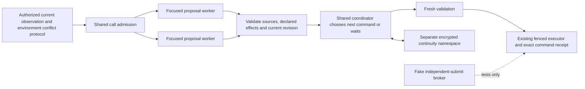

# F6 — focused workers and shared coordinator — 17 October 2026

Source/offline phase4 assignment, dependency F5 `eeec21e`. Existing worktree reused; Codex owns implementation without delegation. No installed runtime, cohort, model, allowance, anchor or recovery review changed. Server Fleet was not contacted.

## Execution contract

`specialist-coordinator@1` coexists with the four existing profiles. It uses at most two focused worker calls plus one coordinator call under the same parent task/cohort allowance. A remaining-call snapshot includes actual turn calls, cohort-period calls and retained token allocations. This snapshot does not prepay or reserve future coordinator capacity: each actual request still reserves atomically. If a shared budget race removes capacity, admission fails rather than exceeding it or committing an uncoordinated proposal. With fewer than two available slots, no focused model work starts. Five changes do not promise five model workers.

Workers receive environment-provided focused observations and minimal shared capacities/promises/owner values, plus bounded source-linked continuity. They produce proposals only. Host code supplies original task/binding identity, a new command UUID and the observed revision. Only delivered focus source references can support a proposal. Focus admission order is supplied by the environment; there is no domain-role preference in Fleet. Version1 reviews at most one next command per parent task. Unselected or omitted concerns need fresh later tasks/periodic review; admission order within a parent is not a general fairness guarantee.

The coordinator may select a proposal or abstain; continuity updates and communication remain optional. Saved predictions/updates precede command dispatch in a separate `specialist-coordinator@1` namespace. The existing evidence journal, retention, version checks, consent-controlled inspection and thirty-day expiry apply. `runtime().specialistContinuity.inspect(binding)` selects this namespace; legacy/F5 state is not copied. Owner values remain separate from interpretations.

Proposal effects are exact only for supported structured resource, authority and promise claims. Environment-advertised schemas define pools/keys and integer units; Fleet compares declared quantities using BigInt and checks mutually exclusive structured promise values. An environment validator must additionally verify that declarations match the actual action and its complete effects. Omitting a cost cannot make an action free. This validator is not a second gameplay permission system. Free-form diplomatic consistency is explicitly a model judgment, not a formal guarantee.

Before submitting, Fleet reads again and checks source availability, validity horizon, binding, schemas and snapshot revision. An adapter must atomically enforce `ActionIntent.expectedVersion` at the actual authoritative commit. Stale intents are rejected, never silently rebased. The existing executor retains exact IDs, pending commands and original-receipt reconciliation. Confirmation means admission unless the environment supplies an actual material outcome.

Focused input fitting discloses omitted keys/catalog/continuity entries. Owner values and structured coordination constraints are never silently discarded; inputs that still cannot fit fail shared admission. Existing ceilings remain24,000 input bytes,2,000 output tokens and at most3 model calls per turn. No budgets were raised.

## Capability and provider boundaries

The new profile requires `continuity:true` and `coordination:true`, `fleet.coordination.v1`, `atomicExpectedVersion:true` and a session `validateProposal` port. Focus references are scoped by environment/version/instance/actor/entity and must belong to the authorized observation. The frame carries declared claim schemas, current capacities, existing structured promises, focused views and owner priorities. See `src/platform/contracts.ts` and `src/engines/specialists/proposals.ts` for exact shapes.

Within-actor worker overlap additionally requires the environment's `parallelReasoning:true`. Provider admission remains a separate restriction: a serial route stays serial even when the environment permits overlap. New sibling leases are admitted only by the host for specialist workers; worker stage labels alone do not grant overlap to other profiles. Existing exclusive leases remain exclusive. All parallel requests have unique allocation IDs and parent task/budget links. The older per-turn execution counter can coincide during overlap; consumers must use allocation IDs for unambiguous pairing. Existing UI qualification for parallel stages is future F7 work.

PACT currently advertises neither the required structured coordination protocol nor parallel reasoning. Selecting F6 for PACT is rejected before inference. This assignment does not implement or activate a PACT parallel exception, game reservation broker or new economy. A real adapter's authoritative claim mapping/atomic revision protocol and provider route require separate qualification before a real F6 run. The four existing profiles keep their support and settings.

## Recovery and schema changes

Migration017 permits the separate specialist continuity namespace without backfilling or enrolling anyone. Migration018 adds default-false sibling-lease metadata, preserving exclusive leases and provider serialization. Only the isolated test database was migrated.

Sibling results are joined before the coordinator can act. On failure or cancellation, siblings receive the shared abort signal and all admitted work is settled before the operation exits. Late results still record known usage against their original allocations but cannot act after fencing. Unknown calls retain their full original allocation; no automatic review or refund is granted.

The old recovery phase belongs to a whole turn, so one sibling's preparing phase cannot prove that another never dispatched. A hard-crashed F6 turn therefore conservatively marks outstanding reservations unknown. Normal explicit not-dispatched errors still settle per allocation, and old single-call tracked recovery stays unchanged. More precise F6 crash classification needs per-call dispatch evidence in a later release; the current policy can require owner review even when a process died before actual dispatch. Pending commands always reconcile their original receipts across restart.

## Offline comparison and recommendation

[Recorded synthetic comparison](specialist-coordination-comparison-20261017.json) is generated by the integration test using the same two focused inputs,3-call cap and failure schedules for both options. Worker responses/choices are scripted; this does not measure strategic intelligence. Logical delays are injected (20ms per worker,10ms for coordination), not measured real-provider latency. Useful outcome means one fixture-defined immediate state change; it is not a survival score. Reserved allocation and reported token use remain separate.

| Serial synthetic case, each workload | Coordinator | Fake independent broker |
| --- | --- | --- |
| Resource or conflicting-promise workload, no tight deadline |1 useful outcome,3 calls,1,650 reported tokens,50ms simulated |1 useful outcome,2 calls,1,100 reported tokens,40ms simulated |
| Same workload with45ms deadline |0 useful outcomes,1 missed deadline;3 calls paid |1 useful outcome,0 missed deadlines;2 calls paid |
| Second worker has a transport failure | No command committed; original unknown allocation retained | First independent action may already be committed; original unknown allocation retained |
| Cancellation and late results | No late commit | No late commit |

Retained allocations are120,000 versus80,000 in successful measured rows; neither is a currency charge or a refunded allowance. Both avoid double debits and incompatible structured promise commits. The broker denies its second stale submission after the first changes state:1 denial out of2 submission attempts in these rows. Unit cases independently exercise stock/authority exhaustion and conflicting promises even when both messages are individually legal.

Keep the coordinator as the first executable architecture candidate, while retaining this broker comparison for future qualification. It provides a single joint judgment and uses the existing command boundary. The toy results also show its overhead can lose a tight deadline; they do not establish an overall winner or outcome-quality improvement. A real independent-submit engine remains disabled. Its fake-only journal/mutex preserves reservations across restart and rejects late validation after stop, but does not claim a production lease/expiry/promise protocol.

## Verification and preservation

Full verification:174 unit tests/39files and318 integration tests/37files passed (492 total). Type/style, production build, recursive boundaries and full dependency audit passed with0 vulnerabilities. Existing non-blocking style/AJV warnings remain. Compiled runtime resolved all five profiles and rejected F6 on current PACT capabilities before inference; the pinned legacy controller is byte-identical and existing basic-input parity/cognition/continuation/recovery suites pass. Commands: `npm run check`, `npm run build`, `npm run check:boundaries`, `npm test`, `npm run test:integration`, `npm audit`, `git diff --check`. Node24.12.0; fake games/models and separate loopback5437/fleet_test only. Integration files run serially because their fixture resets this database. No real model call or hosted CI result is claimed. Author review is recorded rather than independent review because delegation is prohibited.

Tests cover shared call accounting, coordinator overhead, resource/authority/promise conflicts, missing effects, forged sources, stale preflight and atomic commit, input omissions, provider/environment overlap combinations, cancellation/late results, hard-crash recovery, exact unknown allocations, original pending receipt reconciliation, namespace/consent and immutable existing behavior.

Read-only preservation at17:50UTC found the same installed7093cb8 release and exact22/22 application table fingerprints. Existing20 agents remain needs_owner,40 unknown allocations/1,600,000 retained tokens and10,121 historical turns are intact; zero running turns. No cohort was resumed or reconfigured. Server Fleet and PACT source/runtime remain untouched.

Before any future installation: drain original work under normal receipt rules, retain encrypted rollback, migrate with preservation checks and qualify the exact new profile/adapter/provider. Source acceptance alone is no rollout or new-run authorization. Next architecture phase is F7 operation/reporting plus PACT P3 scenarios, followed by F8 qualification.
