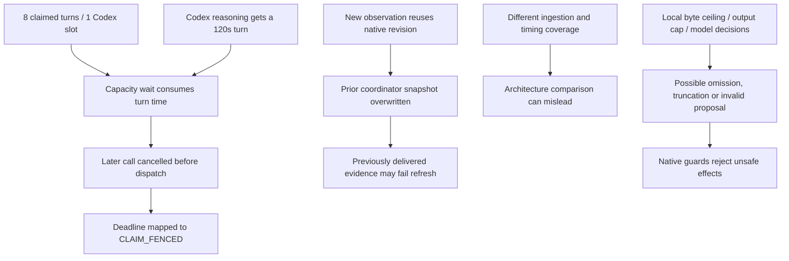

# Runtime reliability fixes after the Nemotron–Terra comparison

**Current status:** shared implementation and a fresh Nemotron 30-minute validation are authorized by the subsequent user request. [Implementation, evidence and actual run status](../../runtime-reliability-nemotron-20261027.md). Codex-specific deadline/concurrency/quota changes are deferred. Work inline; preserve old worlds, unknown usage and E4/KQ1 blocks.

The proposal and planning-only checks below are historical scope, superseded only by that explicit subsequent request.

**Goal:** remove demonstrated execution and measurement defects so that the society experiment measures agents' reasoning, communication and survival choices. A rejected unsafe action, deliberate wait, unprofitable trade or unsuccessful strategy is not automatically an engine defect.

**Architecture:** retain the existing worker pool, provider-capacity queue, durable tasks, bounded correction loop and native PACT command/receipt authority. Repair evidence identity and admission policy at their existing boundaries. Do not introduce another scheduler, agent framework, model migration or gameplay planner.

**Stack:** Node 24, TypeScript, PostgreSQL 17, existing Vitest synthetic fixtures; native Codex subprocess fixtures and fake Nemotron providers only during implementation verification.

## Evidence and comparison boundary

Evaluate the two runs over the same **1,452.520 seconds (24m12.520s)**. Terra's cutoff is `2026-10-27T10:01:00.325Z`; Nemotron's is `2026-10-26T22:59:58.617Z`. Exclude later quota failures, shutdown outcomes and passive construction completion from behavioral comparisons.

| Matched observation | Nemotron 4B | GPT-6.1 Terra |
|---|---:|---:|
| Completed calls | 206 | 212 |
| Committed actions | 65 | 85 |
| Completed building upgrades at cutoff | 22 | 34 |
| Accepted contacts / messages / reciprocal pairs | 1 / 3 / 0 | 7 / 10 / 2 |
| Terminal rejection/error outcomes | 13 | 3 |
| Calls reported as truncated | 5 | Unknown: telemetry unavailable |
| Largest serialized request / byte allowance | 63,987 / 64,000 | 154,798 / 1,048,576 |

The [full Terra report](../../codex-terra-hour-run-20261027.md) also describes later passive world progress; its 55 completed upgrades are **not** the active-period total. The [Nemotron report](../../fresh-half-hour-run-20261026.md) describes the full 30-minute window. Neither report's full-window table is a controlled model-only comparison.

Private evidence, retained outside Git:

- Terra run `pact-fresh-canary-20261027-6a87f53e`, under `~/.local/share/`: `evidence/active-period-only.json`, `nemotron-terra-matched-comparison.json`, `coordinator-reference-check.json`, `coordinator-snapshot-probe.mts` and `coordinator-snapshot-probe-result.json`.
- Nemotron run `pact-fresh-canary-20261026-6cb1c48d`: archived observation and call-metrics snapshots. The matched reconstruction recovers all 227 calls in the two overlapping snapshots before filtering. Its action observer is 53ms before the matched cutoff; surrounding snapshots agree on construction/social/error totals.
- No retained database or model service was started for this investigation. Synthetic coordinator reproduction was rerun successfully with zero database access/model calls. A second local source probe confirmed the deadline values and abort-code mapping below.

## What is established, and what remains uncertain

| Finding | Evidence / confidence | Affected area |
|---|---|---|
| Coordinator observations overwrite one another when their native revision matches | Reproduced offline: changed evidence references with the same native revision reject refresh; advancing the revision accepts the control. Live proposal cited five references actually delivered to it. The final live cache contents were not retained, so this edge case is not proven to be that live rejection's exact cause. | `specialist-coordinator@1`; not evidence that all eight architectures have this defect |
| Too many active turns compete for the Codex slot | Eight worker slots, one provider slot. Two legacy-cognition turns committed an action, then expired while waiting for their third call. One had 26.8s and 47.1s waits for its first two calls. | Shared execution policy; observed in `legacy-cognition@1` |
| Deadline policy recognizes only the local thinking flag | `model-bounds.ts` returns 180s/call and 360s/turn for Nemotron with thinking, but 90s/call and 120s/turn for Codex with medium reasoning. Codex correctly rejects the local-only thinking flag. Its subprocess also has an independent 95s hard limit. | Provider configuration and turn admission |
| Queue aborts can be mislabeled as lost claims | `RouteCapacity` preserves only `DEADLINE_MISSED`; `MODEL_DEADLINE_EXCEEDED` and a generic timeout become `CLAIM_FENCED`. This is visible directly in source and a pure local probe. | Shared capacity/timeout diagnostics |
| Coordinator failures and Codex failures lose useful attribution | Several snapshot conditions share one error; a nonzero Codex exit discards captured events before the adapter parses them. | Diagnostics; exact historical causes cannot all be reconstructed |
| Communication counts have unequal architecture coverage | `communications` ingestion is called from the legacy engine; the six platform architectures do not share those ingestion calls. Metrics query this journal, not native PACT messages. Archived Nemotron metrics show zero ingested messages while native PACT records three. | Research measurement; not proof messages were lost |
| Timing and completion fields are not comparable across routes | Legacy elapsed time includes queueing; modern elapsed time starts after admission. Codex supplies no finish reason/reasoning-text metadata through this adapter. | All-architecture/provider comparisons |
| Remaining local guard failures need individual attribution | Matched Nemotron: six resource-claim conflicts, two coordinator evidence failures, and one each invalid output, duplicate negotiation, trade-perspective mismatch, undelivered evidence reference and expiry. Five truncated calls may overlap these outcomes. | Mostly autonomous specialists, plus coordinator and legacy loop |

The quota failure happened **after** the successful comparison window. It still exposed an operational weakness: additional calls were admitted against a known-unavailable provider, and errors were opaque. The intentionally separate native Codex account is not a defect. Unknown usage must remain unknown.



The last branch describes possible causes to distinguish, not a finding that every guard rejection is a packing bug. Longer queueing also makes observations older, but a direct link between queueing and the live coordinator rejection has not been established.

## Design decisions

1. **Separate observation identity from native revision.** Native revision protects game effects; it is not a unique identity for the exact evidence supplied to a model. Use immutable, bounded observation frames and a host-stamped frame reference on admitted proposals. Keep native `expectedVersion` and guarded commit unchanged.
2. **Use existing admission controls first.** For a future isolated Codex-only profile, propose one active turn for its one model slot. Turns waiting as durable tasks do not yet consume their turn lease; actual task deadlines still apply. Existing legacy/platform lane rotation and platform cohort tickets provide fairness to test. Do not globally serialize the four-slot Nemotron deployment.
3. **Make the Codex time budget explicit.** Proposed future policy: 90s model-call bound, existing 95s subprocess kill limit, up to 360s per turn, always capped by the approved run/budget deadline. This accommodates up to three bounded calls plus overhead without abusing `thinking:true`. It is a proposed policy change, not a setting applied to retained runs. Slow calls can still time out.
4. **Preserve uncertainty and authority.** Accurate error classification must never turn a dispatched-but-unmeasured call into zero usage, renew a lost lease, resubmit a command under another ID, or relax native state/claim checks.
5. **Measure missing data honestly.** Separate observed facts, engine outcomes, native game outcomes and strategic quality. Neither missing truncation metadata nor an empty ingestion journal establishes a zero rate.

Rejected shortcuts: unioning evidence across observations; caching by command ID alone (composed messages receive new host IDs); extending already-running leases; raising all time/context limits; adding Codex accounts/parallel homes; forcing construction or social actions; changing trade rules to make rejected decisions pass.

## Implementation sequence

Each task is a separate reviewable change. Add a failing synthetic regression first, implement the smallest change, run its named checks, then stop broadening the task. If a named failure cannot be reproduced from retained evidence, record it as unresolved rather than start a live exploration loop. Use 60–90 minute checkpoints for implementation work; report a scope change before expanding a package.

### 1. Bind coordinator proposals to immutable evidence frames

Files: `src/games/pact/coordination.ts`, `src/platform/contracts.ts`, `src/engines/specialists/proposals.ts`, `src/engines/specialists/coordinator.ts`; inspect propagation through `src/environments/pact.ts` and native grounding/packing. Tests: `tests/unit/pact-coordination.test.ts`, `tests/unit/pact-proposals.test.ts`, `tests/integration/pact-coordination-native.test.ts`, `tests/integration/native-pact-workflows.test.ts`.

- Add a host-issued frame reference distinct from the native action revision. Keep it out of worker-generated fields; stamp it from the exact `groundedObservation` associated with the accepted response. Preserve it through strict host schemas and observation projection. Version the internal frame contract if compatibility requires it; do not silently alter PACT's native wire contracts.
- Store cloned frames by that identity with the existing bounded, session-scoped lifecycle. Never replace a live frame merely because another observation has the same native revision. Eviction must fail explicitly and safely; no fallback to whichever snapshot is newest.
- During refresh, check the proposal's citations against its own frame, then compare the selected old/new option, owner intent, costs, claims and expected outcome. Only an unchanged semantic choice may acquire fresh references/version. Move the host frame reference alongside those references. Preserve command ID, payload, task and validity constraints.
- Preserve conservative owner-intent change handling, including an intervening change and reversion. Do not accidentally lose that protection when replacing revision-keyed storage.
- Emit safe reason codes for absent origin frame, absent current frame, empty/foreign citations and evicted frame. Trace counts/booleans and scoped references in private evidence; never dump correspondence or prompts into ordinary logs.

Acceptance: same-revision/different-reference and changed-revision controls both refresh an unchanged proposal; foreign/mixed-frame citations and changed owner/choice/cost reject. Include composed message bodies, parallel focused proposals, repeated refresh, bounded eviction and packing propagation. A native synthetic command commits once under the original ID; stale effects still fail atomically.

### 2. Align Codex turn admission, time limits and cancellation reasons

Files: `src/model-bounds.ts`, `src/model-deadline.ts`, `src/platform/admission.ts`, `src/platform/supervisor.ts`, `src/engine.ts`; profile checks in `scripts/lib/owned-local-world.ts`, documentation in `docs/codex-provider.md`. Existing controls: `src/config.ts`, `src/worker.ts`, `src/platform/scheduling.ts`, `src/platform/tasks.ts`, `src/store.ts`. Tests: `tests/unit/model-bounds.test.ts`, `tests/unit/model-deadline.test.ts`, `tests/unit/worker-pool.test.ts`, `tests/unit/owned-local-world.test.ts`, `tests/integration/admission.test.ts`, `tests/integration/model-deadline-runtime.test.ts`.

- Encode the explicit Codex bounds above without enabling a local-only provider flag. Preserve existing non-Codex defaults and cap new turn deadlines by the original cohort/run deadline. Do not mutate any retained turn or profile.
- Make the proposed isolated Codex configuration require `FLEET_CONCURRENCY=1` with its existing single provider slot. Validate that mismatch before activation. Reuse current durable task admission and lane/cohort fairness; do not add a second scheduling queue.
- Preserve typed model/turn/task deadlines through capacity waits and provider cancellation. Keep owner stop, actual claim loss and provider timeout distinguishable. Use an explicit deadline abort reason where the supervisor currently emits an anonymous timeout.
- Check remaining time before dispatch. A queued cancellation may be marked not dispatched only with dispatch evidence. An already committed action stays committed even if a later call fails; reports must retain both facts. Do not turn every failed continuation into a successful WAIT.

Acceptance: fake-clock, fake-provider scenario with 24 bindings, both scheduling lanes, all eight profiles and four simultaneous events. Every eligible binding gets an opportunity; no lease starts merely because work is queued; true expired task deadlines remain enforced. Cover three-call turns, slow calls, a committed first action followed by cancellation, owner stop, actual fence loss and unknown dispatched usage. Queue deadlines must not report `CLAIM_FENCED`; zero duplicate game effects; no suppression of event intake while the model is busy.

### 3. Classify Codex unavailability without losing accounting

Files: `src/codex.ts`, `src/domain.ts`, `src/platform/admission.ts`, `src/app/composition.ts`; use the existing `model_capacity_routes` boundary if a durable availability field is required. Tests: `tests/codex-fixture.ts`, `tests/unit/codex.test.ts`, `tests/integration/codex.test.ts`, `tests/integration/admission.test.ts`.

- Retain a bounded parser result for known structured Codex error events even when the subprocess exits nonzero. Expose only an allowlisted classification, stage and dispatch state. Unknown/malformed failures remain generic; do not persist raw stderr, account identity, prompts or peer text.
- Verify which quota signal the pinned CLI actually provides using synthetic CLI fixtures and retained private evidence. A generic nonzero exit must never be guessed to mean quota exhaustion.
- On an explicit provider-wide quota/unavailability signal, stop further model admission for that route/account scope before spawning another process. Check both when queueing and immediately before dispatch. Preserve tasks and the world policy; do not terminate the game, settle old unknowns or silently switch accounts/models.
- Reuse the route-capacity persistence boundary for the smallest durable availability record if no existing suitable state exists. Scope by a non-secret account/configuration fingerprint; do not expose credentials. Reset/recovery is an explicit operator action, not a timer that retries uncertain work. This is a narrow admission guard, not a generalized circuit-breaker platform.

Acceptance: fake CLI emits a known quota event with nonzero exit; a second waiting call never starts, including after controller restart. Generic transport/malformed errors do not falsely trip a quota block. Calls proven undispatched release only their own unused reservation; dispatched unknown usage remains reserved. Successful usage survives an invalid answer. Process-tree cleanup and the shared-home lock still pass Linux fixture tests.

This package addresses a longer-run operational issue outside the active-period model-quality comparison. No account change, payment action or clearance is required to implement its offline tests.

### 4. Make runtime and society metrics comparable

Files: `src/call-metrics.ts`, `src/engine.ts`, `src/platform/admission.ts`, `src/codex.ts`, `src/communications.ts`, `src/games/pact/communications.ts`, `src/environments/pact.ts`; use injected observation ports at the composition boundary. Tests: `tests/integration/fleet-metrics.test.ts`, `tests/unit/call-packet-metrics.test.ts`, `tests/unit/metrics-view.test.tsx`, `tests/integration/native-pact-workflows.test.ts`.

- Record separate queue wait, provider execution and end-to-end call times at the same boundaries for legacy and platform engines. Distinguish measured generation time from wall execution time. Retain an explicit unknown for historical records with ambiguous timing; do not rewrite old ledger values.
- Add per-field availability/coverage denominators for finish reason, reasoning metadata and truncation. Preserve null for unsupported Codex fields. Distinguish configured reasoning effort from local thinking selection; configured request limits from actual packet bytes; token usage from exact context occupancy.
- Keep attempts-with-effects separate from final turn code: a WAIT or failed continuation can follow a successful command.
- Reuse consented journal ingestion for authenticated communication reads in all eight runtime paths. Inject the observation hook; platform packages must not import PACT domain code. Record only pages actually read under that account and deduplicate by native message identity/direction. Do not fetch extra peer history merely to improve metrics or treat an outgoing receipt as proof the recipient read it.
- Keep native PACT sent-message totals and Fleet ingested-message totals separately named. Add coverage by architecture and label the journal's observation-time window. Zero observed reciprocity is not proof of zero native communication or meaningful cooperation.

Acceptance: two synthetic kingdoms exchange messages through each runtime path; consented native receipts, scoped reads and ingested counts agree for the tested coverage. A message unread by an account remains absent from its journal; duplicate reads do not inflate counts; consent-off and foreign-account cases leak no content. Timing equations agree on identical fake executions, and missing metadata stays unknown in API/view fixtures. No GUI work is required.

### 5. Attribute remaining Nemotron failures before changing behavior

Entry points: `src/modules/action-admission/v1/claims.ts`, `src/engines/autonomous-specialists/engine.ts`, `src/games/pact/negotiation.ts`, `src/games/pact/trade.ts`, existing packet/grounding/feedback modules. Tests as indicated by the reproduced cause: `tests/unit/specialist-claims.test.ts`, `tests/unit/specialist-read-progress.test.ts`, `tests/unit/pact-specialist-packing.test.ts`, `tests/unit/input-context.test.ts`, plus existing synthetic native workflows.

Bounded scope: the 13 matched-window terminal rejections and five truncated calls, deduplicated; no historical whole-project replay. Produce one private evidence row per case: architecture/stage, facts available, facts actually delivered after packing, model proposal, validation result, command/dispatch outcome, correction feedback and final disposition.

Classify each as:

1. **Engineering defect:** delivered state or feedback was lost/contradicted, attribution is wrong, or valid current evidence was rejected. Add a sanitized regression and a focused fix.
2. **Correct guard rejection of a model proposal:** wrong resource claim, perspective, reference or duplicate operation despite correct visible facts. Preserve the rejection and existing bounded feedback; verify the error and necessary facts reach the next allowed correction.
3. **Legitimate environmental change:** state changed after observation. Refresh/reconsider within existing bounds; never certify a stale action or replay a dispatched one.
4. **Strategic outcome:** a valid wait, risk or contract default. Report it as behavioral evidence, not a software failure.
5. **Unknown:** insufficient retained evidence. Record exactly what is missing; do not infer model incompetence or correctness from the error code.

Context check: Nemotron used a 32K context, 64KB request ceiling and an 8,192-token output cap; Terra used 500K context and a 1MiB request allowance. Inspect final packed bytes, omitted-source coverage, required pending requests, selected action prerequisites and correction evidence for every affected architecture. A 99.98%-full byte allowance is evidence of a tight packing limit, not proof the 32K model context overflowed. Input token usage is not a complete provider-context trace. Five `length` finishes establish output exhaustion on those calls; the terminal invalid-output case reportedly ended normally and must be checked separately.

Acceptance: every sampled case has an evidence-backed category or an explicit unknown, and each proven packing/feedback defect has a synthetic regression. No weakening of native validators, forced actions, automatic larger model, blanket context increase or unbounded retries. A later controlled comparison should hold prompt content, task state and decision opportunities constant before attributing improvements solely to model intelligence.

### 6. Verify composition offline and hand back a candidate

After tasks 1–5, use the existing owned fixture harness for a single selected integration pass through PACT and all eight Fleet architectures. Native handlers, authenticated views, events, model admission, feedback, command identity, receipts and metrics must compose; providers remain fake. Include a valid social workflow and a rejected unsafe proposal for each applicable path.

Suggested commands from the Fleet repo (only after the corresponding implementation exists):

```sh
PATH=/home/mnim/.nvm/versions/node/v24.12.0/bin:$PATH npx vitest run tests/unit/pact-coordination.test.ts tests/unit/pact-proposals.test.ts tests/unit/model-bounds.test.ts tests/unit/model-deadline.test.ts tests/unit/worker-pool.test.ts tests/unit/owned-local-world.test.ts tests/unit/codex.test.ts tests/unit/call-packet-metrics.test.ts
PATH=/home/mnim/.nvm/versions/node/v24.12.0/bin:$PATH npm run test:architecture -- --suite integration tests/integration/pact-coordination-native.test.ts tests/integration/admission.test.ts tests/integration/model-deadline-runtime.test.ts tests/integration/codex.test.ts tests/integration/fleet-metrics.test.ts tests/integration/native-pact-workflows.test.ts
PATH=/home/mnim/.nvm/versions/node/v24.12.0/bin:$PATH npm run check
PATH=/home/mnim/.nvm/versions/node/v24.12.0/bin:$PATH npm run check:boundaries
PATH=/home/mnim/.nvm/versions/node/v24.12.0/bin:$PATH npx tsc -p tsconfig.server.json
git diff --check
```

Add the focused regressions created in tasks 4–5 to the selections. The harness must own fresh isolated synthetic `fleet_test`/`pact_test` databases; never substitute a retained world if Docker/fixtures are unavailable. No new production PACT rule or schema change is currently justified; if a native-contract regression proves one is necessary, narrow and report that dependency before expanding implementation.

Deliver a verified source diff, tests/results, safe diagnostic example, candidate manifest with worker/provider/time limits and outstanding behavioral unknowns. Report before deployment or trials. A possible separately authorized next check is one coordinator construction turn, one coordinator composed-message turn and one legacy multi-call turn, with at most nine calls and ten minutes; stop on the first engineering failure, preserve already committed effects and report. This is a proposed future probe, not authorization or evidence of acceptance. Do not begin another 24-kingdom half-hour or hour run from this plan alone.

## Definition of done

Engineering acceptance means exact evidence survives refresh; admissible work does not lose its turn budget merely waiting behind overclaimed peers; deadline/quota/lease outcomes are distinguishable; safe and unsafe native workflows have correct effects/accounting; and cross-architecture measurements state their coverage. It does **not** mean every agent acts, every contact is accepted, every correction succeeds, or a small model makes optimal decisions. Those remain the research questions the repaired system should let us observe.

## Checks performed for this planning assignment

- Reran the private synthetic coordinator probe: unchanged native revision plus changed references reproduced `COORDINATION_EVIDENCE_UNAVAILABLE`; changed-revision control accepted. No model, network or database access.
- Executed the source deadline helpers against schema-valid Nemotron-thinking and Codex-medium configurations: 180/360 seconds versus 90/120 seconds. Checked the existing capacity abort mapping: model deadline becomes `CLAIM_FENCED`; task deadline retains `DEADLINE_MISSED`.
- Verified local links in both new documents/current-state entries and existence of explicitly named source/test files. `git diff --check` passed in both repos.
- No implementation test suite was run for these documentation changes. Existing uncommitted source/test edits predate this assignment and remain preserved; no claim of a repaired runtime or live acceptance is made.
