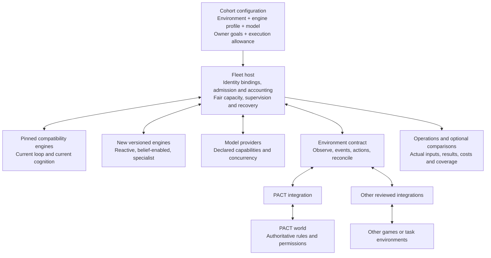
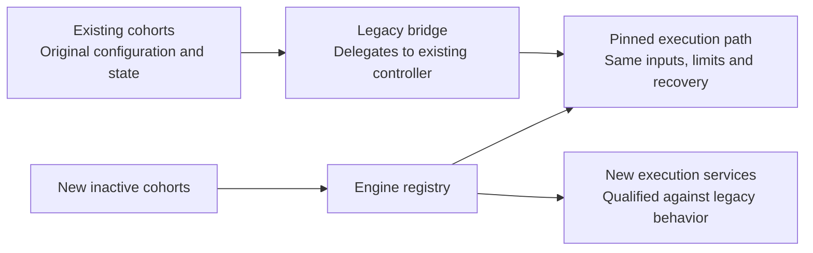
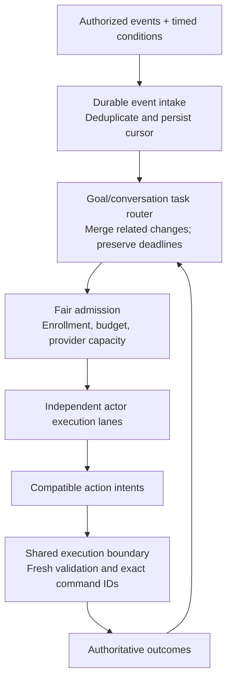
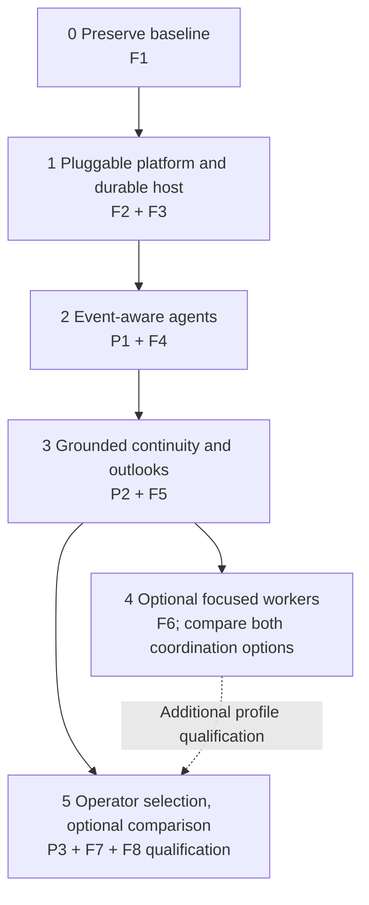

# Fleet multi-engine and environment architecture

Date: 17 October 2026. Status: proposed architecture and phased implementation design, prepared at the founder's request. Implementation, installation and new runs are not started by this document.

Fleet's purpose is to run capable, reliable agents in supported environments. Optional comparisons and reports help choose improvements and share useful results. They are supporting features, not a required research workflow.

Implementation plans: [Fleet](../plans/2026-10-17-multi-engine-platform.md) and [PACT](https://github.com/safa-safakhou/pact/blob/master/docs/superpowers/plans/2026-10-17-fleet-platform-integration.md). Work-package names in these documents are local planning references, not newly created tracker issues or implementation claims.

## 1. Decisions and scope

- Preserve the current controller and its optional cognition configuration as versioned compatibility engines. New engines coexist with them.
- Separate environment, engine, model/provider, owner intent, execution policy and optional comparison configuration.
- Fleet owns scheduling, model accounting, execution supervision, private continuity and recovery. Environment adapters own integration. The actual environment owns its state, visibility, rules and action effects.
- Start with the existing modular Node 24 / TypeScript / Fastify / PostgreSQL 17 / React application. Engines are logical implementations, not a service per specialist. No new queue product or plugin marketplace is required.
- Initial implementation retains one reviewed environment integration per Fleet deployment, with multiple engine-profile cohorts in that deployment. Other deployments can select other adapters. Namespaced contracts permit a later multi-environment deployment without making that tenancy work a prerequisite now. This is an implementation choice, not a request from the founder.
- An agent needs no comparison setup to operate. Optional comparisons link independent cohorts and their actual configurations.
- Changing PACT incentives, authority, economy, models, budgets or existing runtime configuration is outside this planning assignment. Optional specialization remains a separate product proposal.

## 2. Current foundation, checked from source

Planning source anchors: Fleet `a2c82db03232ddef5eeb524a1d86325c463960f6`; PACT `a567c5e80943473551945042c1941cbe48e219f5`. These identify inspected checkouts, not a new installed release or a live-state measurement.

| Existing component | Reuse and gap |
| --- | --- |
| `src/engine.ts`, `src/worker.ts` | Existing scheduled bounded controller; the worker holds one active turn promise, and the engine has a shared abort controller. It is not already a general parallel engine host. |
| `src/game.ts`, `GamePort`, `ModelPort` | An injected integration and model boundary already exists. Runtime composition still directly selects PACT; identities, strategy defaults and parts of the UI retain PACT assumptions. |
| `src/cognition.ts`, `src/continuation.ts` | Encrypted, source-linked memory, beliefs, reflections, intentions and waits exist. Reuse them; do not describe this plan as inventing memory. |
| `src/store.ts`, `src/codex.ts` | Claims, fences, budget reservations, exact pending commands and provider serialization already exist. Preserve their accounting and recovery guarantees. |
| Runs/debugging and comparisons | Detailed consent-controlled inputs/outputs, timing, JSON reports and paired comparisons already exist. Extend their identifiers, stage links and group count. |
| PACT outbox, observations, commands and receipts | Existing authoritative source. Alert-filtered notification inboxes and bounded human SSE batches are not a complete autonomous agent event feed. |

See [integration boundary](../../game-integration.md), [cognition](../../cognition.md), [comparisons](../../comparisons.md), [run debugging](../../run-debugging-20261016.md) and [readable steps](../../readable-run-steps-20261016.md). Later operational reports supersede older running/blocked labels; this plan does not resolve existing recovery gates.

## 3. Target architecture

No engine imports PACT types or accesses a game's database. Adapters are reviewed, statically registered code with versioned contracts; configuration selects them rather than executing arbitrary code supplied by a model or peer.

### Configuration and identity

Each new cohort selects one immutable `EngineProfileRef` before first execution; its agents inherit it. A profile pins an engine implementation, trigger policy, continuity module and coordination policy. The model reference contains provider/model settings rather than silently choosing a cognition architecture. Existing consumed configuration is preserved by compatibility mapping, not rewritten into a new shape.

Every binding and evidence reference includes an environment ID/version, instance ID and authenticated actor/entity scope. External IDs are opaque strings, not universally UUIDs. A Fleet agent's internal UUID and vault associated-data identities remain stable. Add generic binding tables; retain legacy `kingdom_id`/`peer_kingdom_id` columns and encrypted history as compatibility data. Enforce one active controlling binding for the same environment instance/entity scope. This does not implement terminal-account rollover or authorize existing-account reassignment.

Private state is isolated by binding and continuity namespace. Knowledge or memory transfer between agents, environments or studies is an explicit operation with permitted source scope, never an incidental consequence of using the same model.

### Contracts and capability negotiation

| Contract | Required behavior |
| --- | --- |
| `EnvironmentAdapter` | Descriptor, supported schema versions, authenticated `connect(binding)` and environment-specific enrollment/presentation. Credentials stay inside the integration. |
| `EnvironmentSession` | Authorized `observe`, action catalog, `execute` and `resolve` outcomes. Optional `events` and simulation controls are advertised capabilities. |
| Observation | Source/reference IDs, domain schema, actor visibility, state version, environment time, observed wall time and explicit omission/coverage. An observation need not expose full world state. |
| Events | Stable source IDs, cursor, relevant entity/record references, occurrence/observation times and deadlines where authoritative. Native versus polled delivery and latency limitations remain visible. |
| Actions/outcomes | Typed domain-specific arguments; original command ID; `confirmed`, `rejected`, `pending` or `unknown` status. Admission and later material completion are separate events. |
| `AgentEngine` | Descriptor with required capabilities and `run(context)`. Engines consume scoped services and produce decisions/intents; they cannot bypass accounting or authorize their own exceptions. |
| `EngineProfile` | Exact implementation/module versions, trigger policy, owner intent reference and execution policy. Validate compatibility before any model dispatch. |

Adapters declare turn-based/real-time timing, native/polled/no events, command idempotency, outcome-query support, permitted execution scopes and any reasoning-concurrency restriction. Social exchange, episodic reset, seeds, snapshots and media are optional capabilities. Engines requiring unsupported capabilities are refused before dispatch. Fleet does not invent reliable receipts for a transport that lacks them, promise hard real-time response from an LLM, or reset a persistent live world to emulate an episodic API.

Typed envelopes standardize interaction while allowing different observation/action schemas. Fleet-wide measurements cover delivery, latency, usage and execution; environment evaluators define game-specific outcomes. Reward signals, if supplied, do not automatically become an engine objective.

## 4. Preserve the engine before extracting it

The first change records a baseline manifest and introduces a bridge around the existing controller. It does not relocate its reasoning body, reformat its prompt, enrich its observations, change recall or replace its scheduler as part of labeling it.

The manifest pins source/artifact digests, integration contract, prompt/schema generation, model configuration, continuity/recall settings, limits and scheduling policy. Initially expose `legacy-loop@1` and `legacy-cognition@1`. The latter includes the actual existing cognition bundle; optional Laya configuration is recorded independently. A loop without structured cognition still has its current notes, cached reads and recovery feedback.

Shared services are extracted only behind deterministic parity checks. Compare actual fake-provider inputs, decision sequence, receipts, reservations, unknown usage and restart behavior with the pinned path. Telemetry envelopes may gain metadata; decision-visible content and authority behavior must match. Performance changes caused by host scheduling are measured separately from reasoning parity. Existing provider restrictions and scheduling policy remain on compatibility bindings until separately qualified.

Existing cohorts retain original identities, anchors, models, consumed allowances, pending command IDs, unknown allocations and recovery status. Historical rows are not rewritten to imply an engine/version was recorded at the time; additive associations identify inferred legacy provenance as such. Engine changes on consumed cohorts require a separately reviewed quiescent migration, not an editable dropdown.

## 5. Timing, tasks and concurrency

Use PostgreSQL durable rows for intake, tasks, wake conditions and claims. Event ingestion performs no inference. Persist a source event and its task effects atomically before advancing a cursor. Deduplicate by binding and stable source ID. Group two building completions under one development task when appropriate; three independent conversations can remain separate tasks. Routing and admission are code, not mandatory model calls.

Task states: `ready`, `running`, `waiting`, `completed`, `blocked`, `cancelled`. Each task records binding/profile version, goal/conversation key, source refs, authoritative deadline if present, owner priority, last evaluated state and wake condition. Tasks are intentions/work records, not a queue of unreviewed future commitments. Cancellation prevents future task work and never implies cancellation of a committed game action.

Different actors may execute concurrently where provider/environment capabilities permit. One actor has one coordinating task lane initially; specialists may later overlap read-only reasoning. A fenced claim and separate abort controller belong to each admitted operation. Fair admission prevents event-heavy cohorts from taking all shared model capacity; record queue delay independently of inference time.

Keep the Codex process lock and route accounting restriction. Ollama concurrency requires actual memory/throughput qualification rather than assuming configured parallelism is available. All specialist, coordinator, helper and retry work uses the same admission/accounting ledger. Unknown usage retains its original allocation; a timeout is not a refund.

Timer triggers remain for deadlines, conditional waits, periodic reconsideration and event resynchronization. Their intervals/caps are explicit execution policy. A peer saying "urgent" cannot grant inference authority or increase priority above authoritative deadlines and owner policy.

## 6. Initial profiles and optional coordination

| Profile | Trigger | Continuity | Coordination |
| --- | --- | --- | --- |
| `legacy-loop@1` | Existing schedule | Existing basic notes/cache | Existing single decision maker |
| `legacy-cognition@1` | Existing schedule | Existing full cognition bundle | Existing single decision maker |
| `reactive-basic@1` | Owner-enabled events + timed review | Basic continuity with equivalent delivery rules | One coordinating decision maker |
| `reactive-cognition@1` | Owner-enabled events + timed review | Versioned structured continuity | One coordinating decision maker |
| `specialist-coordinator@1` | Task admission | Structured continuity | Focused proposals, shared coordinator/executor |

These profiles are proposed until their work packages pass. Fresh comparisons may match the first four into a trigger-by-continuity matrix. Calling the factor "beliefs only" would be misleading while the cognition bundle also changes memory, planning and reflection. Isolated belief/reflection ablations are later explicit profiles with their own dependency checks.

Before choosing a specialist architecture, compare both requested options:

| Option | Benefit | Required coordination and cost |
| --- | --- | --- |
| Workers propose; coordinator commits | Coherent resources, promises and owner intent; easiest first integration | Coordinator can delay or bottleneck decisions; include its model usage and missed deadlines |
| Workers submit independently through a broker | Less coordinator dependence; potentially faster independent tasks | Still requires shared budget, stale-state checks, resource/authority reservations and conflicting-promise handling; legal messages can also contradict one another |

Recommendation: implement the proposal/coordinator engine first. Include a fake-provider broker candidate in the comparison before approving a second real execution engine. Both must use one canonical command/lease boundary per PACT kingdom. Independent workers do not receive independent game authority. Current PACT's one-model-request-in-flight rule must be explicitly corrected for any overlapping within-kingdom reasoning; it is not implicitly changed by this recommendation.

Conflict prevention is exact for supported structured resource/authority/promise claims. Free-form diplomatic language still requires judgment; its semantic consistency is not a formal guarantee. Record which claims were declared and checked rather than presenting arbitrary prose as mechanically verified.

## 7. Survival, beliefs and relationships

Survival is the kingdom's ability to preserve material viability, autonomy and future options under owner priorities. PACT already has upkeep, losses, food exposure and binding obligations; buildings remain persistent under current rules. Do not add extinction, mandatory scarcity or alliance bonuses as a platform prerequisite.

Fleet reuses encrypted source-linked beliefs, alternatives, confidence, predictions and reflection. Add explicit self/dependency outlooks and task links using authorized evidence. Owner values remain distinct from factual beliefs. A record that a promise failed does not establish motive; uncertainty and missing evidence remain explicit. Agent declarations are inspectable self-reports, not proof of subjective experience or model-weight learning.

PACT supplies deterministic owner-scoped outlooks from existing calculations: resources and commitments, projected food pressure, known threat/deadline exposure and feasible options under actual authority. Assumptions and unavailable information are labeled. Private relationship models stay in Fleet; no global trust score or prescribed reply/coalition behavior is added.

Knowledge exchange initially uses existing permitted messages and records. Source references prove only what the recipient can independently verify; peer claims stay untrusted. No automatic private-memory sharing. Formal transferable intelligence packages and optional specialization are separate future product proposals.

## 8. PACT integration changes

PACT retains a modular monolith and its API/rules/inference/notification process boundaries. Fleet continues using public authenticated API/MCP operations, never the PACT database.

- Add an owner-scoped, replayable agent event projection with opaque, scope-bound cursors, explicit retention gaps and authoritative deadlines. Keep it independent of external notification preferences; trigger policy separately honors enrolled categories/mutes.
- Use committed outbox events and typed domain audience selectors. A new consumer writes a per-owner publication sequence under a transaction-held owner lock; it must scan unprocessed committed deliveries rather than advance a global source-ID high-water mark. This prevents late-committing source rows from being skipped. Deduplicate source IDs and revalidate read authorization.
- Retain source-aligned privacy/deletion limits with a maximum seven-real-day metadata-feed window proposed for the new projection. Purged sources invalidate their detail refs; do not copy message bodies into the feed. This retention choice must be included in the PACT specification correction before implementation.
- Expose bounded polling first: proposed `GET /v1/agent-events` and `pact_agent_events_v1`. Defaults: 20 entries, maximum 50, maximum 32,768 serialized response bytes; entries contain references/metadata rather than full private messages. Oversized content remains available only through its normal authorized read. Add transport streaming later only if measurements justify it.
- Add owner-scoped outlook projections and capability metadata. Their arithmetic reuses authoritative rules/decision services rather than teaching Fleet a second economy.
- Document explicit external-host event-wake enrollment and separately the optional parallel-reasoning exception. Events themselves never authorize inference. PACT notification/rules workers do not call models, and the exclusive write lease remains.

## 9. Operations, comparisons and reports

Extend the existing Runs/agent inspectors with engine/environment versions, task IDs, trigger source, delivered evidence, pre-action predictions, proposed/submitted/confirmed actions, delayed outcomes and belief revisions. Record real time and environment time separately. Reuse existing consent, encryption, bounded payloads and 30-day detailed-observation retention; unavailable/expired history remains unavailable.

Ordinary operation needs no study. Optional comparison records link two or more cohorts, pin configuration/version digests, disclose mismatches and compare actual outcomes, latency and total compute. Goals/obligations define useful outcomes; more messages, more actions or more belief updates are not automatic success.

The founder prefers outcome quality within a larger explicit cap. No numeric cap or new run has been selected. Any future five-per-profile, twenty-account, one-week example needs its own exact configuration, duration and execution authorization. Treat mixed-world groups as interacting observations. Repeated isolated world/scenario runs support narrower component claims; they do not replace useful mixed-society observations.

Exports separate private operator bundles from shareable, sanitized aggregate reports. Include definitions, denominators, missing-data coverage, versions, failures and unknown allocations. An optional model grader uses a published rubric and reviewed samples; receipts score factual outcomes. Playback uses recorded events without inference; a counterfactual branch is a separately admitted sandbox run and is never described as recovered historical truth.

## 10. Phased delivery

| Phase | Fleet deliverable | PACT deliverable | Exit evidence |
| --- | --- | --- | --- |
| 0 | F1 pinned baseline, bridge and manifest | Source-contract inventory | Fake-provider parity and unchanged identities/configuration |
| 1 | F2 versioned environment/profile registry; F3 durable host and fair admission | Existing integration remains usable | Second-environment fixture with opaque IDs; crash/retry/parallel-account accounting |
| 2 | F4 reactive profiles alongside scheduled profiles | P1 scoped feed, contract correction and audience coverage | Duplicate/reordered/late-commit events, cursor resync, no unenrolled inference, deadline handling |
| 3 | F5 evidence-linked continuity/task/self-model integration | P2 factual outlooks and exposure | Contradictory evidence, missing sources, food/defense tradeoffs, honest waits |
| 4, optional | F6 specialist coordinator plus broker comparison candidate | Parallel-reasoning contract only if needed | Shared resources/promises, stale proposals, all-call accounting, stop/recovery |
| 5 | F7 profile-aware UI and optional reports; F8 qualification/rollout preparation | P3 integrated scenarios and outcome verification | Offline suites, compatibility matrix, preservation proof and a concrete separately authorized release/run proposal |

Phase 5 can qualify the first four profiles without waiting for optional F6. No phase requires changing the game economy or launching a live comparison. Each implementation batch records actual evidence and a verified local commit; deployment, push and real model/run acceptance require covering authorization.

## 11. Review disposition and next work

Reviewed locally using the builder-check questions because repository instructions require ownership without delegation. Decisions made here: one environment per deployment initially; cohort-level engine profiles; bounded polling before streaming; seven-day metadata-feed maximum; coordinator first with broker comparison retained. Provider concurrency is accepted only after route-specific qualification. No remaining owner answer is required to review or plan the offline work.

The first implementation package would be F1 after this design/plan receives implementation authorization. Existing tracker assignments, deferred tickets, terminal cohorts and current recovery blockers are unchanged by saving this design.
