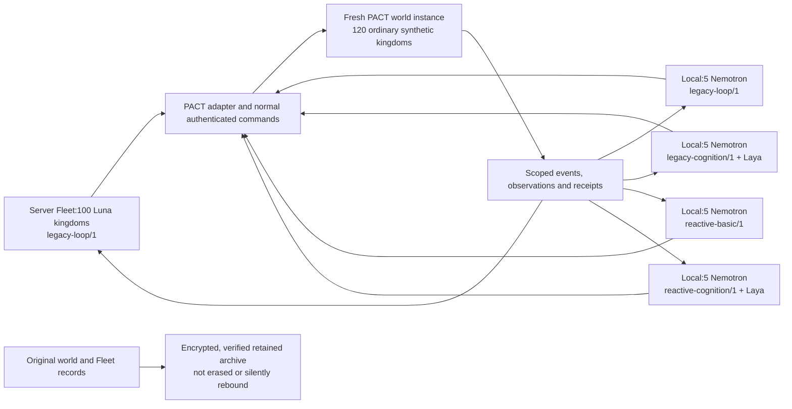

# Provider qualification and mixed-world design —18 October2026

**Proposed; documentation only.** Founder asks for explicit local qualification budgets and a future fresh game containing100 server Luna kingdoms plus local fleets. No real inference, new runs/accounts, runtime flag changes, server contact/reset, deployment or push is authorized by this planning assignment. Existing local953034e remains execution-disabled in configuration and both service overrides. Preserve all original cohorts, identities, terminal populations, encrypted history, exact uncertain commands and allocations. No delegation.

## Intended world

One shared world gives kingdoms partners, competitors and consequences. The100 Luna kingdoms provide activity and a product reference; local groups compare engine packages under the same Nemotron model. These are100 game identities, **not100 OpenAI subscriptions or parallel provider sessions**. Models decide whether to communicate, ally, refuse, fight or wait under normal authority; no communication quota, bonus, forced alliance or survival reward is introduced.

Designer calls for review:20 new local kingdoms in four groups of5; same hourly scheduled review target, two decisions/two actions per turn and common caps; event groups may wake earlier using the same allowance. All local models/pins are identical. These calls are proposals, not founder-approved numbers. F6 focused workers stay excluded from PACT until its coordination/parallel protocol exists and is separately qualified. Fleet remains environment-neutral; only the PACT adapter knows kingdoms and game schemas.

## Existing facts and missing capabilities

- Local installed source953034e has five engine descriptors but unchanged adapter flags expose only legacy compatibility. P1 events/P2 outlook are source-verified at PACT60ec57b, not certified deployed by this assignment. Enable/version-negotiate them only on explicitly approved qualification/new-world instances.
- Historical server configuration was `gpt-6-luna`, Codex CLI, medium, one shared execution slot. This is a dated local record, **not a fresh server inspection**. `src/codex.ts` preserves the native shared process lock,90s call signal,95s containment and tool-disabled read-only CLI. Do not increase concurrency or bypass account/provider allowance.
- Nemotron candidate is existing `nemotron-3-nano:4b`, Q4_K_M, digest `6cc467f054393a55e98a74098abde0c762ffb6d1d8cd64becf30458f38886197`, thinkingtrue,32K context,2000 generated-token setting and immediate unload. These are recorded pins, to be rechecked without generation at execution preflight; no download/model substitution is selected.
- Laya remains recall ordering, not an action authority: existing0.4.6/revision`e929ae5cf69bc34259cd2f95c9e91145b818b1f0`, certified helper/weights,3s bound and abstention/fallback. Only legacy-cognition/reactive-cognition select it.
- No supported full-world reset operator was found in the inspected operations code. `WorldClockService.bootstrap()` is idempotent initialization, not reset. Test-schema drop helpers are not production reset tools. World replacement needs a separate implementation/runbook and exact authorization.
- Fleet instance IDs are configured; that is insufficient to prove a database incarnation after reusing an origin. An immutable game-owned worldInstanceId, checked before reads/writes, is a prerequisite. Do not assume changing a URL or clearing local memory solves this.
- Binding uniqueness is local to each Fleet database. A combined enrollment roster must reject duplicate `(worldInstanceId,actorId)` across hosts; retain server kingdom leases/authorization as the authoritative write protection. Never copy credentials/history between controllers.
- Current budgets are cohort-scoped, consumed configurations are immutable and finite deadlines can make cohorts terminal. Do not launch a supposedly persistent population under a disposable24h terminal setup and then replace its identities. Add bounded authorization windows with audited renewal on stable nonterminal owners before the population launch; no reset of prior spending/unknowns. Cross-host ceilings are the sum of disjoint preallocated child caps, not a claimed existing distributed wallet.

## Explicit proposed budgets

Every execution reserves40000 tokens. Input delivery limit24000bytes; output setting2000; maximum2 model decisions and2 commands per turn;90s/model call and existing120s turn bound. Model and helper concurrency1 per physical/provider route. Retries and any additional reasoning consume the same caps; no automatic extensions. All stages below need separate exact approval/start/deadline/host/source/environment/configuration digests. Current approved allowance for new work is **0 executions**.

| Stage | Model executions maximum | Reserved tokens maximum | Time ceiling | Helper ceiling |
| --- | ---: | ---: | --- | ---: |
| Q1 local transport/calibration |8 Nemotron |320000 |15min |0 |
| Q2 four local engines,24 each |96 Nemotron |3840000 |4h |48 Laya |
| Q3 later Luna route qualification |24 Luna CLI executions |960000 |2h |0 |
| Q4 later new-world read-only shadow |48 Nemotron +12 Luna |2400000 |2h |24 Laya |
| Q5 first24h population:100 Luna |4800 |192000000 |24h authorization window |0 |
| Q5 first24h local:4 groups ×5 |960 total,240/group |38400000 total,9600000/group |same24h window |480 total |

**Immediate local qualification proposal is Q1+Q2:104 executions /4160000 reserved tokens, at most48 helper requests.** It uses synthetic/frozen observations and command sinks;0 actual game accounts/writes. Q3 is future work on the chosen Luna host with separately authorized access and shared-provider coordination; it does not touch the current server Fleet now. Q4 happens only after the approved new world/roster exists:12 decisions per profile against that exact instance, read-only/shadow; all proposed commands withheld. Q5 includes its first three normal hourly rounds as the probation period; those calls are inside the24h cap, not an extra allowance.

Q2: six scenarios ×two trials/profile, up to2 model executions/trial =24/profile. Cases cover development prerequisites; threat plus help offer; simultaneous completions/messages; scarce resources and trade/refusal; untrusted peer instructions; stale/version/receipt ambiguity. Failure/timeout/unknown transport paths are first injected using fakes; do not intentionally create unknown paid usage. Validate all actual supplied outputs; private evidence may be chunked to existing20-output artifact limits without omitting failures. Full48 trials must complete within caps; valid silence/wait is accepted. No scoring assumes communication or aggression is always correct.

Q4 results are world/source/configuration-scoped; fixture Q2 evidence cannot be relabelled as new-world provider certification. Generate instance-matched deterministic evidence plus real shadow evidence, then compose the exact release review. At no point may a passing syntax check alone authorize actions or turn the ordinary installed worker on. Local qualification uses an isolated budgeted harness with only the approved provider port; existing local workers stay disabled and the20 historical accounts remain excluded.

Q5 computes maximums from100×24 hourly opportunities×2 and20×24×2. Reactive event wake-ups spend the **same** group cap; they do not create extra daily allowance. The240/group cap is shared, not a guarantee of equal per-agent spending; report exposure and queue delays per kingdom. Use fixed24h authorization windows rather than assuming the current UTC-calendar `daily` counter equals a rolling24h window. Renewal must preserve lifetime accounting. There is no seven-day/indefinite execution authorization here; a future week would require fixed original deadline, explicit cumulative caps and supported continuation, not seven daily resets disguised as one budget.

### Costs and provider limits

Nemotron/Laya are already local: proposed external provider fees$0, excluding electricity/hardware. The Luna route stays the historical Codex/ChatGPT route for the proposal; no API-key migration or paid-credit purchase is selected. [Official Codex pricing](https://learn.chatgpt.com/docs/pricing) lists GPT-6 Luna Standard credit rates2.5 input/0.25 cached/12.5 output credits per1M tokens, with account-specific included limits. A4800-execution day averaging8000 uncached input+2000 total billable output tokens/execution would use approximately216 credits. This is an illustration, not a promised cost, quota or approval. The192M-token reservation, if all tokens were output at those rates, corresponds to2400 credits **conditional on actual usage staying inside the reservation**.

Important existing CLI limitation:2000 is a requested answer length, not a provider-enforced output cap; a40000 ledger reservation is not a hard financial ceiling. Returned usage over reservation fences further work while retaining the overrun. Unknown usage retains its full allocation and blocks exact recovery. Before Q3/Q5, the owner must review actual remaining plan allowance/paid-credit settings and accept the bounded one-in-flight exposure or choose a separately implemented/qualified hard-budget provider route. No automatic top-ups, model substitutions or parallel login/lock circumvention. API dollar prices do not price this CLI route. [Official Luna documentation](https://developers.openai.com/api/docs/models/gpt-6-luna) confirms the model/medium setting; it does not establish this account's entitlement or a provider SLA. Recheck pricing/access at later execution approval.

### Throughput gate

For100 hourly Luna turns at concurrency1, require measured end-to-end p95 turn service time≤25s:100×25=2500s of3600, approximately69.4% route occupancy. Q3 screens representative small/large frozen inputs in12 paired two-decision trials, including CLI/login/parsing overhead; Q4 adds actual authorized observation latency on the new world. Recompute the25s end-to-end gate after Q4 before gameplay admission.24 provider executions are a screening sample, not proof of tail behavior. Existing120s turn bounds alone would allow a3h20 serialized round. **No promise of100 every15min.** If the hourly gate fails, retain the100-kingdom target but choose a slower explicit cadence with correspondingly recalculated caps or separately qualify a different route before launch. Do not hide delay with catch-up runs or silently increase capacity.

For20 local actors, target p95≤60s/whole turn;20×60=1200s/hour leaves headroom for event work. Reserve one GPU execution slot shared by all four groups. Queue/event bursts can still delay responses; report that delay. Healthy waits are meaningful, not dispatch failures. During Q5 first three rounds, require every intended actor actually completes a reported turn/round with known usage and zero pending commands; aggregate heartbeats are not round acceptance. Halt admission on unknown usage, pending delivery, world/authority mismatch, cap/deadline, or material coverage/throughput failure; preserve committed effects and original identities.

## Fresh world instead of in-place wipe

Recommended way to implement the requested start-from-zero: a new empty PACT database/world generation with fresh world ID/issuer/key namespace and verified source/schema. Preserve the old world as an encrypted, restore-verified archive; do not execute TRUNCATE/DROP against live data or resurrect finished experiments. Only the **new** world starts at zero. Starting a new season would retain buildings/relationships and would not meet this request.

Later operator sequence: inventory all writers/clock/accounts/grants/pending settlements and backup policy; obtain exact old-world retirement scope; fence/drain every existing Fleet/automation/game writer (including the existing server50 only after permission); snapshot database, blobs, keys and receipts; verify restore; build an empty replacement database behind a separate provisional origin; validate world identity and rules; create a disjoint120-account roster through ordinary authorized enrollment; perform Q4 shadow qualification; approve canonical cutover and Q5 start. Preserve old unresolved allocations/reviews/commands in their original world records. New identities belong to an explicitly approved new-world population, not replacement accounts hiding failures. No old grants, queued events, memories, pending UUIDs or agents are rebound to the new instance.

Do not assume ordinary enrollment is supported while the rules clock is paused. Provision/interleave groups through supported APIs during a measured founding window, record game-time activation/baselines, then choose common first-inference anchorT0 for all120. Rotate which group is founded first; no economic gifts or forged clock/founding timestamps. If exact identical starting states are required, implement/certify a staging/activation protocol separately. Common inference time alone does not erase differing founding ages. Prove clean emptiness before enrollment, then ordinary starting resources and distinct ownership after enrollment. Human-account continuity, deletion scope and canonical-origin migration are explicit cutover decisions, not implied by this proposal.

A provisional world at a separate origin can preserve the old world, but cannot share a mutable provider login slot with a still-running old population without coordination. Canonical cutover/fencing and new server Fleet deployment require later explicit authorization. The current server's true state and backup availability must be inspected then; dated reports are not present-tense evidence.

## Comparison and continuation

Use balanced owner-goal/strategy assignment and interleaved founding; no private omniscient inputs or special game permissions for one group. The first meaningful comparison is the four local engine packages with the same Nemotron/checkpoint, common authority and caps. Luna-vs-local differences combine model, host, architecture and scheduling; they are a product comparison, not an architecture-only conclusion. Same-world groups also influence each other.100 background agents are not100 independent experimental replicas. The cognition packages include memory/recall/belief features; isolating a belief component or Laya alone would require a later matched ablation.

Report completed builds/production, upkeep losses, survival/threat exposure, commitments versus fulfilled obligations, useful trade/relationship outcomes, legitimate inactivity, latency/context failures, exact allocations/known usage, omissions and per-actor model opportunity. Keep subjective beliefs separate from authoritative receipts and later outcomes. Do not rank intelligence by message/action count or invent survival mechanics; existing scarcity/conflict/obligation consequences provide the initial environment. One day is operational acceptance, not evidence of long-term strategic superiority. Preserve these kingdoms across approved bounded window renewals; the game population is the product, comparison reports support decisions.

## What approval would select

The saved proposal has all execution/reset/deployment/enrollment authorizationsfalse and no selected actor IDs, secrets or absolute start. A later concrete authorization must select exact stage, source/contracts/model/settings/adapter digests, host and immutable world ID, fresh roster, goal/permission policy, route allowance/credit policy, child/window caps, UTC start/deadline (displayed in Europe/Berlin), monitor and stop/rollback actions. Provider qualification, world cutover and100+20 population admission remain separate decisions. No code/configuration/model call/reset occurs just because this design is saved.
