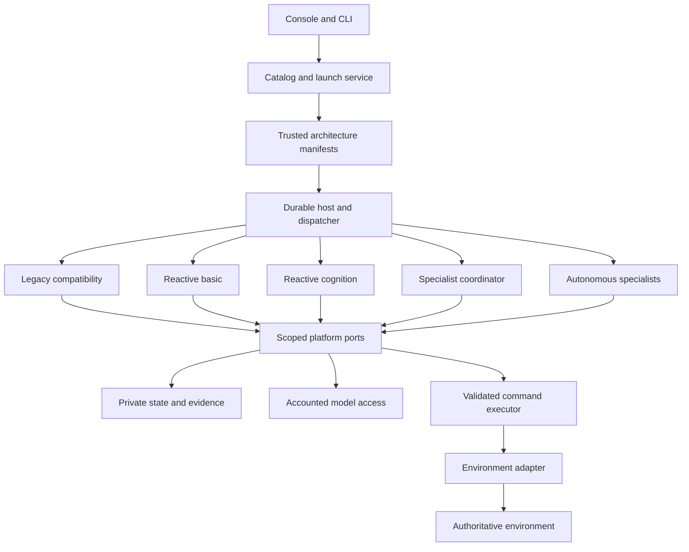
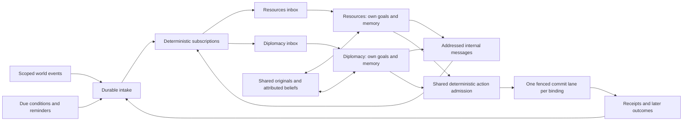

# Autonomous specialists and independent Fleet architectures

Date: 20 October 2026. Status: proposed design for review; implementation has not started.

Source review baseline: Fleet `421ad90a480ad4f6086ca8fffb69f542a920aa8f`. See the [code architecture review](../../architecture-review-20261020.md) for demonstrated coupling and exact affected files.

## 1. Intent and agreed requirements

The founder wants specialists with their own enduring goals and memory, capable of deciding and acting within their expertise rather than merely advising a central agent. They should share knowledge and respond to events. This must be an additional architecture alongside all current Fleet architectures. Each architecture should be independently understandable and maintainable, and easy to select and launch.

This document provides a concrete design and change map. It does not activate an engine, enroll accounts, grant inference, change existing budgets, install a release or alter game rules. Existing cohorts, history, unknown allocations and disabled installation remain outside this design work.

### Design choices proposed here

- Add `autonomous-specialists@1` as the sixth built-in profile. Preserve the existing five IDs and behavior.
- Start with persistent logical specialists inside Fleet's current process/database, not one service or model process per specialist.
- Use deterministic event routing and shared execution infrastructure. There is no compulsory central decision-making LLM.
- First implementation permits independent decisions and serial execution for one bound actor. Simultaneous reasoning is not required for autonomy and is deferred.
- Default all specialists to the cohort's chosen model; different per-specialist models are a later extension. Different goals and contexts do not imply independent model errors.
- Offer a two-role resources/diplomacy preset and a fuller resources/diplomacy/defense/development preset. Presets express responsibilities, not mandatory communication, alliances or action frequency.
- Preserve one environment per deployment for this release. The launcher explains unsupported environments rather than promising arbitrary adapters or cross-host rollout.
- Use the existing TypeScript, Node, PostgreSQL, React and provider infrastructure. No new agent framework, message broker or vector database is required.

These are recommendations for approval, not additional decisions already made by the founder.

## 2. Architectures coexist

| Exact profile | Owns its reasoning organization | Shared services |
| --- | --- | --- |
| `legacy-loop@1` | Original schedule/context/decision/action controller | Compatibility adapters to existing accounting and execution |
| `legacy-cognition@1` | Original controller with its historical cognition/recall configuration | Same compatibility boundary |
| `reactive-basic@1` | Focused event/timer tasks, reads, action or wait | Host, evidence, model admission, command execution |
| `reactive-cognition@1` | Reactive tasks plus its versioned continuity policy | Same host; explicitly selected continuity module |
| `specialist-coordinator@1` | Temporary focused workers and a coordinator selecting a command | Same host; coordination and continuity modules |
| **`autonomous-specialists@1`** | Persistent specialists, private goals/memory, addressed events and independently submitted actions | Same host; scoped state, evidence, delivery, action admission |

No old architecture becomes a mode flag inside the new engine. No consumed cohort changes architecture through a dropdown. Sharing a module does not share its private state.

Architecture selection remains per cohort. Multiple cohorts can select different architectures in the same Fleet deployment under shared host capacity. One bound kingdom has one controlling architecture instance; its specialists are internal components, not additional Fleet accounts or rival controllers.

## 3. Platform separation



### Proposed code ownership

```text
src/
  app/
    composition.ts                 constructs adapters, modules and host
    builtins.ts                    explicitly registers trusted architectures
  platform/
    architecture.ts               manifests and factory contracts
    engine-context.ts             scoped ports, no concrete stores/providers
    launch.ts                     common draft/check/start validation
    tasks.ts / event-intake.ts     durable delivery and work admission
    admission.ts / execution.ts    shared accounting and command lifecycle
    state.ts / evidence.ts         scoped persistence and evidence interfaces
    supervision / reporting       lifecycle and architecture-neutral status
  modules/
    decision-step/v1/             preserved bounded read/decide mechanics
    continuity/v1/                preserved existing continuity semantics
    evidence/                     journal/retention implementation adapters
    action-admission/v1/          effects, claims and revision checks
  engines/
    legacy/                       bridge, manifests and compatibility logic
    reactive/                     manifest, engine and tests
    continuity/                   manifest, engine and tests
    specialists/                  existing coordinator architecture
    autonomous-specialists/       new architecture only
      manifest.ts / engine.ts
      goals.ts / memory.ts / routing.ts
      messaging.ts / conflicts.ts / schemas.ts
  environments/
    pact.ts                       PACT adapter and capability negotiation
    pact-presets.ts                role goals, topics and permitted action mappings
```

This is a target ownership map, not a demand to rename every existing file at once. `runtime.ts` can remain the public entry point delegating to composition. The historical controller can remain physically in `src/engine.ts` behind a narrowly allowlisted legacy bridge.

Rules enforced by import-graph checks:

1. An engine imports its own internals, public platform ports and explicit shared module versions. It cannot import another engine implementation.
2. Generic platform modules do not import engines or PACT. Composition may import all registered implementations.
3. Engines cannot import concrete database, vault, raw model transport or game clients. The legacy bridge has documented exact exceptions until parity-preserving extraction is justified.
4. UI/CLI consume catalog and launch DTOs; they never infer capabilities from architecture names.
5. Environment-specific topics, role presets, action schemas and arithmetic stay in reviewed adapters. The generic specialist engine understands responsibilities and claims, not PACT resources or tool names.
6. Shared module changes are versioned when behavior changes. Refactoring old profiles preserves their decision-visible inputs, selection order, output handling and recovery behavior.

This is maintainability isolation, not a sandbox against malicious plugin code. Plugins are statically registered trusted source. No model can upload an executable architecture.

### Manifest and factory

Each architecture exposes one descriptor containing:

- Exact ID/version, display name, description and explicitly public report identity.
- Architecture configuration schema, schema version, defaults and compatible named presets.
- Required environment capabilities and schema versions.
- Supported triggers: periodic, event, deadline, internal message.
- Supported execution modes and whether sibling reasoning is implemented.
- Required module versions and private-state codec versions.
- Pure configuration validation and a factory receiving scoped services.
- Inspection metadata and maintenance hooks with bounded work.

The descriptor is an implementation fact, not runtime authority. Host admission intersects it with the selected launch configuration, environment contract, provider capacity, account authority and remaining budget.

Factories produce instances per immutable launch/binding scope, or stateless handlers with all state keyed by that scope. Mutable module-level memory must not leak between cohorts. Persistent state is authoritative; process-local caches are disposable and scoped.

Use the current `AgentEngine.run(context)` as a migration seam. Introduce a small public context containing opaque operation identity, binding, task, observation, cancellation, and interfaces for model requests, actions, evidence, state, messages, wake conditions and traces. It must not expose a `Store`, SQL client, credential broker or raw `Claim`. Existing engines initially receive compatibility adapters.

The conceptual contract is:

```typescript
interface ArchitectureDefinition {
  ref: { id: string; version: string };
  configSchema: JsonSchema;
  requirements: EnvironmentRequirements;
  triggers: TriggerKind[];
  executionModes: ExecutionMode[];
  modules: VersionedModuleRef[];
  stateCodecs: VersionedCodecRef[];
  validate(config: unknown, launch: LaunchInputs): ValidationResult;
  create(ports: ScopedPlatformPorts): ArchitectureInstance;
}

interface ArchitectureInstance {
  route(event: ScopedEvent): RecipientSpec[]; // Pure, bounded; no inference.
  run(context: ScopedOperation): Promise<void>;
}
```

Names above describe proposed interfaces, not existing exported types. Routing runs only for registered trigger-capable architectures; legacy routing is handled by its compatibility adapter. Platform code owns the transaction and persists returned recipient specifications, so routing cannot advance a cursor or write arbitrary task rows itself.

### Legacy preservation

Old cohorts without a platform profile keep their current scheduler and recovery path. New legacy drafts are selected through the common catalog but translated by the legacy descriptor into their existing model/cognition configuration. Historical records are never rewritten to pretend a manifest existed.

Unifying the user-facing launch contract does not require rewriting the old scheduler. Keep the compatibility lane explicit and tested. Removing it is not a prerequisite or an implied migration assignment.

## 4. A persistent specialist

A specialist belongs to one architecture instance and one authenticated environment binding. It does not create another game account, obtain its own credentials or acquire independent game authority.

```text
Specialist
  identity: instance + stable specialist ID + role/preset version
  charter: responsibility, owner priorities, permitted actions and limits
  goals: active/suspended/completed/abandoned objectives and subgoals
  memory: evidence-linked experiences, beliefs, predictions and plans
  inbox: subscribed external events and addressed internal messages
  execution: current task, wake conditions, pending intent, latest outcome
```

A charter is a configured responsibility. Specialists may create, revise, suspend and retire subgoals within it. They cannot rewrite the charter, owner priorities, permissions or budget. A new subgoal records its parent, rationale, supporting evidence, desired result, reevaluation condition and optional authoritative deadline. Rejection or changed circumstances can legitimately cause abandonment; completion is not compulsory.

The resources role might adopt “cover the next obligation while maintaining the owner's reserve.” Diplomacy may adopt “seek a replacement supplier before the current agreement expires.” These goals persist across unrelated events and process restarts. One specialist can sleep while another works.

A specialist's allowed output is a bounded structured envelope: goal revisions, memory updates, addressed messages, action intents, expectations and wake conditions. Narrating “I remembered this” does not persist a memory. Accepted writes and rejected updates are separately observable.

### Initial roles

| Role | Its own goal domain | Evidence it needs | Action responsibility |
| --- | --- | --- | --- |
| Resources | Material viability and agreed reserves | Stock, obligations, production and actual deliveries | Advertised resource operations within its configured scope; requests to other specialists |
| Diplomacy | Relationships, negotiations and commitments | Correspondence, offers, relevant outcomes and shared needs | External conversations and agreements within authority and shared resource checks |
| Defense | Readiness and response to known threats | Threats, forces, protection obligations and deadlines | Advertised defense actions subject to the same resource/authority gate |
| Development | Useful capacity and longer-term improvements | Prerequisites, available capacity, owner priorities and resource outlook | Advertised development actions and requests for allocations |

Observation, calculation and deadline evaluation are deterministic services. There is no observation LLM or mandatory strategic-review LLM. A later strategy specialist could propose goal changes, but would not automatically control all actions.

## 5. Event and work lifecycle



1. Intake records a scoped external event once. Event metadata is a pointer; relevant details require fresh authorized reads.
2. A pure router evaluates versioned subscriptions and produces zero or more recipient deliveries. Intake receipt, deliveries, task changes and cursor advance commit together.
3. Each recipient has its own delivery status. Related events coalesce by specialist and concern; separate conversations remain separate concerns.
4. The dispatcher selects an eligible specialist task using configured owner priority, real deadlines and bounded fairness. It does not ask an LLM who should think.
5. The specialist receives its charter, active relevant goals, fresh observations, relevant private memory, delivered shared evidence and messages.
6. It can wait, read, revise a goal, write memory, request another specialist's help, or submit its own action intent.
7. State changes, acknowledgment of the consumed deliveries, accepted internal messages and a durable pending-intent record commit together under the specialist state version and task fence. External execution uses the command journal and the same stable command ID.
8. Receipt reconciliation produces a durable delivery back to the origin specialist and relevant subscribers. Later material outcomes are different events; an accepted command is not a fulfilled goal.

The host executes durable tasks; it does not choose the next gameplay action. Every specialist has a path to execution without another model approving it.

### Fan-out and waiting

Existing `(binding,event_id) -> one task` sources remain unchanged for old profiles. Add recipient deliveries keyed by `(instance_id,event_id,specialist_id,subscription_version)` and explicitly join them to specialist tasks. Source deduplication and delivery deduplication are different operations.

Wake conditions support a received event, a deadline, a predicate over an authorized observation, a reply to a request, or an explicit periodic review. Predicate evaluation uses allowlisted adapter facts/functions; it never executes model-generated code. A missing response becomes “reply not observed by deadline,” not proof of refusal.

Event gaps generate a resync delivery to affected specialists and mark historical coverage incomplete. Resync must not invent missing conversation or delivery events. A fresh snapshot can change goals while leaving past outcomes unresolved.

### Work bounds

V1 uses one model operation per binding at a time and one canonical action lane. Independent specialists need not run simultaneously to own goals and make decisions. Different bindings retain ordinary host/provider admission. No PACT parallel-reasoning exception is requested.

Configuration includes finite active-goal, memory-packet, message-size, inbox, internal-message-chain and conflict-round bounds. Proposed first implementation caps one envelope at eight messages and one conflict negotiation at two rounds. These are source defaults for review, not new live budgets. Static presets have a finite role roster; specialists cannot spawn more specialists.

Internal messages carry a causation root, parent message and depth. Duplicate requests, no-op updates and repeated identical beliefs do not repeatedly wake peers. A chain stops at its configured depth/round bound; continuation needs new external evidence, an explicit due condition, or an operator decision. It cannot manufacture a fresh root to bypass the bound.

Queue admission coalesces replaceable observations before rejecting new low-priority work; command outcomes and obligation/deadline events must be durably retained or intake must apply visible backpressure without advancing past undelivered events. There is no silent dropping of critical events or unbounded inference on restart.

## 6. Memory and knowledge exchange

Private memory is keyed by `(architecture_instance, specialist_id, memory_schema_version)` and encrypted with scope-bound associated data. Specialists cannot overwrite one another's state. Shared evidence is scoped to the same authenticated actor/world and retains source provenance and visibility.

Four record classes remain distinct:

1. Original observed fact or statement with source and occurrence time.
2. Specialist interpretation with author, alternatives and uncertainty.
3. Predicted outcome with the evidence needed to evaluate it.
4. Intent/commitment with proposal, admission and later fulfillment status.

An interpretation being repeated by several specialists does not turn it into a fact. Internal publication is permission to consider the record, not a transfer of world authority. Models cannot promote peer claims to owner instructions.

Use a shared board of explicitly published summaries/references and addressed messages. Private scratch memories are not broadcast automatically. Sharing here is within one kingdom's architecture; sharing across kingdoms/accounts requires their ordinary permitted communication and is outside this design.

Retrieval is driven by the current goal, entity, conversation and causal chain. Protect relevant open obligations and their outcomes, diversify sources, then fill with recent state. Record candidate IDs, selected IDs, omitted counts and the final delivered evidence IDs. Include both original evidence and a supported interpretation when needed; never retain a conclusion while silently discarding its necessary support.

The existing missed-delivery retrieval diagnostic becomes a regression scenario for the new selector. The new memory policy is versioned separately; extracting shared storage must not silently change old profiles' ranking behavior.

No LLM writes are required on every activation. Original receipts and task/goal state are recorded deterministically. A structured memory update is optional, but its acceptance must be real and inspectable. Retention and source deletion follow existing privacy policies; expired evidence becomes unavailable rather than reconstructed from a summary.

## 7. Independent actions and competing goals

Autonomy means a specialist can author and submit its own intent. Execution still uses the shared host and authoritative environment.

### Admission steps

1. Check specialist charter, current owner policy and exact action schema.
2. Obtain fresh authorized state and complete effects from the adapter.
3. Check resources, authority claims, configured reserves, active promises and pending commitments.
4. Obtain a short local claim/reservation under the binding lock.
5. Journal a stable command ID and expected environment revision before submission.
6. Execute through the normal authenticated environment handler with atomic revision/effect validation.
7. Settle the claim only from an authoritative result or exact original-receipt reconciliation.

Fleet reservations are local coordination records, not reservations in PACT's economy and not authority over human or other-client actions. Environment commit validation is still required. Expired proposals must be freshly reconsidered. A pending or ambiguous dispatched command does not release its protection merely because a local lease expires.

### Resolving conflicts

Nonconflicting admissible work proceeds without a coordinator LLM. When two goals compete for the same resources or incompatible commitments:

- Deterministic policy first checks owner priorities, obligations, actual deadlines and existing reservations.
- If policy decides, return the reason to the affected specialists; do not invent a preference from role names.
- If judgment remains necessary, send a conflict record to the involved specialists. They may revise costs, defer, retract or propose a compatible alternative within the bounded negotiation.
- Compatible revised intents can proceed. Unresolved material tradeoffs remain blocked with the conflicting goals and a concrete next step, rather than granting a hidden planner unrestricted authority.

First-ready admission is not presented as optimal strategy. Record contested reservations, waiting duration and starvation; use fair task admission and bounded reservation lifetime for work that has definitely not dispatched.

External diplomatic wording cannot be formally checked for every implication. The diplomacy role is the sole external dialogue writer within the preset, and per-conversation work is serialized. Other specialists request communication internally. Structured agreement effects still pass shared validation; narrative consistency remains a measured limitation.

### PACT contract required

Current PACT exposes scoped events/outlooks but not F6's complete coordination/revision protocol. It cannot launch this architecture merely because Fleet code exists.

Add an independently advertised action-effects protocol, proposed `fleet.action-effects.v1`, rather than forcing the new engine to consume F6's coordinator-focused frame. It supplies authoritative revision scope, complete supported action effects, resource/authority/promise claim schemas, fresh validation and atomic expected-revision enforcement at commit. F6 can later use a compatibility mapping, but its existing advertised contract remains distinct.

For supported PACT actions, validation and commit must use the same existing domain formulas/handlers, transaction boundaries and locks. The revision scope must cover all actor resources, obligations, authority and referenced records whose changes invalidate the checks, including ordinary game ticks and other clients. A timestamp read immediately before submission is not sufficient.

Unsupported effects or incomplete revision coverage are a visible compatibility/action limitation, never an assumed zero cost. The first PACT implementation can expose a documented subset; no blanket “all gameplay supported” claim. Owner reserve constraints narrow legal behavior and cannot grant permission. A precise action/effect/revision matrix is an implementation prerequisite.

No parallel inference permission, new game economy, resource creation, autonomous mandate changes or new game accounts is required by this design.

## 8. Persistence, failure and recovery

Proposed additive logical records:

| Record | Purpose and key |
| --- | --- |
| `architecture_instances` | Binding, exact architecture/config/module digest and immutable launch identity |
| `specialist_instances` | Instance + specialist ID; charter version, lifecycle and state version |
| `specialist_goals` | Stable goal ID, parent, status, evidence, evaluation/wake conditions |
| `specialist_memories` | Scoped memory ID, type, source links, version, expiry and encrypted payload |
| `specialist_deliveries` | External/internal source + recipient + subscription version; processing cursor/status |
| `specialist_outbox` | Durable addressed messages, causation and delivery state |
| `specialist_intents` | Origin goal/task, stable command ID, complete claim set and decision status |
| `specialist_claims` | Binding-scoped resource/authority/promise coordination; pending-resolution state |

Exact physical tables/indexes can be consolidated during planning, provided the stated uniqueness, transaction, encryption and recovery boundaries remain. Existing `continuity_states`, event sources and legacy evidence are not repurposed or backfilled with invented specialist identities.

Each active specialist task has one fenced writer. State/outbox/intent acceptance uses compare-and-swap on the specialist state version. A lost version race discards stale proposed changes and requires fresh context; it cannot dispatch the attached action.

Pending-intent dispatch and result delivery are restartable host work. A crash after a command result is recorded but before its specialist receives it must be repaired from a durable result outbox or an equivalent idempotent scan, with a unique `(command_id,result_version,recipient)` delivery. Retrying delivery never repeats the world action. Process-local callbacks are insufficient.

State updates and an execution request can be atomic locally, but Fleet and PACT do not share a transaction. Use the durable intent/command journal boundary; never claim global exactly-once delivery. Duplicate events/messages are tolerated through stable IDs and idempotent recipient processing.

Persist per-allocation dispatch evidence and origin specialist/task, so crashes are classified from actual records. All inference, corrections and optional helper work retain the original parent allowance. Logical role quotas partition that allowance; they do not multiply it.

Known noncommitting failures can replan within limits. Unknown usage preserves the full allocation and existing recovery gate. Uncertain commands block conflicting work and use their original receipts; no specialist can create a replacement to bypass uncertainty. Credential/authority problems block the affected binding. A local malformed update can block one specialist task without corrupting other private memories, but actor-wide uncertainty still takes precedence.

Pause/stop fences work, cancels queued inference, retains durable state/outcomes and drains/reconciles admitted operations under existing rules. Restart reconstructs waiting tasks, unfinished goals and pending commands; it does not reset counters or make terminal cohorts runnable.

## 9. One launch experience

One catalog powers the console and a small CLI. Every architecture uses the same sequence:

1. Choose architecture **and version**.
2. Choose its preset and edit validated architecture settings.
3. Select the model/provider independently.
4. Connect the intended accounts through the existing environment flow.
5. Set the existing execution allowance, duration and wake policy.
6. Review readiness and start the selected draft.

Display all registered architectures, including incompatible ones with specific missing requirements. Ordinary use does not require a comparison/study. Architecture-specific controls come from bounded declarative schema metadata and reusable widgets; no executable UI from manifests.

The common launch service returns separate results for configuration validity, adapter capabilities, credential readiness, provider availability/capacity, qualification evidence, remaining allowance and execution-enable state. Capability compatibility alone is not “ready to run.”

Preview/draft/check cannot enroll accounts, call models or start work. Credential connection is an explicit step. Start rechecks current conditions transactionally, records the exact manifest/config digest and is idempotent under a request ID. It cannot silently choose another architecture or enable a globally disabled installation.

Proposed CLI syntax, not currently implemented:

```text
fleet architectures list
fleet launch check --file launch.json
fleet launch draft --file launch.json
fleet launch start --draft <id>
```

`launch.json` refers to architecture/version, registered preset, architecture settings, model reference, environment, existing account bindings, limits and wake policy. It contains no credentials. All CLI commands use the same authenticated launch service and error vocabulary as the console.

For versioned configuration, `engine_profile` remains the compatibility reference; new launch snapshots add manifest/config/module digests and schema versions. Old snapshots continue to display their recorded or inferred provenance accurately.

## 10. What must change

| Area | Existing source | Required work |
| --- | --- | --- |
| Registry and composition | `src/platform/engine-registry.ts`, `profiles.ts`, `src/runtime.ts` | Descriptors/factories, pure generic references, legacy ownership split, static built-ins |
| Engine boundaries | `src/engines/continuity/engine.ts`, `state.ts`, `src/engines/specialists/coordinator.ts` | Remove sibling-engine imports through versioned shared modules and injected ports |
| Host/model/recovery | `src/platform/supervisor.ts`, `admission.ts`, `src/store.ts`, `src/worker.ts` | Descriptor-driven modes, scoped operation identity, per-allocation recovery facts and maintenance registration |
| Launch and configuration | `src/platform/profile-console.ts`, `src/domain.ts`, `src/store.ts`, `src/server.ts`, `web/profiles.tsx` | Exact-version catalog, architecture/model separation, common readiness service and guided launch; add CLI |
| Event routing | `src/platform/event-intake.ts`, `tasks.ts`, migrations | Recipient fan-out, durable internal outbox, scoped task keys, conditions and backpressure |
| State/evidence | Existing cognition/continuity adapters plus new scoped repositories | Specialist goals/memory, attributed shared records, delivery-aware retrieval and isolation |
| New architecture | New `src/engines/autonomous-specialists/` | Charter/goal lifecycle, selective context, independent actions, messaging and conflict protocol |
| PACT adapter | `src/environments/pact.ts`, `src/games/pact/` and paired PACT source | Presets, action-effects/revision contract, claim mapping and handler-level acceptance |
| Operations and reports | `src/platform/reports.ts`, web inspectors | Specialist goals, wake reasons, delivered evidence, messages, conflicts, action outcomes and total usage |
| Enforcement | `scripts/check-boundaries.mjs`, unit/integration/acceptance suites | Import graph, version-selection fixtures, old-profile parity and deterministic specialist scenarios |

## 11. Delivery sequence and acceptance

| Package | Deliverable | Required evidence before moving on |
| --- | --- | --- |
| AS-01 | Manifest/catalog and common launch validation | A fixture architecture with two versions appears, validates and drafts through the same UI/API; unsupported versions fail explicitly; old settings retain behavior |
| AS-02 | Scoped ports, shared-module extraction and boundaries | All five existing profiles retain fake-provider packets, decisions, allocations, receipts and recovery behavior; forbidden sibling/storage imports fail |
| AS-03 | Specialist state and delivery infrastructure | Isolation, restart persistence, one-to-many delivery, transactional cursor/outbox, deduplication, stale writer fencing, expiry and gap handling |
| AS-04 | Autonomous specialist engine with synthetic environment | Two specialists persist different goals, handle different events, exchange evidence and each commit an admissible action without a coordinator call |
| AS-05 | PACT effects/revision integration | Handler-level races with game ticks/other clients, resource and promise conflicts, unsupported effects and unchanged authority; no real account required |
| AS-06 | Complete guided launch, CLI and inspectors | Same readiness outcomes across entry points, no preview side effects, exact-version start, idempotent start, observable per-specialist lifecycle |
| AS-07 | Qualification proposal, then authorized execution | Exact source/provider/adapter budget proposal; only a separately authorized run can establish real-model/game quality |

AS-01 includes catalog/readiness foundations; AS-06 completes the user flow once specialist operation and PACT requirements can be represented accurately. This is the implementation dependency outline; a detailed task plan follows design approval.

### Acceptance scenarios

- **Independent initiative:** Resources notices a shortage and requests help; diplomacy selects its own negotiation goal and acts without a central model selecting it.
- **Persistent difference:** After restart, diplomacy remembers an unfulfilled promise while development retains its different unfinished plan.
- **Selective wake:** A building completion wakes its subscribers, not every specialist; a delivery can wake both resources and diplomacy exactly once each.
- **Memory reaches decision:** A retained missed-delivery outcome appears in the relevant next negotiation context despite repeated stock observations.
- **Conflicting spending:** Two intents fit separately but exceed shared stock together. One cannot consume stock protected by the other's admitted claim; stale intents are rejected at authoritative commit.
- **No hidden veto agent:** A nonconflicting specialist action reaches the executor with zero coordinator model calls.
- **Bounded discussion:** Two specialists disagree; negotiation terminates at the configured bound without creating fresh self-triggered chains.
- **Receipt truth:** Proposal, admission, actual delivery, default and unknown outcome remain different states.
- **Fault recovery:** Crash after model dispatch, after local state commit, before command send and after ambiguous send preserves usage and uses original command IDs.
- **Architecture isolation:** A test-only architecture can be registered and launched against a synthetic adapter without adding engine-ID branches to host, store, intake, UI or reporting.
- **Compatibility:** Old consumed cohorts, profiles, namespaces, model flags, pending commands, counters and terminal states remain unchanged.

Measure useful outcomes, fulfilled obligations, reserve violations, response/missed-deadline latency, blocked goals, retrieval omissions and total compute. More messages, goals, memory writes or actions do not define success. Compare against existing reactive and coordinator profiles under matched limits; interacting worlds and different models remain confounders.

## 12. Review disposition

Local builder-oriented self-review completed; repository instructions prohibit delegation. The review checked whether an implementer could identify the owning component, persistence boundary, authority, wake behavior and failure behavior for each proposed operation.

The review clarified four otherwise consequential gaps: cohort-level selection versus internal specialist identity; pure routing under host-owned transactions; atomic acknowledgment of deliveries with state/outbox acceptance; and durable command-result delivery after restart. These are now explicit above.

No additional founder answer is needed to prepare a detailed offline implementation plan once the design choices in section 1 are approved. The PACT action/effect/revision matrix still requires source investigation during AS-05 planning; support must remain unavailable until its complete coverage can be demonstrated.

The design intentionally leaves physical table consolidation, UI widget details and module file naming to the implementer. It does not leave the authority model, central-controller question, architecture coexistence, event fan-out, state isolation or uncertain-command behavior unspecified.

No model budget, deployment or activation is requested by this document. Approval of this design would lead to a detailed implementation plan; actual rollout and model qualification retain their separate scope.
