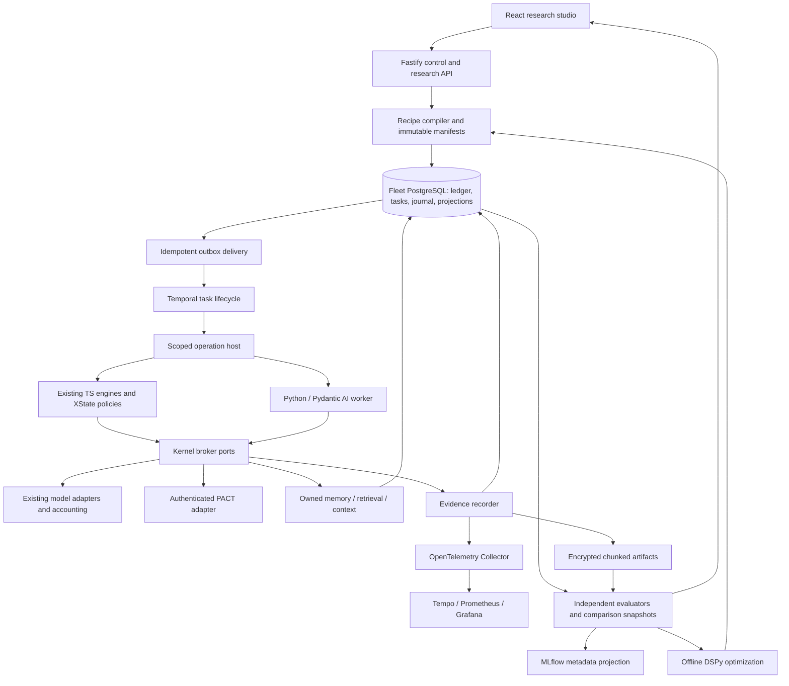

# PACT research engine: migration design

30 October 2026. Proposed source and offline migration scope, following the owner's request for a full implementation plan. The owner supports Python/Pydantic AI and Temporal where they improve observation, accuracy, or reliability. This document specifies that bounded adoption; it does not establish that a language or framework is inherently more reliable.

The [implementation plan](../plans/2026-10-30-pact-research-engine.md) is the execution map. The [broad target architecture](../../proposals/fleet-target-architecture-20261030.md) remains the future vision; this design controls the narrower release. Existing completed work and deferred milestones are evidence, not assignments to reopen them.

## 1. Outcome and scope

Build a configurable, inspectable, experimentally testable Fleet engine for **PACT**. Researchers must be able to explain what an agent received, which transformations produced its context, what it proposed, what Fleet admitted, what PACT confirmed, and what subsequently happened. They must be able to compare outcomes against resources and uncertainty, not just count calls or actions.

| Include in this release | Explicitly defer |
| --- | --- |
| The six selected tools: fast-check, Promptfoo, XState, OpenTelemetry, DSPy, PostgreSQL full-text search and pgvector. | Certifying another game, game-agnostic authoring, connector marketplace, universal environment descriptors. |
| Temporal task orchestration, a scoped Python/Pydantic AI worker, typed cross-language contracts, and a PACT reference recipe. | Rewriting the authoritative kernel/control API in Python solely for uniformity; replacing working provider adapters without evidence. |
| Owned evidence journal, complete paginated inspection/export, causal visualization, metric catalog, independent evaluation, experiment tracking, retrieval/context experiments. | Pixels/audio, Rust capture/control, C#/C++ engine integrations, fast control loops, Gym/PettingZoo facades, Ray, RL training and learned controllers. |
| PACT scripted, advisory, deliberative, and existing specialist recipes using the same authority gates; exact profile qualification. | Installing every researched memory/agent framework. Graphiti, Mem0, Letta, LangMem, LlamaIndex and Haystack remain candidates, not dependencies. |
| Rehearsal on fresh synthetic Fleet/PACT fixtures, repeatable offline suites, packaging and operational instructions. | Inference, game runs, enrollment, deployment, resets, recovery review, budget/schedule changes, automatic promotion, commits or pushes under this planning assignment. |

"Perfect" means explicit contracts and demanding, testable acceptance criteria. It is not a claim of bug-free code, guaranteed strategic success, complete knowledge of a provider, or a numerical reliability percentage before representative measurements exist.

## 2. Starting point and preserved behavior

Current Fleet uses Node 26, TypeScript, Fastify, React and PostgreSQL 17. Composition is in `src/app/composition.ts`; `src/runtime.ts` delegates to it. Durable task/claim services, scoped engine services, action execution, provider capacity and the original token ledger already exist. The deployed game authority remains PACT through its authenticated API. Deployed Fleet must not import PACT source or read its database.

`src/observability.ts`, `web/runs.tsx`, `src/call-metrics.ts`, `web/metrics.tsx`, `src/platform/workflow-metrics.ts`, and existing comparison reports provide useful foundations. Rich run debug records currently have a 256 KiB bound; ordinary details have an 8 KiB bound. Oversized details can be omitted. The metrics call list is capped at 200. The new design removes those as investigation ceilings through artifact chunking and pagination; bounded individual responses remain necessary. Historical omitted/expired evidence cannot be recreated.

Preserve IDs, bindings, credentials, encrypted history, goals, mandates, budgets, full unknown allocations, reservations, queue contents, pending command bodies/IDs, schedule anchors, terminal states and original receipt semantics. Existing consumed cohorts remain pinned. No schema migration enrolls or starts a cohort. An old run is labeled with its actual historical engine and observation limitations, never relabeled as having passed new qualification.

## 3. Logical and physical architecture

This is a modular system, not a service for every box. Keep the current TypeScript control API and small transactional authority/accounting kernel. Introduce a Python worker process because it gives a practical home to Pydantic AI, DSPy and embedding research. Use Protobuf/gRPC at that actual process boundary, not throughout every TypeScript call. Keep React/TypeScript for the studio. Do not migrate the existing certified Laya environment or invalidate its certificate as incidental setup.

Temporal owns the new task's durable waits, wake delivery and operation scheduling. PostgreSQL owns effect identities, admission/fences, reservations, usage, command journals and recorded results. SQL lifecycle columns are reconciliation projections for Temporal-owned tasks; the existing scheduler must exclude them. Historical legacy/platform tasks retain their current owner. XState owns pure local policy state and proposals; it performs no network calls or effectful invoked actors. Pydantic AI owns worker-local model/tool composition, not global retries or authority. Fleet remains able to replace each through a conformance-tested port.

Use one workflow per explicitly enrolled logical task, keyed `fleet-task/<taskId>`, rather than one workflow per inference token or PACT tick. Continue-as-new carries logical task identity, processed wake IDs and checkpoint references; workflow execution IDs are not command IDs. Private content stays outside workflow arguments, histories, search attributes and dashboard logs.

## 4. Contracts, configuration and state ownership

`schemas/run-manifest.v1.schema.json` is the recipe/manifest source; Protobuf files under `contracts/fleet/v1/` are the process-wire source. Generated TypeScript and Python bindings are checked for drift. JSON adapters preserve 64-bit counters as decimal strings and distinguish absent values from zero. External account/entity identifiers remain opaque strings.

The resolved manifest seals: source/build/dependency digests; exact profile/component versions; PACT API/effect/observation versions and world incarnation; actor/participant roles; model route/model and inference parameters; context and retrieval policy; memory namespace and embedding revision/dimension; declared tools and permissions; clocks/deadlines; resource limits; evidence/retention/indexing policy; seed where applicable; evaluator/dataset/split identities. Secrets and grants are references, not manifest contents. Hash canonical bytes; changes create a new manifest. Qualification binds this digest plus the tested provider/environment capability fingerprint and expires or invalidates when those inputs change.

Two labels are sufficient: `experimental` and `qualified`. Both enforce the same non-disableable identity, permission, lease, privacy, budget, fencing and journal rules. Experimental does not mean arbitrary code may acquire provider/game credentials. Unsupported semantic combinations fail compilation with machine-readable errors. Validate clocks/units, action-versus-receipt semantics, observation freshness, state/checkpoint compatibility, model/tool schema capability and retrieval policy as well as JSON shape.

Core API vocabulary, defined by work package 01:

| Type / port | Contract |
| --- | --- |
| `RunScope` | `runId`, `agentId`, `bindingId`, `turnId`, `taskId`, `operationId`, `operationEpoch`, optional `participantId`, `manifestDigest`. Created and validated by the kernel. |
| `OperationKey` | `operationId`, `operationEpoch`, `logicalStepId`; a stable identity, never a new key on retry. |
| `EvidenceEvent` | Schema/version, immutable event ID, scope, stream ID and decimal `sequence`, kind, causal parent IDs, occurrence/recording clocks, safe attributes, artifact refs and coverage status. |
| `ArtifactRef` | Opaque ID, content type, byte count, chunk count, ciphertext digest, privacy/retention class; never a public storage path or credential. |
| `WorkerCheckpoint` | Worker/component version, expected previous version, stable step map, source refs and encrypted state ref. No claim that it saves PACT state. |
| `DecisionProposal` | Typed read/action/wait/advisory proposal, supplied evidence refs and current preconditions; no self-approved authority. |
| `BrokerResult` | `completed`, `not_dispatched`, `pending` or `unknown`, original allocation/command identity when created, recorded result/artifact refs. Null usage remains null. |
| `Coverage` | Expected/recorded units and status: `complete`, `partial`, `unavailable`, `withheld` or `expired`, with typed reasons. Count and byte coverage are distinct. |

The broker offers `requestModel(scope, key, request)`, `readGame(scope, key, query)`, `proposeAction(scope, key, proposal)`, `checkpoint(scope, expectedVersion, state)` and `lookup(scope, key)`. All authorization uses persisted authenticated scope, not worker-supplied copies of a budget or binding. A repeated key with different input bytes is a conflict; the same key returns its recorded result or uncertainty. Helpers, rerankers that call a model, judges and optimizers receive explicit allocations and purpose labels.

Step uniqueness is `(operationId, logicalStepId)` across epochs. A new dispatch requires the current scope epoch and a key created in that epoch. An authenticated resumed owner can look up earlier-epoch results through its recorded step map, preserving the original key/allocation/command; it cannot redispatch that step. Old workers cannot create new effects. Recording a late result is a restricted settlement path, not an extension of the old worker's authority.

Workers have no database, game, provider, vault or operator credentials. Production packaging restricts egress to the scoped broker/approved local compute endpoint, filesystem to owned temporary/state paths, and resources to declared limits. Loopback gRPC alone is not process isolation. The reference Python container/network policy and a native supervised development mode are distinct; only the former can receive isolation qualification. Advisory roles cannot commit actions. Specialist communications and shared state continue to use the existing scoped participant/skill services.

## 5. Recovery, dispatch and cancellation

| Boundary | Required behavior |
| --- | --- |
| SQL commit succeeds, Temporal delivery fails | Retry the same outbox item; deduplicate the workflow/wake identity. No lost task or second owner. |
| Duplicate Temporal activity / broker RPC | Read the existing step journal before executing. Same key and payload has one retained operation; conflicting payload is refused. |
| Reservation made, dispatch not proved absent | Keep the original full reservation and unknown status; do not create a fresh model call to discover what happened. |
| Model reply received, worker acknowledgement lost | Return the recorded reply on lookup; no new inference. If recording failed, mark an evidence gap and preserve accounting/uncertainty. |
| PACT accepted, HTTP response lost | Query the original receipt through the existing authorized reconciliation path. Never submit a replacement ID. |
| Worker dies mid-step | Resume only from a recorded checkpoint/step result. Pending or unknown external work blocks resubmission. No automatic restart of the whole agent loop. |
| Cancel arrives during provider/action dispatch | Persist the stop request and fence first. Track requested, fenced, worker acknowledged and effects reconciled separately. In-flight effects can still settle. |
| Late old worker replies | Record late evidence/usage under its original identity; reject new effects using an expired operation epoch. Never clear unknown usage merely because a worker stopped. |
| Temporal unavailable | No new Temporal-owned dispatch. Existing retained obligations remain visible; no fallback to the legacy scheduler. |

Use explicit activity retry policies. Effectful execution activities use `maximumAttempts: 1`; bounded retry is permitted for idempotent lookup/outbox delivery and pure projections. Retried activities still cannot bypass the SQL dispatch journal. Pydantic AI output repair and tool retries are disabled by default; an explicitly configured repair is a new budgeted, observed logical step. No nested framework durability layer or automatic direct provider fallback is installed.

## 6. Full observation contract

"Full" means all **Fleet-owned, exposed and authorized** events and payloads for an opted-in run. It does not mean hidden model reasoning, unexposed provider backend events, other players' private state, or facts Fleet never observed. Capture explanations/analysis only where the provider actually returns an authorized field; no dependency on hidden chain-of-thought.

### 6.1 Required event families

1. Manifest resolution/validation, task arrival/coalescing, cursor resync, admission/refusal, claims, fences, scheduler ownership, workflow wake/retry/timeout/cancellation and checkpoints.
2. Route/capacity queue enter/leave/deferral/drain, resource demand/reservation/release, provider dispatch, returned streaming chunks when exposed, final output/schema parsing, usage settlement and late/unknown usage.
3. Authorized PACT reads and event intake: exact query/arguments, delivered result/envelope, source IDs, visibility, game clock, freshness, sequence/coverage and errors.
4. Memory capture/revision/expiry, candidate retrieval/ranking/filtering, embedding/model revision, selected/omitted sources, contradictions and fact-versus-belief classification.
5. Context construction: ordered source chunks, transformations, compression or truncation, reasons, byte/token accounting, and the **final prepared messages, schema and inference settings at the actual provider boundary**.
6. Decision/proposal, grounded validation/refusal, correction/repair, skill selection/invocation, specialist messages/arbitration, cognition/state writes and optimistic-version conflicts.
7. Command journal/preflight/lease/dispatch/receipt, uncertain results/reconciliation, admitted-versus-completed effects, waits and their reasons, later observable goal/negotiation outcomes.
8. Evaluator execution, dataset/split/version, metric aggregation/coverage, comparison snapshots, human annotation and optimization candidates/promotions.

Instrument legacy, task, continuity, specialist, skill, helper and new Python paths. A call-count reconciliation test must detect an uninstrumented branch. Observers record existing interactions and do not introduce additional game/model reads; any future monitoring read is a separately authorized, counted action.

### 6.2 Storage and completeness

Use an append-only SQL journal with unique producer/event keys, per-stream durable sequence and causal links across streams. There is no invented global chronology for parallel workers. Record UTC occurrence/ingest time, local monotonic durations with process identity, and typed PACT time; show clock uncertainty. A gap between events is not an operation duration. Events can have multiple causes and late arrival.

Keep safe, typed metadata in SQL; keep private payloads as authenticated-encrypted chunks in a protected artifact store. Reference implementation is local filesystem storage with a versioned storage port, atomic temporary-write/rename and orphan reconciliation. Maximum plaintext chunk size is **1 MiB**; a 2 MiB model body becomes multiple chunks, not an omitted summary. Large streams are bounded by manifest byte/disk quotas. Fetch defaults to **200 events**, maximum **500 per page**, with stable cursor, explicit total/hasMore/snapshot identity; exhaustive export streams every retained page and validates counts/digests.

Do not rely on arbitrary regex scrubbing to distinguish secrets from evidence. Auth headers, cookies, keys, grants and transport credentials are excluded by construction. Authorized final application content is encrypted without silently modifying it. A required privacy redaction/withholding creates a typed gap and records its scope; the UI never calls those bytes exact. Export is authorized and encrypted by default; any decrypted export needs an explicit request and protected destination. No prompts, peer text or private payloads enter OTel attributes, metrics labels, Temporal history, MLflow autologging or browser logs.

Private observation retains the current **30-day** policy unless a separately approved policy changes it. Consent/revocation and expiry propagate to chunks, derived projections, retrieval indexes, exports under Fleet control and cached UI responses. Required recovery/accounting records retain their existing distinct policy. Counts/tombstones retained after deletion must contain only permitted minimal metadata. Expiry is not evidence corruption.

A strict research profile requires durable intent metadata and any required pre-dispatch input artifacts before model/action dispatch. Recorder unavailability before dispatch refuses work with `EVIDENCE_UNAVAILABLE`. After dispatch, recovery/accounting settlement must continue even if the observation backend fails; mark incomplete evidence and stop further dispatch when bounded capture cannot recover. No finite disk can guarantee all bytes through an unlimited outage. The journal is authoritative for investigation; OTel delivery may lag or fail without erasing it. Each terminal run has a completeness manifest reconciled against all owned call/action/task records. "100% complete" is a measured coverage claim within this contract, never a platform-wide promise.

## 7. Observability backends and mandatory studio views

OpenTelemetry provides cross-process traces, safe structured operational events and metrics. Use a Collector, Tempo for traces, Prometheus for operational metrics and Grafana dashboards. The owned journal/artifacts remain the audit source and feed Fleet's richer run UI. Qualified research uses no trace sampling for owned run spans; unexpected drop/backpressure is measured. Prometheus labels are bounded (component/profile/outcome), never run/agent/command IDs or arbitrary errors; drilldown IDs belong in traces/journal. Pin Fleet semantic conventions; upstream generative-AI conventions may change.

Apache ECharts is the reference chart library; graph layout uses a deterministic layout adapter. All views need keyboard access, useful text/table equivalents, explicit units, missing-data markers, filter provenance, stable deep links to event IDs and authorized exports. Graphs must not depend on a proprietary editor. Raw-provider chain-of-thought visualization is not a requirement.

| Mandatory view | It must answer |
| --- | --- |
| Run timeline and causal graph | What happened, in what per-stream order, with which parallel lanes, waits, retries, queue/provider/action durations, parents, cancellations and unresolved gaps? |
| Request/context inspector | What exact allowed input was delivered? Which sources were selected, omitted, transformed or compressed, by which versions, with what budgets and coverage? |
| Memory/state/skill lineage | Which observation produced a memory/belief/plan/skill, which revision was retrieved, what contradicted/expired, and which decisions used it? |
| Resource and service charts | Where were queueing, concurrency, input/output limits, reservations, actual/unknown tokens, deadlines, disk/backlog and exporter losses? |
| PACT outcome timeline | What was proposed/admitted/confirmed/completed? Which owned objective, building, contact, agreement or negotiation outcome is actually supported? |
| Experiment comparison | Which conditions differ, how many independent units were tested, what changed in outcome/cost/latency with uncertainty and missingness, and where are confounds? |
| Fleet overview | Which recipes/tasks are waiting, progressing, blocked or uncertain; which evidence is complete; which incidents need inspection? |

Communication networks show delivery/replies/agreement evidence separately. A dense network is not social intelligence. Pareto plots show declared tradeoffs (e.g. verified objective success versus known tokens), not an invented universal agent score. Historical reports visibly lack fields that were never captured.

## 8. Memory, retrieval and context

Keep typed working state, episodes, beliefs, plans, reflections, specialist state and skills as distinct records with source refs, actor visibility, observed/effective times, version and retention. A peer statement is evidence of speech; an agent belief is not independent corroboration; command admission is not future completion. Do not replace these records with a single vector database or summaries that lose their evidence.

Offer a versioned retrieval port with these reference strategies: current lexical/recency baseline, PostgreSQL full-text search, exact pgvector cosine search, and reciprocal-rank fusion of lexical/vector results. Use GIN for FTS, language configuration recorded per corpus/query, explicit handling of unsupported language. Start vector qualification with exact search; HNSW is an experimental option only after recall@k and filtered-tenant tests against exact results. Fix fusion constant to **60** in `rrf-v1`; rank starts at 1 and stable source ID breaks ties. Keep top-k, recency, importance and mandatory-source selection explicit in policy.

Sentence Transformers is the reference local embedding adapter. Pin model revision, license, digest, dimension, preprocessing and normalization; `trust_remote_code=false`, no request-time downloads or unapproved external upload. Qualification uses frozen fake embeddings plus an optional separately provisioned real artifact fixture. Changing embeddings creates a new index namespace; no mixed-dimension or mixed-model comparisons. Any model-based reranking/summarization uses the compute broker and consumes a declared budget.

**Search indexes reveal information.** PostgreSQL FTS lexemes and embeddings are not encrypted private text. Creating them from the current encrypted journal changes its threat model. Keep raw evidence encrypted. A private derived index requires explicit indexing consent/policy, a dedicated non-owner role, forced row-level scope isolation, disk/backup encryption and deletion propagation. No such live consent is granted here. Profiles without indexing permission use their declared existing recall policy or fail compilation if hybrid retrieval is required; there is no silent fallback. Inspect/explain permission is separate from permission to create an index. This release implements both policies and tests them with synthetic corpora.

Context assembly produces a deterministic ordered source map, mandatory-source constraints, exact final messages, supplied schema/byte/token limits, omitted reasons and transformation records. Pin tokenizers where available; mark estimates where not. Preserve owner guidance, fresh observations, actual feedback and exact pending-command evidence. Compression is off in the qualified reference recipe until held-out factual/decision tests pass; no automatic helper-model call merely to fill context. Retrieval relevance is evaluated separately from downstream decision correctness.

## 9. Metric catalog and independent evaluation

Every metric has an ID/version, unit, direction or neutral interpretation, formula, numerator/denominator, population, time basis/window, coverage, exclusions, source refs and evaluator version. No zero fills unknown values. Counts of missing/expired/withheld records accompany aggregates. Timestamp filters use half-open `[start,end)` windows and declare whether creation, dispatch, settlement or completion time is used. Late settlement updates a new snapshot, never silently changes an old published result.

| Family | Required measurements and interpretation |
| --- | --- |
| Integrity | Unauthorized/isolation/duplicate-effect violations; stale-fence refusals; pending/unknown commands; known/not-dispatched/unknown model calls; reservation conservation; original-ID reconciliation success; evidence count/byte coverage. A refusal is protection, not useful task completion. |
| Runtime | Logical tasks, attempts, calls, tool reads, actions and waits separately; admission deferrals/fairness, queue/service/end-to-end p50/p95/max with sample count, deadline/cancellation/recovery latencies, event lag, active/blocked/unresolved work and censoring. |
| Resources | Known input/output/cache/reasoning tokens where exposed, reserved/unknown allocations, calls and helper purpose, request/schema bytes and limit utilization, output-cap hits, compute CPU/RAM/disk, storage/event rates and telemetry overhead. Monetary cost only with a versioned applicable price and billable-unit evidence. |
| Accuracy | Parse/schema validity, factual correctness, objective correctness, first-attempt correctness, grounded citation correctness, contradictory/expired source use, proposal validity and valid proposals wrongly rejected. Grade denominators include only graded cases and report ungraded counts. |
| Recovery | First-pass failures, correction attempts, repeated identical failures, eligible recoveries and verified successful recoveries; abandoned/blocked/censored attempts remain separate. Recovery is not inferred from a second well-formed response. |
| Retrieval/context | Recall@k, precision@k, MRR/nDCG with labeled relevance; mandatory-source coverage, source freshness, contradiction/unsupported citation rate; context omission/truncation, retrieval/embedding latency and cost. |
| PACT effectiveness | Authorized objective completion and time-to-observed-completion; committed versus completed construction/upgrade; confirmed contact/agreement, delivered message/reply and scoped negotiation outcome. Declare observation opportunities and delayed/unobserved results. Preserve game-economy semantics. |
| Team/skills | Per-role allocations, observed delivery/duplicate work, proposal acceptance, arbitration conflict/delay, skill retrieval/invocation success and verified objective contribution. Message volume and self-reported plan completion are descriptive only. |
| Experiment quality | Independent world/session units and seeds, assignment/order, manifest differences, budget/time opportunities, baseline, confidence interval method, missingness, interference, dataset overlap and evidence completeness. |

Example formulas pinned for the first catalog:

- `objective_success_rate.v1 = verified_completed_objectives / graded_objectives`; report ungraded and censored separately. Definition of an objective and its observation horizon belongs to the evaluator manifest.
- `first_pass_accuracy.v1 = correct_first_attempts / graded_first_attempts`.
- `recovery_rate.v1 = verified_recovered_failures / recovery_eligible_failures`, with eligibility specified before the run.
- `duplicate_effect_rate.v1 = duplicate_confirmed_logical_effects / confirmed_logical_effects`; zero denominator produces null, and any duplicate is a release failure regardless of this rate.
- `known_tokens_per_success.v1 = known_input_plus_output_tokens / verified_completed_objectives`, accompanied by unknown allocation count/reserved tokens and exclusion flags; unavailable for cost-efficiency ranking while material usage is unknown.
- `evidence_event_coverage.v1 = recorded_required_event_units / expected_required_event_units`; payload-byte coverage is a separate value and a redacted response is not byte-complete.
- `latency_p95.v1` uses nearest-rank on explicitly comparable, completed samples with count; unresolved waits are censored observations, never zero-duration samples.

The evaluator consumes an immutable evidence snapshot plus evaluator-specific authorized result sources. It does not trust the agent's claimed success or reuse the agent's summarizer as ground truth. Any oracle view belongs to an isolated evaluation principal and cannot flow into the acting worker's tools, memory or context. For later PACT outcomes, evaluation uses already recorded authorized observations; new evaluation polling requires a separate grant and is counted.

Use paired independent fixture sessions/worlds or independent randomized blocks when possible. Agents in one shared world interfere: do not treat their turns as independent trials. Do not randomize existing retained cohorts. Comparison records declare assignment unit, workload, budgets, stopping rule, primary metrics, practical-effect margin and missing-data policy before execution. Use seeded world/session-cluster bootstrap intervals for repeated dependent measurements: the reference display requires at least 10 independent clusters and uses 2,000 resamples. Below that policy threshold, show descriptive results and no superiority conclusion; reaching 10 does not establish statistical power. Report effect sizes and tradeoff plots; do not infer architecture quality from a single successful run or accumulate tests as independent trials. No automatic winner/promotion.

## 10. Evaluation and optimization tools

fast-check supplies independent model-based/stateful tests for identities, budgets, scope, leases, delivery, retries and checkpoint histories, saving seed/path and shrunk counterexamples. Hypothesis covers Python/JSON/protobuf boundaries. Reference models encode invariants rather than copying production implementations.

Promptfoo runs frozen PACT prompt/schema/grounding/regression datasets through a custom Fleet provider. Default mode uses recorded synthetic/fake providers and cannot access real endpoints. A real evaluation requires explicit model/resource authorization and routes every call through the compute broker. LLM judges are optional fallible graders, with versioned prompts, independent rubric validation and disagreement evidence; deterministic authoritative outcome grading remains primary where available.

DSPy is an offline optimizer, not an always-on agent component. Begin with a small bounded few-shot optimization of a PACT decision/grounding module. Split by scenario family/world, not adjacent turns; freeze development and held-out sets with overlap checks. Candidate compilation, teacher and evaluator calls all have visible allocations. Export a versioned candidate recipe; promotion requires held-out accuracy, integrity, cost and context gates. Never train/optimize on held-out labels or silently change active agents.

MLflow is a replaceable metadata projection for experiment parameters, sanitized scalar metrics and artifact references. Disable automatic tracing/autologging of private content. Fleet's immutable experiment/evidence records remain authoritative; MLflow outage does not lose a run or change its result. A deleted private artifact must not survive as an unmanaged MLflow copy.

## 11. Acceptance, preservation and limits

The source release requires all seven work packages, including studio visualizations. Observability is not an optional follow-up. Completion is evaluated at three separate levels:

1. **Source/offline acceptance:** generated contracts stable; invariant, semantic, failure, migration, UI and synthetic PACT suites pass; every required interaction in the frozen trace corpus reconciles; isolation and privacy tests pass; exact manifests and package/container locks recorded.
2. **Installation acceptance:** under a separate operational assignment, verify pinned services/extensions/storage, restoration, paused-state preservation and disabled execution on the actual target. No automatic model or game activity.
3. **Behavior/provider acceptance:** under an explicit bounded run grant, test exact PACT/provider/manifest combinations, predeclared metrics and independent workload units. Only measured scope can receive a qualified label. Existing E4/KQ1 or other blocked milestones remain blocked until their own criteria and grants are satisfied.

Hard failures: unauthorized effect or disclosure, duplicate confirmed effect, allocation loss/refund on uncertainty, changed original command identity, dual scheduler owner, silent evidence omission, unbudgeted hidden helper call, held-out leakage, silent fallback, or historical-state mutation. Tests require zero such violations in the tested fixtures; this is not a real-world zero-risk guarantee.

Provisional synthetic performance guardrails: on a recorded Linux reference runner, compare recording enabled/disabled on the same fake-provider workload; target no more than 10% p95 host service-time overhead and 15% peak RSS increase, excluding the deliberately externalized artifact/backend processes. Record absolute values and storage throughput. Large-run UI fixture: 100,000 events and a 16 MiB artifact; first timeline interaction within 2 seconds after initial metadata load, page API p95 at most 500 ms on the reference runner, no all-events-in-browser requirement. These are engineering budgets to verify, not claims about current/live performance; changing a budget requires a recorded design decision rather than hiding a failure.

Additive migration rehearsal uses synthetic snapshots of the pre-change schema through migration 041. New migrations start at 042 if still available at execution time. Compare canonical hashes/counts of preserved rows and exact pending/unknown identities before/after; run twice. Old code must not consume new scheduler-owned rows. Forward rollback means stop/fence the new path and retain its records; downgrade binaries may require a compatibility patch and must never erase unknowns or redispatch effects. Backup/restore of SQL plus encrypted chunks is tested together, with manifest reconciliation and privacy expiry.

## 12. Primary references behind bounded tool choices

These support capabilities and hazards, not claims that the tools have improved Fleet already. Recheck versions, licenses and target compatibility when pinning; do not select alpha software merely because current docs show it.

- [Temporal activities and idempotency](https://github.com/temporalio/documentation/blob/main/docs/encyclopedia/activities/activity-definition.mdx) and [retry patterns](https://docs.temporal.io/design-patterns): replay/retries still need stable effect identities and explicit policies.
- [Pydantic AI durable execution](https://ai.pydantic.dev/durable_execution/temporal/): integration exists, but this release uses Fleet's single durability owner rather than layering framework retries over the kernel.
- [XState persistence](https://stately.ai/docs/persistence): restored invoked actors can restart; pure local policy transitions avoid making restoration another effect-dispatch path.
- [OpenTelemetry sampling](https://opentelemetry.io/docs/concepts/sampling/): sampled observability is not an exhaustive audit journal.
- [PostgreSQL 17 FTS indexes](https://www.postgresql.org/docs/17/textsearch-indexes.html) and [pgvector filtering/multitenancy](https://github.com/pgvector/pgvector#filtering): index behavior and filtered approximate recall require qualification.
- [Sentence Transformers model API](https://www.sbert.net/docs/package_reference/sentence_transformer/model.html): model revision, local loading, normalization and remote-code choices are explicit inputs.
- [fast-check model-based testing](https://fast-check.dev/docs/advanced/model-based-testing/): independent simplified models and shrinkable histories support invariant testing.
- [Promptfoo custom provider](https://www.promptfoo.dev/docs/providers/custom-api/) and [DSPy source](https://github.com/stanfordnlp/dspy): integrate through the owned compute/evaluation boundary.
- [MLflow Tracking](https://mlflow.org/docs/latest/ml/tracking/): experiment metadata is useful without making another system the authority for evidence.
- [ECharts accessibility](https://echarts.apache.org/handbook/en/best-practices/aria/): chart descriptions and patterns help; keyboard controls and equivalent tables still need Fleet implementation.
